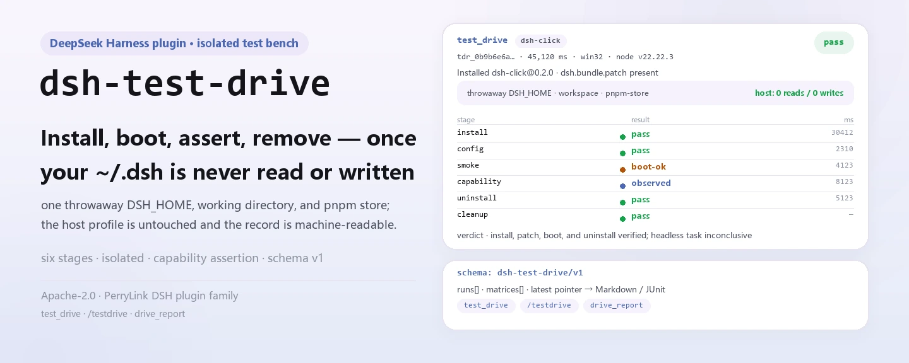

<div align="center">

<picture>
  <source media="(prefers-color-scheme: dark)" srcset="docs/assets/dsh-test-drive-hero-en-dark.webp">
  
</picture>

# dsh-test-drive

**Install, boot, assert, uninstall, clean up inside a throwaway profile — turn "does it even run?" into a reproducible pipeline.**

Isolated install-and-smoke test drives for DeepSeek Harness plugins: every target gets its own `mkdtemp` root (a throwaway `DSH_HOME`, a throwaway working directory, a redirected pnpm store), your real `~/.dsh` is never read or written, and the result is a structured record downstream tools can consume.

[Install](#three-step-setup) · [Configuration](#configuration) · [FAQ](#faq) · [简体中文](README.md) · [English](README.en.md) · [Español](README.es.md) · [Português](README.pt.md) · [हिन्दी](README.hi.md)

[](LICENSE)
[](#compatibility)
[](https://www.npmjs.com/package/dsh-test-drive)
[](https://github.com/PerryLink/dsh-test-drive/actions/workflows/ci.yml)
[](#compatibility)

[](https://github.com/PerryLink/dsh-test-drive/stargazers)
[](https://www.npmjs.com/package/dsh-test-drive)
[](https://dshfind.com/plugins/PerryLink/dsh-test-drive?ref=badge)
[](https://securityscorecards.dev/viewer/?uri=github.com/PerryLink/dsh-test-drive)
[](https://dsh.market/)
[](https://gitee.com/perrylink/dsh-test-drive)

```sh
dsh plugin --profile <name> add dsh-test-drive
```

</div>

<sub>Community plugin, not affiliated with DeepSeek. Canonical repository: <https://github.com/PerryLink/dsh-test-drive> (Gitee is a mirror).</sub>

## What it is

`dsh-test-drive` turns "can this plugin even install, and does it boot?" into a six-stage pipeline: `dsh plugin add` into a throwaway `DSH_HOME` → `--dump-config` to prove the bundle patch layer really took effect → a headless boot that scans for loader failure markers → an optional capability assertion (drive the agent to call a named tool or command, then check that the durable session log recorded the invocation and the observed output contains the expected literal) → `dsh plugin remove` → cleanup of the temp roots this plugin owns through the dry-run → quarantine-rename → delete ladder. Every stage carries a status, exit code, duration and a sanitized output tail, and the whole run is one `schema: "dsh-test-drive/v1"` record: `test_drive` for a single target, `/testdrive` for a batch, `drive_report` to read results back.

<picture>
  <source media="(prefers-color-scheme: dark)" srcset="docs/assets/dsh-test-drive-flow-v5-dark.svg">
  
</picture>

## Three-step setup

1. **Install** (two channels):

   ```sh
   # npm channel (published releases; prebuilt packages need no build allowance)
   dsh plugin --profile web add dsh-test-drive
   # git channel (latest main; same as git+https://github.com/PerryLink/dsh-test-drive.git)
   dsh plugin --profile web add github:PerryLink/dsh-test-drive#<commit-sha>
   ```

   The first `add` on the git channel fails because pnpm blocks the package's `prepare` build; copy the exact key pnpm printed into the profile's `pnpm-workspace.yaml` and re-run:

   ```yaml
   allowBuilds:
     'dsh-test-drive': true
   ```

   Prebuilt npm packages need no build allowance. Restart the profile, then use `test_drive` / `/testdrive` from a session.

2. **Minimal config** (the defaults already work; only the capability stage needs `capability.*` and `forwardEnv`):

   ```yaml
   - insert:
       - id: test-drive
         name: dsh-test-drive
         config:
           headlessTask: "Reply with exactly: ok"
           forwardEnv: [DEEPSEEK_API_KEY]
           capability:
             enabled: true
             kind: tool
             name: plugin_vet
             args: '{}'
             expect: pass
   ```

3. **Verify it took effect** (after a restart):

   ```sh
   dsh --profile web --dump-config | grep -A3 'id: test-drive'
   ```

   Then drive a known target for the first time:

   ```text
   test_drive({ target: "dsh-click" })
   → verdict pass · tdr_0b9b6e6a61e3e80cc4620f2e · full record in "Examples"
   ```

**Uninstall**: `dsh plugin --profile web remove dsh-test-drive` (or delete the line from the profile patch).

> `test_drive` needs a `dsh` CLI that can boot a **second** headless DSH process. The DSH Desktop launcher (`dsh.CMD`) only permits `dsh plugin …`, `--dump-config` and `--version`, and rejects a second headless boot by policy — the error now says so explicitly instead of "cannot parse npm shim". Point `config.dshBin` at an npm/pnpm-installed `dsh` CLI, or a plain Node + dsh JS entry.

<details>
<summary>Install from the DSH Desktop marketplace</summary>

Every PerryLink plugin is listed in the DSH Desktop built-in marketplace: **Market → Sources → Add source → paste** `https://perrylink-dsh-catalog.perrylink.workers.dev/catalog-source.json` **→ select**. Installation still goes through the marketplace's npm identity check and your confirmation.

</details>

## Core capabilities

`dsh-test-drive` splits "verify this install" into stages you can watch and replay:

- **`test_drive` tool** — runs the full pipeline for one target and returns the structured record synchronously; `background: true` starts a `drive-batch` job and returns `{ kind: 'background', jobId }`.
- **`/testdrive <targets...>` command** — takes a whitespace/comma-separated target list, runs it as one `drive-batch` background job, streams progress through the job output, and finishes with a matrix report (JSON + Markdown) whose last line names the matrix id.
- **`drive_report` tool** — fetches any stored run (`tdr_...`), matrix (`tdm_...`), or the latest matrix when no id is given, rendered as Markdown.
- **Capability assertion** — beyond "booted and exited": the optional `capability` stage drives the agent to call a named tool (`kind: tool`) or run `/command` (`kind: command`) with `args`, then verifies the durable session log recorded the invocation and the observed output contains `expect`. A clean boot is only a smoke test; `observed` proves a named capability really works.
- **Structured results** — every record carries the discriminator `schema: "dsh-test-drive/v1"` with first-class fields: `stages.install.status`, `stages.smoke.status`, `stages.capability.status`, per-stage `durationMs`, sanitized `summary` / `outputTail`, and an overall `verdict` (`pass` / `fail` / `partial` / `unknown`). This is the machine-readable contract downstream scorers (dsh-score) consume.
- **Safety by construction** — every temp directory is created by this plugin under a dedicated `dsh-test-drive-` prefix, tracked in a live ownership registry, and removed only through the dry-run → quarantine-rename → delete ladder. The host profile is never read or written.

```text
target ──dsh plugin add──▶ throwaway DSH_HOME ──--dump-config──▶ patch layer
                                │                                     │
                                ├──headless boot──▶ FAILED-marker scan
                                ├──capability────▶ tool/command + session log
                                └──dsh plugin remove──▶ quarantine → delete
```

### Tool surface

| Surface | Form | Returns / notes |
|---|---|---|
| `test_drive` | tool | the full structured record (synchronous), or `{ kind: 'background', jobId }` |
| `/testdrive` | command | one `drive-batch` job; the last line names the matrix id for `drive_report` |
| `drive_report` | tool | a `tdr_...` run, a `tdm_...` matrix, or the latest matrix, rendered as Markdown |

`test_drive`'s `target` accepts a git spec (`github:owner/repo#sha`, `git+https://...`), an npm package name, a local path, or a `.tgz` tarball; `capability` looks like `{ kind: 'tool' | 'command', name, args, expect }` and needs `DEEPSEEK_API_KEY` (host environment or `forwardEnv`) — without it the stage is `skipped`, never failed.

### Structured result

Verdict rules: an install failure, a boot failure (`smoke.fail`), or a capability stage that reached `not-registered` / `failed` ⇒ `fail`; install pass + patch effective + clean boot (`pass` / `boot-ok`) + uninstall pass ⇒ `pass` (with a note when the capability stage reached `observed`); anything installed but missing a later assurance ⇒ `partial`; otherwise ⇒ `unknown`.

<details>
<summary>Full record sample (dsh-test-drive/v1)</summary>

```json
{
  "schema": "dsh-test-drive/v1",
  "run": { "runId": "tdr_9f2c...", "startedAt": "2026-08-16T00:00:00.000Z",
           "finishedAt": "2026-08-16T00:00:45.120Z", "durationMs": 45120,
           "harnessVersion": "0.1.7-rc.2", "pluginVersion": "0.3.13",
           "platform": "win32", "node": "v22.22.3" },
  "target": { "kind": "repo", "spec": "github:owner/dsh-click#abc123",
              "resolved": { "packageName": "dsh-click", "packageVersion": "0.1.0",
                            "hasBundleManifest": true } },
  "isolation": { "tempDshHome": true, "tempWorkspace": true, "tempStore": true,
                 "hostHomeTouched": false },
  "stages": {
    "install":   { "status": "pass", "exitCode": 0, "durationMs": 30412, "attempts": 2,
                   "summary": "install ok after allowBuilds allowance", "outputTail": "",
                   "allowBuildsNeeded": true },
    "config":    { "status": "pass", "exitCode": 0, "durationMs": 2310, "attempts": 1,
                   "summary": "dump ok (exit 0)", "outputTail": "",
                   "patchEffective": true, "layers": ["dsh-click"] },
    "smoke":     { "status": "boot-ok", "exitCode": 1, "durationMs": 4123, "attempts": 1,
                   "summary": "booted without loader failures; headless task did not complete (credentials/model unreachable)",
                   "outputTail": "", "bootFailed": false, "taskCompleted": false },
    "capability": { "status": "observed", "exitCode": 0, "durationMs": 8123, "attempts": 1,
                    "summary": "tool \"plugin_vet\" called and its result contains the expectation",
                    "outputTail": "", "capabilityKind": "tool", "name": "plugin_vet",
                    "expectMatched": true,
                    "detail": "tool \"plugin_vet\" called and its result contains the expectation" },
    "uninstall": { "status": "pass", "exitCode": 0, "durationMs": 5123, "attempts": 1,
                   "summary": "remove ok (exit 0)", "outputTail": "" },
    "cleanup":   { "status": "pass", "quarantined": true, "removed": true,
                   "summary": "owned temp root quarantined and removed" }
  },
  "verdict": "pass",
  "verdictReason": "install, patch, boot, and uninstall verified; headless task inconclusive (see smoke.summary)"
}
```

</details>

### Examples

These are the plugin's real entry points; install once, then call one.

**Detailed example** — command `test_drive`, input:

```sh
test_drive({ target: "dsh-click" })
```

Output:

```text
# Test drive tdr_0b9b6e6a61e3e80cc4620f2e

- Target: `dsh-click` (npm)
- Verdict: ✅ pass — install, patch, boot, task, and uninstall all verified
- Installed: dsh-click@0.2.0
- Isolation: throwaway DSH_HOME + workspace + pnpm store; host profile untouched

| Stage | Result | Exit | Duration | Summary |
|---|---|---|---|---|
| install | ✅ pass | 0 | 1 ms | install ok (exit 0) |
| config (--dump-config) | ✅ pass | 0 | 0 ms | patch effective: dsh-click |
| smoke (headless boot) | ✅ pass | 0 | 0 ms | booted cleanly and the headless task completed |
| capability | ⏭️ skipped | null | 0 ms | capability assertion disabled (config.capability.enabled is false and no per-drive capability given) |
| uninstall | ✅ pass | 0 | 0 ms | remove ok (exit 0) |
| cleanup | ✅ pass | — | — | owned temp root quarantined and removed |
```

*Observed from `README.md:153-163,174-211; tests/drive.spec.ts:73-101; src/report.ts:34-55`*

**Failure branch** — input:

```text
{"target":"   "}
```

Output:

```text
isError=true; error.message=dsh-test-drive: target must be a non-empty string
```

*Observed from `plugins/dsh-test-drive/src/tools.ts:297-299 (blank target check); exercised through plugins/dsh-test-drive/tests/harness.ts`*

**Brief examples**: `test_drive` · `/testdrive` · `drive_report`

## Configuration

All keys are optional (defaults shown); invalid values fail loudly at load. `cordis.patch.yml` documents every key inline.

Most-used keys:

| Key | Default | Description |
|---|---|---|
| `profileName` | `headless` | Profile template initialized inside each throwaway DSH_HOME (base + headless bundles). |
| `dshBin` | `""` | Absolute `dsh` executable override; empty auto-detects PATH (on Windows the npm `.cmd`/`.bat` shim is parsed automatically). |
| `headlessTask` | `"Reply with exactly: ok"` | One-shot task for the boot-smoke stage; empty skips the stage. |
| `forwardEnv` | `[]` | Environment VARIABLE NAMES (never values) forwarded into test-profile child processes; values are never logged. |
| `allowBuilds` | `true` | Allowlist a blocked git `prepare` build in the test profile and retry the install once. |
| `capability.enabled` | `false` | Run the capability-assertion stage (registered → invoked → observed). |
| `capability.expect` | `""` | Literal expected in the observed output (case-insensitive substring). |
| `keepTempDirs` | `false` | Keep temp dirs on failure for forensics (ownership is dropped; you clean up). |

<details>
<summary>Full configuration table (19 keys)</summary>

| Key | Default | Description |
|---|---|---|
| `profileName` | `headless` | Profile template initialized inside each throwaway DSH_HOME (base + headless bundles). |
| `dshBin` | `""` | Absolute `dsh` executable override; empty auto-detects PATH (on Windows the npm `.cmd`/`.bat` shim is parsed automatically). |
| `headlessTask` | `"Reply with exactly: ok"` | One-shot task for the boot-smoke stage; empty skips the stage. |
| `forwardEnv` | `[]` | Environment VARIABLE NAMES (never values) forwarded into test-profile child processes; values are never logged. |
| `allowBuilds` | `true` | Allowlist a blocked git `prepare` build in the test profile and retry the install once. |
| `installTimeoutMs` | `600000` | `dsh plugin add` stage deadline (ms). |
| `configTimeoutMs` | `60000` | `--dump-config` stage deadline (ms). |
| `smokeTimeoutMs` | `300000` | Headless boot-smoke stage deadline (ms). |
| `capabilityTimeoutMs` | `300000` | Capability-assertion task deadline (ms). |
| `capability.enabled` | `false` | Run the capability-assertion stage (registered → invoked → observed). |
| `capability.kind` | `tool` | What to assert: `tool` or `command`. |
| `capability.name` | `""` | Tool or command name (no leading `/`). |
| `capability.args` | `""` | Invocation text: tool arguments (JSON-ish) or command words. |
| `capability.expect` | `""` | Literal expected in the observed output (case-insensitive substring). |
| `uninstallTimeoutMs` | `120000` | `dsh plugin remove` stage deadline (ms). |
| `outputTailBytes` | `8000` | Cap on the sanitized output tail recorded per stage (bytes). |
| `keepTempDirs` | `false` | Keep temp dirs on failure for forensics (ownership is dropped; you clean up). |
| `maxBatchTargets` | `20` | `/testdrive` batch cap. |
| `batchConcurrency` | `1` | Batch concurrency (serial avoids pnpm-store contention). |

</details>

Override example in a profile patch:

```yaml
- insert:
    - id: test-drive
      name: dsh-test-drive
      config:
        headlessTask: "Reply with exactly: ok"
        forwardEnv: [DEEPSEEK_API_KEY]
        capability:
          enabled: true
          kind: tool
          name: plugin_vet
          args: '{}'
          expect: pass
```

## FAQ

<details>
<summary>Does it touch my real <code>~/.dsh</code>?</summary>

No. Every drive runs inside a fresh `mkdtemp` root under the OS temp directory: a throwaway `DSH_HOME`, a throwaway working directory, and a redirected pnpm store. The tested plugin's code only ever runs in that profile; the host profile is neither read nor written, and the structured record states `isolation.hostHomeTouched: false`. Cleanup only accepts directories this plugin registered — no `%TEMP%` sweeps, no foreign prefixes, no real-home paths.

</details>

<details>
<summary>What happens without a <code>storageDomain</code> in the composition?</summary>

The tools still work, but reports are not persisted: the plugin logs a reason and disables persistence, and `drive_report` fails honestly instead of pretending. Conversely, compositions that do have a `storageDomain` store the records in the `test_drive` domain (tables `runs`, `matrices`, plus the latest-matrix pointer).

</details>

<details>
<summary>Do tested child processes get my credentials?</summary>

Not by default. Child processes inherit a credential-scrubbed environment; unless you explicitly name a variable in `forwardEnv` (names only), host secrets never reach a tested profile, and those values are never logged. Every report and log string also passes through pure sanitizers: token literals, URL credentials and bearer headers are redacted, temp-root paths become `<testdrive-temp>`, and output tails are byte-capped.

</details>

<details>
<summary>Why does the smoke stage often stop at <code>boot-ok</code>?</summary>

Because the boot check itself needs no credentials, while actually completing the one-shot task does. Without credentials the plugin reports the honest `boot-ok` — it saw no loader failure and did not finish the task — instead of recording something unverified as `pass`. To reach `pass`, forward credentials explicitly with `forwardEnv` (their values still never enter the log).

</details>

<details>
<summary>Do temp directories leak when a drive fails?</summary>

Not silently. Cleanup runs in a `finally` across success, failure, timeout and abort, and once more on plugin teardown; removal first renames the root into a `dsh-test-drive-quarantine-<ts>` directory, verifies it, and only then deletes. A failed removal leaves the directory quarantined and reported. To keep the crime scene for forensics, set `keepTempDirs: true` — ownership is then dropped and cleanup becomes your job.

</details>

## Security boundaries

- **Isolation.** Each drive runs inside a fresh `mkdtemp` root under the OS temp dir: a throwaway `DSH_HOME`, a throwaway working directory, and a redirected pnpm store. The tested plugin's code only ever runs in that profile; your host profile is untouched.
- **Ownership.** A live registry records every root this plugin instance creates. Cleanup refuses anything that is not a registered direct child of the OS temp dir carrying the `dsh-test-drive-` prefix — no `%TEMP%` sweeps, no foreign prefixes, no real-home paths.
- **Cleanup ladder.** Before any mutation the full dry-run plan is logged (absolute paths). Removal renames the root into a `dsh-test-drive-quarantine-<ts>` directory first, verifies, then deletes; failures leave the directory quarantined and reported, never silently dropped. Cleanup runs in a `finally` on success, failure, timeout, and abort, and again on plugin teardown.
- **`allowBuilds` is a real permission.** Allowing a git package's `prepare` build executes that package's code at install time. The allowance is scoped to the throwaway profile only, but only test targets you trust, and pin commits.
- **Headless smoke is keyless by default.** The boot check needs no credentials; completing the one-shot task does. Forward credentials explicitly (`forwardEnv`) and never log them.

## Permissions & data

- **Service surface.** Only public services are consumed: `ctx.subprocess`, `ctx.jobs`, `ctx.storageDomain`, `ctx.tools`, `ctx.commands`. `storageDomain` is optional — without it both boot and drives keep working.
- **Permissions.** The `dshWorkshop` manifest declares `fs:read`, `fs:write`, `subprocess:spawn`, `session:append`, `network:inherit`, `native-code:none` — write access covers only the temp roots it creates and report persistence, and `network:inherit` just inherits the host (registry/git installs for the target need network anyway).
- **Data.** Reports live in the `test_drive` storage domain (tables `runs`, `matrices`, plus the latest-matrix pointer); without that domain reports are not persisted and the reason is logged.
- **Session log.** Child processes get a credential-scrubbed environment and `forwardEnv` forwards names only; every report/log string is sanitized — token literals, URL credentials and bearer headers redacted, temp-root paths replaced with `<testdrive-temp>`, output tails byte-capped.

## Known limitations

- **DSH Desktop is not a supported test host.** `test_drive` needs a `dsh` CLI that can boot a second headless process, while the `dsh.CMD` launcher only permits `dsh plugin …`, `--dump-config` and `--version`; point `dshBin` at an npm/pnpm-installed `dsh`.
- Installing registry/git targets requires network access from the child `dsh`/pnpm processes.
- The smoke task needs model credentials to reach `pass`; without them it reports the honest `boot-ok`.
- In compositions without `storageDomain`, reports are not persisted (`drive_report` fails honestly).
- `dsh` must be locatable on PATH (or set `dshBin`); on Windows the npm `.cmd`/`.bat` shim is parsed automatically, a bare `.ps1` resolution asks for `dshBin`.
- Batches default to serial execution; raising `batchConcurrency` shares the pnpm-store disk, not correctness.

## Interoperability with other DSH plugins

`dsh-test-drive` exposes two tools and one command, and does not join other plugins' seams:

- **Namespace isolation.** It registers only `test_drive` and `drive_report`, plus the `/testdrive` command — no bare names held by built-in tools or other plugins.
- **No client or HTTP resources.** This package has no `client/` half: no client slot keys, no `webServer` prefixes, no `agent/pre-step` or `tools/post-execute` waterfall listeners (`AGENTS.md` records that this plugin registers no waterfall listeners today), and no global patching.
- **No service-key conflicts.** It provides no service keys and consumes only `subprocess`, `jobs`, `tools`, `commands`, and the optional `storageDomain`.
- **The patch layer inserts its own row only.** The bundle patch `insert`s its single `test-drive` row and never overwrites a built-in row's `config`.
- **Registration is an effect.** Tools, the command and the domain closure all register inside `ctx.effect`; stop or hot-reload revokes only what this plugin registered, and the temp-root registry sweeps leftovers through its disposer.

## Compatibility

| Surface | Status |
|---|---|
| Harness | DeepSeek Harness `dsh-v0.2.1-alpha.1` (GitHub tag, verified 2026-09-11: full gate chain + profile install smoke). npm dependency lines `0.1.2-rc.1` and `0.1.7-rc.2`; `engines.dsh`: `>=0.2.1-0 <0.3.0 \|\| >=0.2.2-0 <0.3.0` |
| Node | `^22.19.0 \|\| >=24.9.0` |
| Package manager | `pnpm@11.7.0` |
| Platform | Windows / macOS / Linux (pure host plugin, no UI half) |
| External tools | `dsh` CLI on PATH (auto-detected, npm shims parsed), `pnpm` on PATH |

## Ecosystem & quality

- [Gitee mirror](https://gitee.com/perrylink/dsh-test-drive) (sync mirror; GitHub is canonical)
- [dshfind plugin page](https://dshfind.com/plugins/PerryLink/dsh-test-drive) (installs and ranking)
- [OpenSSF Scorecard report](https://securityscorecards.dev/viewer/?uri=github.com/PerryLink/dsh-test-drive) (driven by [.github/workflows/scorecard.yml](.github/workflows/scorecard.yml))
- [dsh-plugin-doctor verification report](https://github.com/PerryLink/dsh-plugin-doctor#verified-徽章) (driven by this repo's [.github/workflows/plugin-doctor.yml](.github/workflows/plugin-doctor.yml))
- [DSH Market](https://dsh.market/) (listed)
- **1024 store channel**: `npm i -g dsh1024` once, then `dsh1024 plugin --profile web add dsh-test-drive` (counts toward the [deepseek1024.com](https://deepseek1024.com) install ranking)
- [Ecosystem knowledge base](https://perrylink.github.io/dsh-plugin-guide/) — measured data, not marketing: plugin development guide · plugin-selection data · maintenance criteria

## Development

```sh
pnpm install                     # node ^22.19 || >=24.9
pnpm run typecheck               # tsc: src + tests, resolving @deepseek-ai/* through the local harness checkout
pnpm run typecheck:ci            # tsc: against the published host types
pnpm test                        # vitest
pnpm run build                   # node scripts/prepare.mjs (tsdown bundle + declarations)
pnpm run verify:self-contained   # dependency specs resolve from the registry
pnpm run verify:artifacts        # shipped files present + lib/index.js importable
pnpm run check:readmes           # five-language README consistency
pnpm pack                        # the published tarball
```

- `typecheck` resolves `@deepseek-ai/*` through the local harness checkout; `typecheck:ci` checks against the published host types.
- Tests use the real `Context`/`Session`/`ToolRuntime`/`LocalJobRegistry`/storage stack with a scripted subprocess provider.
- Real-CLI end-to-end (requires network + `dsh` on PATH): `DSH_TESTDRIVE_E2E=1 pnpm run test:e2e` — drives this package's own checkout through the real install-smoke loop.
- Release: `node scripts/release.mjs <x.y.z>` (bumps, stamps CHANGELOG, re-runs the gate, commits + tags; never pushes).

### GitHub Action (action.yml)

The repository ships a composite [`action.yml`](action.yml) that reuses this plugin in any plugin repo: it drives a target in an isolated throwaway profile and emits the report pair CI consumes — Markdown (PR comment) and JUnit XML (test reporter / status check).

```yaml
# .github/workflows/test-drive.yml
name: test-drive
on: [pull_request, workflow_dispatch]
jobs:
  smoke:
    runs-on: ubuntu-latest
    steps:
      - uses: actions/checkout@v4
      - name: Drive this plugin
        id: drive
        uses: PerryLink/dsh-test-drive@v0.2.4
        with:
          target: github:${{ github.repository }}#${{ github.sha }}
      - name: Publish JUnit
        uses: EnricoMi/publish-unit-test-result-action@v2
        with:
          files: ${{ steps.drive.outputs.junit }}
      - name: Comment the report
        run: cat "${{ steps.drive.outputs.markdown }}"
```

`action.yml` inputs: `target` (required), `headless-task` (optional smoke task), `dsh-version` (the `dsh` CLI spec). Outputs: `markdown`, `junit` (report paths), and `verdict` (`pass`/`fail`/`partial`/`unknown`). The drive itself stays keyless (install → patch check → boot smoke → uninstall → cleanup); a capability assertion is the only stage that needs `DEEPSEEK_API_KEY`, and it is `skipped`, never failed, without one.

The same report pair is available programmatically: `renderDriveResult` / `renderMatrix` (Markdown) and `renderDriveJUnitXml` / `renderMatrixJUnitXml` (JUnit) are exported from the package root over a settled `DriveResult` or `MatrixRecord`.

The README images are generated programmatically by [`scripts/gen-readme-assets.py`](scripts/gen-readme-assets.py) (Python + Pillow) and are safe to re-run: `python scripts/gen-readme-assets.py`.

Topics: `dsh`, `dsh-plugin`, `deepseek-harness`, `deepseek`, `cordis`, `plugin-testing`, `install-smoke`, `compatibility-matrix`, `ci`

## Family & thanks

This project is part of the DeepSeek Harness plugin family from [PerryLink](https://github.com/PerryLink) (all Apache-2.0). If it is useful, **a star helps the next person find it** — nothing is gated behind it.

- [@PerryLink](https://github.com/PerryLink) — creator and maintainer: the single-target pipeline, the capability-assertion stage, temp-root ownership and the isolation cleanup ladder, the structured result contract, and the five-language docs.

<details>
<summary>Expand all plugins</summary>

| Plugin | Status |
|---|---|
| **[dsh-aqua-input-check](https://github.com/PerryLink/dsh-aqua-input-check)** |  |
| **[dsh-archive-check](https://github.com/PerryLink/dsh-archive-check)** |  |
| **[dsh-auto-review](https://github.com/PerryLink/dsh-auto-review)** |  |
| **[dsh-autotier](https://github.com/PerryLink/dsh-autotier)** | 🧊 FROZEN — see the repo README |
| **[dsh-bid-ca-precheck](https://github.com/PerryLink/dsh-bid-ca-precheck)** |  |
| **[dsh-bid-qual-check](https://github.com/PerryLink/dsh-bid-qual-check)** |  |
| **[dsh-cert-mcp](https://github.com/PerryLink/dsh-cert-mcp)** | 🧊 FROZEN — see the repo README |
| **[dsh-checkpoint-rewind](https://github.com/PerryLink/dsh-checkpoint-rewind)** |  |
| **[dsh-click](https://github.com/PerryLink/dsh-click)** |  |
| **[dsh-composer-history](https://github.com/PerryLink/dsh-composer-history)** |  |
| **[dsh-contract-stance](https://github.com/PerryLink/dsh-contract-stance)** |  |
| **[dsh-customs-doc-check](https://github.com/PerryLink/dsh-customs-doc-check)** |  |
| **[dsh-data-quality](https://github.com/PerryLink/dsh-data-quality)** | 🧊 FROZEN — see the repo README |
| **[dsh-demurrage-ledger](https://github.com/PerryLink/dsh-demurrage-ledger)** |  |
| **[dsh-doublecheck](https://github.com/PerryLink/dsh-doublecheck)** |  |
| **[dsh-drill-script-check](https://github.com/PerryLink/dsh-drill-script-check)** |  |
| **[dsh-eia-guide-check](https://github.com/PerryLink/dsh-eia-guide-check)** |  |
| **[dsh-emergency-plan](https://github.com/PerryLink/dsh-emergency-plan)** |  |
| **[dsh-essay-rubric-check](https://github.com/PerryLink/dsh-essay-rubric-check)** |  |
| **[dsh-evidence-check](https://github.com/PerryLink/dsh-evidence-check)** |  |
| **[dsh-export-ctl-check](https://github.com/PerryLink/dsh-export-ctl-check)** |  |
| **[dsh-fast](https://github.com/PerryLink/dsh-fast)** |  |
| **[dsh-fmea-table-check](https://github.com/PerryLink/dsh-fmea-table-check)** |  |
| **[dsh-forecast-penalty](https://github.com/PerryLink/dsh-forecast-penalty)** |  |
| **[dsh-fund-research](https://github.com/PerryLink/dsh-fund-research)** |  |
| **[dsh-github](https://github.com/PerryLink/dsh-github)** |  |
| **[dsh-gongwen-flow-check](https://github.com/PerryLink/dsh-gongwen-flow-check)** |  |
| **[dsh-gongwen-word-check](https://github.com/PerryLink/dsh-gongwen-word-check)** |  |
| **[dsh-guard-plan-qc](https://github.com/PerryLink/dsh-guard-plan-qc)** |  |
| **[dsh-hazchem-check](https://github.com/PerryLink/dsh-hazchem-check)** |  |
| **[dsh-hazplan-check](https://github.com/PerryLink/dsh-hazplan-check)** |  |
| **[dsh-hidden-risk-map](https://github.com/PerryLink/dsh-hidden-risk-map)** |  |
| **[dsh-hs-classify](https://github.com/PerryLink/dsh-hs-classify)** |  |
| **[dsh-icd-rule-check](https://github.com/PerryLink/dsh-icd-rule-check)** |  |
| **[dsh-industry-research](https://github.com/PerryLink/dsh-industry-research)** |  |
| **[dsh-lawcite-adapter](https://github.com/PerryLink/dsh-lawcite-adapter)** |  |
| **[dsh-laya](https://github.com/PerryLink/dsh-laya)** |  |
| **[dsh-lc-doc-check](https://github.com/PerryLink/dsh-lc-doc-check)** |  |
| **[dsh-learning-gap-check](https://github.com/PerryLink/dsh-learning-gap-check)** |  |
| **[dsh-library](https://github.com/PerryLink/dsh-library)** |  |
| **[dsh-local-ai](https://github.com/PerryLink/dsh-local-ai)** |  |
| **[dsh-lsp-actions](https://github.com/PerryLink/dsh-lsp-actions)** |  |
| **[dsh-mask](https://github.com/PerryLink/dsh-mask)** |  |
| **[dsh-mcp-panel](https://github.com/PerryLink/dsh-mcp-panel)** |  |
| **[dsh-medrec-qc](https://github.com/PerryLink/dsh-medrec-qc)** |  |
| **[dsh-memento](https://github.com/PerryLink/dsh-memento)** | 🧊 FROZEN — see the repo README |
| **[dsh-nsfc-form-check](https://github.com/PerryLink/dsh-nsfc-form-check)** |  |
| **[dsh-nurse-record-check](https://github.com/PerryLink/dsh-nurse-record-check)** |  |
| **[dsh-observe](https://github.com/PerryLink/dsh-observe)** |  |
| **[dsh-origin-rvc-check](https://github.com/PerryLink/dsh-origin-rvc-check)** |  |
| **[dsh-ota-review-check](https://github.com/PerryLink/dsh-ota-review-check)** |  |
| **[dsh-output-styles](https://github.com/PerryLink/dsh-output-styles)** |  |
| **[dsh-paper-doc-adapter](https://github.com/PerryLink/dsh-paper-doc-adapter)** |  |
| **[dsh-permission-rules](https://github.com/PerryLink/dsh-permission-rules)** |  |
| **[dsh-permit-report-check](https://github.com/PerryLink/dsh-permit-report-check)** |  |
| **[dsh-pipeline-check](https://github.com/PerryLink/dsh-pipeline-check)** |  |
| **[dsh-pleading-draft](https://github.com/PerryLink/dsh-pleading-draft)** |  |
| **[dsh-plugin-doctor](https://github.com/PerryLink/dsh-plugin-doctor)** | 🚫 RETIRED (repo archived) |
| **[dsh-plugin-guide](https://github.com/PerryLink/dsh-plugin-guide)** |  |
| **[dsh-plugin-kit](https://github.com/PerryLink/dsh-plugin-kit)** | 🚫 RETIRED (repo archived) |
| **[dsh-plugin-upgrade](https://github.com/PerryLink/dsh-plugin-upgrade)** | 🚫 RETIRED (repo archived) |
| **[dsh-policy-brief-draft](https://github.com/PerryLink/dsh-policy-brief-draft)** |  |
| **[dsh-power-loss-split](https://github.com/PerryLink/dsh-power-loss-split)** |  |
| **[dsh-power-ticket-check](https://github.com/PerryLink/dsh-power-ticket-check)** |  |
| **[dsh-ppap-check](https://github.com/PerryLink/dsh-ppap-check)** |  |
| **[dsh-protest-deadline](https://github.com/PerryLink/dsh-protest-deadline)** |  |
| **[dsh-railway-window](https://github.com/PerryLink/dsh-railway-window)** |  |
| **[dsh-repair-order-qc](https://github.com/PerryLink/dsh-repair-order-qc)** |  |
| **[dsh-research-report](https://github.com/PerryLink/dsh-research-report)** |  |
| **[dsh-review-reply-check](https://github.com/PerryLink/dsh-review-reply-check)** |  |
| **[dsh-rulefile-check](https://github.com/PerryLink/dsh-rulefile-check)** |  |
| **[dsh-safety-brief-check](https://github.com/PerryLink/dsh-safety-brief-check)** |  |
| **[dsh-score](https://github.com/PerryLink/dsh-score)** | 🧊 FROZEN — see the repo README |
| **[dsh-session-sync](https://github.com/PerryLink/dsh-session-sync)** |  |
| **[dsh-site-log-check](https://github.com/PerryLink/dsh-site-log-check)** |  |
| **[dsh-skill-pack-security](https://github.com/PerryLink/dsh-skill-pack-security)** |  |
| **[dsh-soe-decision-check](https://github.com/PerryLink/dsh-soe-decision-check)** |  |
| **[dsh-soilwater-check](https://github.com/PerryLink/dsh-soilwater-check)** |  |
| **[dsh-sop-sync-check](https://github.com/PerryLink/dsh-sop-sync-check)** |  |
| **[dsh-spc-gbt-adapter](https://github.com/PerryLink/dsh-spc-gbt-adapter)** |  |
| **[dsh-talk](https://github.com/PerryLink/dsh-talk)** |  |
| **[dsh-tender-extract](https://github.com/PerryLink/dsh-tender-extract)** |  |
| **[dsh-tender-matrix](https://github.com/PerryLink/dsh-tender-matrix)** |  |
| **[dsh-test-drive](https://github.com/PerryLink/dsh-test-drive)** |  |
| **[dsh-ticktick](https://github.com/PerryLink/dsh-ticktick)** | 🚫 RETIRED (repo archived) |
| **[dsh-translate](https://github.com/PerryLink/dsh-translate)** |  |
| **[dsh-warranty-calc](https://github.com/PerryLink/dsh-warranty-calc)** |  |
| **[dsh-budget](https://github.com/PerryLink/dsh-budget)** | 🧊 FROZEN — see the repo README |
| **[dsh-claude-move](https://github.com/PerryLink/dsh-claude-move)** | 🧊 FROZEN — see the repo README |
| **[dsh-defend](https://github.com/PerryLink/dsh-defend)** | 🧊 FROZEN — see the repo README |
| **[dsh-draw](https://github.com/PerryLink/dsh-draw)** | 🧊 FROZEN — see the repo README |
| **[dsh-reach](https://github.com/PerryLink/dsh-reach)** | 🧊 FROZEN — see the repo README |
| **[dsh-background-agents](https://github.com/PerryLink/dsh-background-agents)** | 🚫 RETIRED (repo archived) |
| **[dsh-session-pin](https://github.com/PerryLink/dsh-session-pin)** | 🚫 RETIRED (repo archived) |
| **[dsh-team-rooms](https://github.com/PerryLink/dsh-team-rooms)** | 🚫 RETIRED (repo archived) |

</details>

## License

[LICENSE](LICENSE) (Apache License 2.0) © 2026 dsh-test-drive contributors

<p align="center"><sub>Apache-2.0 · Community plugin, not affiliated with DeepSeek.</sub></p>
