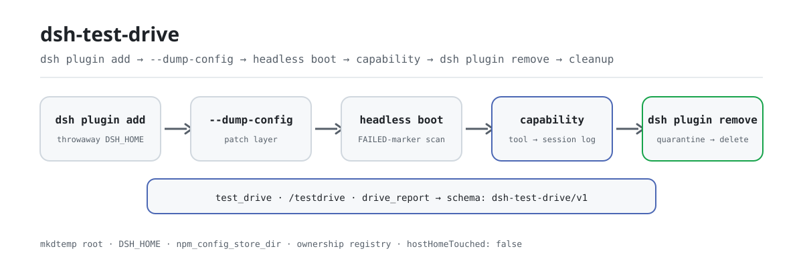

<div align="center">

<picture>
  <source media="(prefers-color-scheme: dark)" srcset="docs/assets/dsh-test-drive-flow-dark.svg">
  
</picture>

# dsh-test-drive

**Instalar, arrancar, verificar, desinstalar y limpiar dentro de un perfil desechable: convierte «¿esto siquiera arranca?» en un pipeline reproducible.**

Pruebas de instalación y arranque aisladas para plugins de DeepSeek Harness: cada objetivo recibe su propia raíz `mkdtemp` (un `DSH_HOME` desechable, un directorio de trabajo desechable y un pnpm store redirigido), tu `~/.dsh` real nunca se lee ni se escribe, y el resultado es un registro estructurado que las herramientas posteriores pueden consumir.

[Instalar](#instalación-en-tres-pasos) · [Configuración](#configuración) · [FAQ](#faq) · [简体中文](README.md) · [English](README.en.md) · [Español](README.es.md) · [Português](README.pt.md) · [हिन्दी](README.hi.md)

[](LICENSE)
[](#compatibilidad)
[](https://www.npmjs.com/package/dsh-test-drive)
[](https://github.com/PerryLink/dsh-test-drive/actions/workflows/ci.yml)
[](#compatibilidad)

[](https://github.com/PerryLink/dsh-test-drive/stargazers)
[](https://www.npmjs.com/package/dsh-test-drive)
[](https://dshfind.com/plugins/PerryLink/dsh-test-drive?ref=badge)
[](https://securityscorecards.dev/viewer/?uri=github.com/PerryLink/dsh-test-drive)
[](https://dsh.market/)
[](https://gitee.com/perrylink/dsh-test-drive)

```sh
dsh plugin --profile <name> add dsh-test-drive
```

</div>

<sub>Plugin de la comunidad, no afiliado a DeepSeek. Repositorio canónico: <https://github.com/PerryLink/dsh-test-drive> (Gitee es un espejo).</sub>

## Qué es

`dsh-test-drive` convierte «¿este plugin se instala y arranca?» en un pipeline de seis etapas: `dsh plugin add` dentro de un `DSH_HOME` desechable → `--dump-config` para demostrar que la capa de patch del bundle sí surtió efecto → un arranque headless que busca marcadores de fallo del loader → una aserción de capacidad opcional (llevar al agente a invocar una herramienta o un comando concreto y comprobar que el registro de sesión durable anotó la invocación y que la salida observada contiene el literal esperado) → `dsh plugin remove` → limpieza de las raíces temporales que el plugin posee mediante la escalera dry-run → renombrado a cuarentena → borrado. Cada etapa lleva estado, código de salida, duración y una cola de salida saneada, y la ejecución completa es un único registro `schema: "dsh-test-drive/v1"`: `test_drive` para un objetivo, `/testdrive` para un lote y `drive_report` para releer resultados.

## Instalación en tres pasos

1. **Instalar** (dos canales):

   ```sh
   # canal npm (versiones publicadas; los paquetes precompilados no necesitan permiso de build)
   dsh plugin --profile web add dsh-test-drive
   # canal git (main más reciente; equivale a git+https://github.com/PerryLink/dsh-test-drive.git)
   dsh plugin --profile web add github:PerryLink/dsh-test-drive#<commit-sha>
   ```

   El primer `add` por el canal git falla porque pnpm bloquea el build `prepare` del paquete; copia la clave exacta que imprimió pnpm en el `pnpm-workspace.yaml` del perfil y vuelve a ejecutar:

   ```yaml
   allowBuilds:
     'dsh-test-drive': true
   ```

   Los paquetes npm precompilados no necesitan permiso de build. Reinicia el perfil y usa `test_drive` / `/testdrive` desde una sesión.

2. **Configuración mínima** (los valores por defecto ya funcionan; solo la etapa de capacidad necesita `capability.*` y `forwardEnv`):

   ```yaml
   - insert:
       - id: test-drive
         name: dsh-test-drive
         config:
           headlessTask: "Reply with exactly: ok"
           forwardEnv: [DEEPSEEK_API_KEY]
           capability:
             enabled: true
             kind: tool
             name: plugin_vet
             args: '{}'
             expect: pass
   ```

3. **Verificar que surtió efecto** (tras reiniciar):

   ```sh
   dsh --profile web --dump-config | grep -A3 'id: test-drive'
   ```

   Después lanza una primera prueba contra un objetivo conocido:

   ```text
   test_drive({ target: "dsh-click" })
   → verdict pass · tdr_0b9b6e6a61e3e80cc4620f2e · registro completo en «Ejemplos»
   ```

**Desinstalar**: `dsh plugin --profile web remove dsh-test-drive` (o borra la línea del patch del perfil).

> `test_drive` necesita un CLI `dsh` capaz de arrancar un **segundo** proceso DSH headless. El launcher de DSH Desktop (`dsh.CMD`) solo permite `dsh plugin …`, `--dump-config` y `--version`, y rechaza por política un segundo arranque headless: el error ahora lo dice explícitamente en lugar de «cannot parse npm shim». Apunta `config.dshBin` a un CLI `dsh` instalado con npm/pnpm, o a un Node normal con la entrada JS de dsh.

<details>
<summary>Instalar desde el mercado de DSH Desktop</summary>

Todos los plugins de PerryLink están en el mercado integrado de DSH Desktop: **Mercado → Fuentes → Añadir fuente → pegar** `https://perrylink-dsh-catalog.perrylink.workers.dev/catalog-source.json` **→ seleccionar**. La instalación sigue pasando por la verificación de identidad npm del mercado y tu confirmación.

</details>

## Capacidades clave

`dsh-test-drive` divide «verificar esta instalación» en etapas observables y reproducibles:

- **Herramienta `test_drive`** — ejecuta el pipeline completo para un objetivo y devuelve el registro estructurado de forma síncrona; con `background: true` arranca un trabajo `drive-batch` y devuelve `{ kind: 'background', jobId }`.
- **Comando `/testdrive <objetivos...>`** — recibe una lista separada por espacios o comas, la ejecuta como un único trabajo `drive-batch` en segundo plano, transmite el progreso por la salida del trabajo y termina con un informe matricial (JSON + Markdown) cuya última línea nombra el id de la matriz.
- **Herramienta `drive_report`** — recupera cualquier ejecución guardada (`tdr_...`), una matriz (`tdm_...`) o, sin id, la última matriz, y la renderiza en Markdown.
- **Aserción de capacidad** — más allá de «arrancó y salió»: la etapa opcional `capability` lleva al agente a invocar una herramienta concreta (`kind: tool`) o ejecutar `/comando` (`kind: command`) con `args`, y verifica que el registro de sesión durable anotó la invocación y que la salida observada contiene `expect`. Un arranque limpio solo es un smoke test; `observed` demuestra que una capacidad concreta funciona de verdad.
- **Resultados estructurados** — cada registro lleva el discriminador `schema: "dsh-test-drive/v1"` con campos de primer nivel: `stages.install.status`, `stages.smoke.status`, `stages.capability.status`, `durationMs` por etapa, `summary` / `outputTail` saneados y un `verdict` global (`pass` / `fail` / `partial` / `unknown`). Es el contrato legible por máquina que consumen los puntuadores posteriores (dsh-score).
- **Seguridad por construcción** — cada directorio temporal lo crea este plugin con el prefijo propio `dsh-test-drive-`, queda registrado en un registro de propiedad en vivo y solo se elimina mediante la escalera dry-run → renombrado a cuarentena → borrado. El perfil anfitrión nunca se lee ni se escribe.

```text
objetivo ──dsh plugin add──▶ DSH_HOME desechable ──--dump-config──▶ capa de patch
                                │                                        │
                                ├──headless boot──▶ escaneo de marcadores FAILED
                                ├──capability────▶ tool/command + registro de sesión
                                └──dsh plugin remove──▶ cuarentena → borrado
```

### Superficie de herramientas

| Superficie | Forma | Devuelve / notas |
|---|---|---|
| `test_drive` | herramienta | el registro estructurado completo (síncrono), o `{ kind: 'background', jobId }` |
| `/testdrive` | comando | un trabajo `drive-batch`; la última línea nombra el id de la matriz para `drive_report` |
| `drive_report` | herramienta | una ejecución `tdr_...`, una matriz `tdm_...` o la última matriz, en Markdown |

El `target` de `test_drive` acepta una especificación git (`github:owner/repo#sha`, `git+https://...`), un nombre de paquete npm, una ruta local o un tarball `.tgz`; `capability` tiene la forma `{ kind: 'tool' | 'command', name, args, expect }` y necesita `DEEPSEEK_API_KEY` (entorno anfitrión o `forwardEnv`): sin ella la etapa queda `skipped`, nunca fallida.

### Resultado estructurado

Reglas del veredicto: fallo de instalación, fallo de arranque (`smoke.fail`) o una etapa de capacidad que llegó a `not-registered` / `failed` ⇒ `fail`; instalación correcta + patch efectivo + arranque limpio (`pass` / `boot-ok`) + desinstalación correcta ⇒ `pass` (con una nota cuando la etapa de capacidad llegó a `observed`); algo instalado pero sin la garantía posterior ⇒ `partial`; en cualquier otro caso ⇒ `unknown`.

<details>
<summary>Ejemplo de registro completo (dsh-test-drive/v1)</summary>

```json
{
  "schema": "dsh-test-drive/v1",
  "run": { "runId": "tdr_9f2c...", "startedAt": "2026-08-16T00:00:00.000Z",
           "finishedAt": "2026-08-16T00:00:45.120Z", "durationMs": 45120,
           "harnessVersion": "0.1.7-rc.2", "pluginVersion": "0.3.13",
           "platform": "win32", "node": "v22.22.3" },
  "target": { "kind": "repo", "spec": "github:owner/dsh-click#abc123",
              "resolved": { "packageName": "dsh-click", "packageVersion": "0.1.0",
                            "hasBundleManifest": true } },
  "isolation": { "tempDshHome": true, "tempWorkspace": true, "tempStore": true,
                 "hostHomeTouched": false },
  "stages": {
    "install":   { "status": "pass", "exitCode": 0, "durationMs": 30412, "attempts": 2,
                   "summary": "install ok after allowBuilds allowance", "outputTail": "",
                   "allowBuildsNeeded": true },
    "config":    { "status": "pass", "exitCode": 0, "durationMs": 2310, "attempts": 1,
                   "summary": "dump ok (exit 0)", "outputTail": "",
                   "patchEffective": true, "layers": ["dsh-click"] },
    "smoke":     { "status": "boot-ok", "exitCode": 1, "durationMs": 4123, "attempts": 1,
                   "summary": "booted without loader failures; headless task did not complete (credentials/model unreachable)",
                   "outputTail": "", "bootFailed": false, "taskCompleted": false },
    "capability": { "status": "observed", "exitCode": 0, "durationMs": 8123, "attempts": 1,
                    "summary": "tool \"plugin_vet\" called and its result contains the expectation",
                    "outputTail": "", "capabilityKind": "tool", "name": "plugin_vet",
                    "expectMatched": true,
                    "detail": "tool \"plugin_vet\" called and its result contains the expectation" },
    "uninstall": { "status": "pass", "exitCode": 0, "durationMs": 5123, "attempts": 1,
                   "summary": "remove ok (exit 0)", "outputTail": "" },
    "cleanup":   { "status": "pass", "quarantined": true, "removed": true,
                   "summary": "owned temp root quarantined and removed" }
  },
  "verdict": "pass",
  "verdictReason": "install, patch, boot, and uninstall verified; headless task inconclusive (see smoke.summary)"
}
```

</details>

### Ejemplos

Estos son los puntos de entrada reales del plugin; instálalo una vez y llama a uno.

**Ejemplo detallado** — comando `test_drive`, entrada:

```sh
test_drive({ target: "dsh-click" })
```

Salida:

```text
# Test drive tdr_0b9b6e6a61e3e80cc4620f2e

- Target: `dsh-click` (npm)
- Verdict: ✅ pass — install, patch, boot, task, and uninstall all verified
- Installed: dsh-click@0.2.0
- Isolation: throwaway DSH_HOME + workspace + pnpm store; host profile untouched

| Stage | Result | Exit | Duration | Summary |
|---|---|---|---|---|
| install | ✅ pass | 0 | 1 ms | install ok (exit 0) |
| config (--dump-config) | ✅ pass | 0 | 0 ms | patch effective: dsh-click |
| smoke (headless boot) | ✅ pass | 0 | 0 ms | booted cleanly and the headless task completed |
| capability | ⏭️ skipped | null | 0 ms | capability assertion disabled (config.capability.enabled is false and no per-drive capability given) |
| uninstall | ✅ pass | 0 | 0 ms | remove ok (exit 0) |
| cleanup | ✅ pass | — | — | owned temp root quarantined and removed |
```

*Observed from `README.md:153-163,174-211; tests/drive.spec.ts:73-101; src/report.ts:34-55`*

**Rama de fallo** — entrada:

```text
{"target":"   "}
```

Salida:

```text
isError=true; error.message=dsh-test-drive: target must be a non-empty string
```

*Observed from `plugins/dsh-test-drive/src/tools.ts:297-299 (blank target check); exercised through plugins/dsh-test-drive/tests/harness.ts`*

**Ejemplos breves**: `test_drive` · `/testdrive` · `drive_report`

## Configuración

Todas las claves son opcionales (se muestran los valores por defecto); los valores inválidos fallan ruidosamente en la carga. `cordis.patch.yml` documenta cada clave en línea.

Claves más usadas:

| Clave | Valor por defecto | Descripción |
|---|---|---|
| `profileName` | `headless` | Plantilla de perfil inicializada dentro de cada DSH_HOME desechable (bundles base + headless). |
| `dshBin` | `""` | Ruta absoluta del ejecutable `dsh`; vacío autodetecta el PATH (en Windows se parsea el shim `.cmd`/`.bat` de npm). |
| `headlessTask` | `"Reply with exactly: ok"` | Tarea única de la etapa de arranque; vacío omite la etapa. |
| `forwardEnv` | `[]` | NOMBRES de variables de entorno (nunca valores) reenviadas a los procesos hijos del perfil de prueba; los valores nunca se registran. |
| `allowBuilds` | `true` | Permite en el perfil de prueba un build `prepare` de git bloqueado y reintenta la instalación una vez. |
| `capability.enabled` | `false` | Ejecuta la etapa de aserción de capacidad (registrada → invocada → observada). |
| `capability.expect` | `""` | Literal esperado en la salida observada (subcadena sin distinguir mayúsculas). |
| `keepTempDirs` | `false` | Conserva los directorios temporales al fallar para forense (se abandona la propiedad; limpias tú). |

<details>
<summary>Tabla de configuración completa (19 claves)</summary>

| Clave | Valor por defecto | Descripción |
|---|---|---|
| `profileName` | `headless` | Plantilla de perfil inicializada dentro de cada DSH_HOME desechable (bundles base + headless). |
| `dshBin` | `""` | Ruta absoluta del ejecutable `dsh`; vacío autodetecta el PATH (en Windows se parsea el shim `.cmd`/`.bat` de npm). |
| `headlessTask` | `"Reply with exactly: ok"` | Tarea única de la etapa de arranque; vacío omite la etapa. |
| `forwardEnv` | `[]` | NOMBRES de variables de entorno (nunca valores) reenviadas a los procesos hijos del perfil de prueba; los valores nunca se registran. |
| `allowBuilds` | `true` | Permite en el perfil de prueba un build `prepare` de git bloqueado y reintenta la instalación una vez. |
| `installTimeoutMs` | `600000` | Límite de la etapa `dsh plugin add` (ms). |
| `configTimeoutMs` | `60000` | Límite de la etapa `--dump-config` (ms). |
| `smokeTimeoutMs` | `300000` | Límite de la etapa de arranque headless (ms). |
| `capabilityTimeoutMs` | `300000` | Límite de la tarea de aserción de capacidad (ms). |
| `capability.enabled` | `false` | Ejecuta la etapa de aserción de capacidad (registrada → invocada → observada). |
| `capability.kind` | `tool` | Qué afirmar: `tool` o `command`. |
| `capability.name` | `""` | Nombre de herramienta o comando (sin `/` inicial). |
| `capability.args` | `""` | Texto de invocación: argumentos de herramienta (estilo JSON) o palabras de comando. |
| `capability.expect` | `""` | Literal esperado en la salida observada (subcadena sin distinguir mayúsculas). |
| `uninstallTimeoutMs` | `120000` | Límite de la etapa `dsh plugin remove` (ms). |
| `outputTailBytes` | `8000` | Tope de la cola de salida saneada registrada por etapa (bytes). |
| `keepTempDirs` | `false` | Conserva los directorios temporales al fallar para forense (se abandona la propiedad; limpias tú). |
| `maxBatchTargets` | `20` | Tope de objetivos por lote de `/testdrive`. |
| `batchConcurrency` | `1` | Concurrencia del lote (en serie evita la contención del pnpm store). |

</details>

Ejemplo de sobrescritura en el patch del perfil:

```yaml
- insert:
    - id: test-drive
      name: dsh-test-drive
      config:
        headlessTask: "Reply with exactly: ok"
        forwardEnv: [DEEPSEEK_API_KEY]
        capability:
          enabled: true
          kind: tool
          name: plugin_vet
          args: '{}'
          expect: pass
```

## FAQ

<details>
<summary>¿Toca mi <code>~/.dsh</code> real?</summary>

No. Cada prueba se ejecuta dentro de una raíz `mkdtemp` nueva bajo el directorio temporal del sistema: un `DSH_HOME` desechable, un directorio de trabajo desechable y un pnpm store redirigido. El código del plugin probado solo se ejecuta en ese perfil; el perfil anfitrión no se lee ni se escribe, y el registro estructurado afirma `isolation.hostHomeTouched: false`. La limpieza solo acepta directorios que este plugin registró: sin barridos de `%TEMP%`, sin prefijos ajenos y sin rutas del hogar real.

</details>

<details>
<summary>¿Qué pasa si la composición no tiene <code>storageDomain</code>?</summary>

Las herramientas siguen funcionando, pero los informes no se persisten: el plugin registra el motivo y desactiva la persistencia, y `drive_report` falla honestamente en lugar de fingir. Al contrario, las composiciones que sí tienen `storageDomain` guardan los registros en el dominio `test_drive` (tablas `runs`, `matrices` y el puntero a la última matriz).

</details>

<details>
<summary>¿Los procesos hijos probados reciben mis credenciales?</summary>

Por defecto no. Los procesos hijos heredan un entorno sin credenciales; a menos que nombres explícitamente una variable en `forwardEnv` (solo nombres), los secretos del anfitrión nunca llegan a un perfil probado y esos valores jamás se registran. Además, cada informe y cada cadena de log pasa por saneadores puros: los literales de token, las credenciales de URL y las cabeceras bearer se tachan, las rutas de la raíz temporal se sustituyen por `<testdrive-temp>` y las colas de salida se recortan por bytes.

</details>

<details>
<summary>¿Por qué la etapa de arranque a menudo se queda en <code>boot-ok</code>?</summary>

Porque la comprobación de arranque no necesita credenciales, mientras que completar la tarea única sí. Sin credenciales el plugin informa del honesto `boot-ok` —no hubo fallo del loader y la tarea no terminó— en lugar de anotar como `pass` algo que no verificó. Para llegar a `pass`, reenvía credenciales explícitamente con `forwardEnv` (sus valores siguen sin entrar en el log).

</details>

<details>
<summary>¿Quedan directorios temporales cuando una prueba falla?</summary>

No en silencio. La limpieza se ejecuta en un `finally` en éxito, fallo, timeout y aborto, y otra vez al desmontar el plugin; antes de borrar, renombra la raíz a un directorio `dsh-test-drive-quarantine-<ts>`, lo verifica y solo entonces elimina. Si el borrado falla, el directorio queda en cuarentena y se informa. Para conservar la escena del crimen pon `keepTempDirs: true`: la propiedad se abandona y la limpieza pasa a ser tu tarea.

</details>

## Límites de seguridad

- **Aislamiento.** Cada prueba se ejecuta dentro de una raíz `mkdtemp` nueva bajo el directorio temporal del sistema: un `DSH_HOME` desechable, un directorio de trabajo desechable y un pnpm store redirigido. El código del plugin probado solo se ejecuta en ese perfil; tu perfil anfitrión no se toca.
- **Propiedad.** Un registro en vivo anota cada raíz que crea esta instancia del plugin. La limpieza rechaza todo lo que no sea un hijo directo registrado del directorio temporal del sistema con el prefijo `dsh-test-drive-`: sin barridos de `%TEMP%`, sin prefijos ajenos y sin rutas del hogar real.
- **Escalera de limpieza.** Antes de cualquier mutación se registra el plan completo de dry-run (rutas absolutas). El borrado primero renombra la raíz a un directorio `dsh-test-drive-quarantine-<ts>`, verifica y luego elimina; si falla, el directorio queda en cuarentena y se informa, nunca se descarta en silencio. La limpieza se ejecuta en un `finally` en éxito, fallo, timeout y aborto, y de nuevo al desmontar el plugin.
- **`allowBuilds` es un permiso real.** Permitir el build `prepare` de un paquete git ejecuta el código de ese paquete durante la instalación. El permiso se limita al perfil desechable, pero prueba solo objetivos en los que confíes y fija los commits.
- **El arranque headless es sin claves por defecto.** La comprobación de arranque no necesita credenciales; completar la tarea única sí. Reenvía credenciales explícitamente (`forwardEnv`) y nunca las registres.

## Permisos y datos

- **Superficie de servicios.** Solo se consumen servicios públicos: `ctx.subprocess`, `ctx.jobs`, `ctx.storageDomain`, `ctx.tools`, `ctx.commands`. `storageDomain` es opcional: sin él tanto el arranque como las pruebas siguen funcionando.
- **Permisos.** El manifiesto `dshWorkshop` declara `fs:read`, `fs:write`, `subprocess:spawn`, `session:append`, `network:inherit`, `native-code:none`: la escritura cubre solo las raíces temporales que crea y la persistencia de informes, y `network:inherit` solo hereda del anfitrión (las instalaciones registry/git del objetivo necesitan red de todos modos).
- **Datos.** Los informes viven en el dominio de almacenamiento `test_drive` (tablas `runs`, `matrices` y el puntero a la última matriz); sin ese dominio los informes no se persisten y el motivo queda registrado.
- **Registro de sesión.** Los procesos hijos reciben un entorno sin credenciales y `forwardEnv` reenvía solo nombres; cada cadena de informe/log se sanea: literales de token, credenciales de URL y cabeceras bearer tachados, rutas de la raíz temporal sustituidas por `<testdrive-temp>` y colas de salida recortadas por bytes.

## Limitaciones conocidas

- **DSH Desktop no es un anfitrión de pruebas soportado.** `test_drive` necesita un CLI `dsh` capaz de arrancar un segundo proceso headless, mientras que el launcher `dsh.CMD` solo permite `dsh plugin …`, `--dump-config` y `--version`; apunta `dshBin` a un `dsh` instalado con npm/pnpm.
- Instalar objetivos de registry/git requiere acceso de red desde los procesos hijos `dsh`/pnpm.
- La tarea de arranque necesita credenciales del modelo para llegar a `pass`; sin ellas informa del honesto `boot-ok`.
- En composiciones sin `storageDomain`, los informes no se persisten (`drive_report` falla honestamente).
- `dsh` debe poder localizarse en el PATH (o configurar `dshBin`); en Windows el shim `.cmd`/`.bat` de npm se parsea automáticamente, pero si solo se resuelve un `.ps1` pide `dshBin`.
- Los lotes se ejecutan en serie por defecto; subir `batchConcurrency` comparte el disco del pnpm store, no la corrección.

## Interoperabilidad con otros plugins DSH

`dsh-test-drive` expone dos herramientas y un comando, y no se suma a las costuras de otros plugins:

- **Aislamiento de nombres.** Solo registra `test_drive` y `drive_report`, más el comando `/testdrive`: ningún nombre desnudo que ya usen herramientas integradas u otros plugins.
- **Sin recursos de cliente ni HTTP.** Este paquete no tiene mitad `client/`: no registra slots de cliente, ni prefijos `webServer`, ni listeners waterfall `agent/pre-step` o `tools/post-execute` (`AGENTS.md` deja constancia de que este plugin no registra listeners waterfall), ni parchea objetos globales.
- **Sin conflictos de claves de servicio.** No ofrece ninguna clave de servicio y solo consume `subprocess`, `jobs`, `tools`, `commands` y el opcional `storageDomain`.
- **La capa de patch inserta solo su propia fila.** El patch del bundle hace `insert` de su única fila `test-drive` y nunca sobrescribe el `config` de una fila integrada.
- **El registro es un effect.** Las herramientas, el comando y el cierre del dominio se registran dentro de `ctx.effect`; detener o recargar en caliente revoca solo lo que este plugin registró, y el registro de raíces temporales barre los restos mediante su disposer.

## Compatibilidad

| Superficie | Estado |
|---|---|
| Harness | DeepSeek Harness `dsh-v0.2.1-alpha.1` (tag de GitHub, verificado el 2026-09-11: cadena completa de puertas + smoke de instalación de perfil). Líneas npm `0.1.2-rc.1` y `0.1.7-rc.2`; `engines.dsh`: `>=0.2.1-0 <0.3.0 \|\| >=0.2.2-0 <0.3.0` |
| Node | `^22.19.0 \|\| >=24.9.0` |
| Gestor de paquetes | `pnpm@11.7.0` |
| Plataforma | Windows / macOS / Linux (plugin de host puro, sin mitad de UI) |
| Herramientas externas | CLI `dsh` en el PATH (autodetectado, con parseo de shims npm), `pnpm` en el PATH |

## Ecosistema y calidad

- [Espejo de Gitee](https://gitee.com/perrylink/dsh-test-drive) (espejo sincronizado; GitHub es el canónico)
- [Página del plugin en dshfind](https://dshfind.com/plugins/PerryLink/dsh-test-drive) (instalaciones y ranking)
- [Informe de OpenSSF Scorecard](https://securityscorecards.dev/viewer/?uri=github.com/PerryLink/dsh-test-drive) (impulsado por [.github/workflows/scorecard.yml](.github/workflows/scorecard.yml))
- [Informe de verificación de dsh-plugin-doctor](https://github.com/PerryLink/dsh-plugin-doctor#verified-徽章) (impulsado por el [.github/workflows/plugin-doctor.yml](.github/workflows/plugin-doctor.yml) de este repo)
- [DSH Market](https://dsh.market/) (listado)
- **Canal de la tienda 1024**: `npm i -g dsh1024` una vez y luego `dsh1024 plugin --profile web add dsh-test-drive` (cuenta para el ranking de instalaciones de [deepseek1024.com](https://deepseek1024.com))
- [Base de conocimiento del ecosistema](https://perrylink.github.io/dsh-plugin-guide/) — datos medidos, no marketing: guía de desarrollo de plugins · datos de selección · criterios de mantenimiento

## Desarrollo

```sh
pnpm install                     # node ^22.19 || >=24.9
pnpm run typecheck               # tsc: src + tests, resolviendo @deepseek-ai/* por el checkout local del harness
pnpm run typecheck:ci            # tsc: contra los tipos publicados del host
pnpm test                        # vitest
pnpm run build                   # node scripts/prepare.mjs (bundle tsdown + declaraciones)
pnpm run verify:self-contained   # las specs de dependencias se resuelven desde el registry
pnpm run verify:artifacts        # archivos enviados presentes + lib/index.js importable
pnpm run check:readmes           # consistencia de los README en cinco idiomas
pnpm pack                        # el tarball publicado
```

- `typecheck` resuelve `@deepseek-ai/*` por el checkout local del harness; `typecheck:ci` comprueba contra los tipos publicados del host.
- Las pruebas usan la pila real `Context`/`Session`/`ToolRuntime`/`LocalJobRegistry`/storage con un proveedor de subprocess guionizado.
- Extremo a extremo con CLI real (requiere red + `dsh` en el PATH): `DSH_TESTDRIVE_E2E=1 pnpm run test:e2e` — conduce el propio checkout de este paquete por el bucle real de instalación y arranque.
- Publicación: `node scripts/release.mjs <x.y.z>` (sube versión, sella el CHANGELOG, reejecuta la puerta, hace commit + tag; nunca push).

### GitHub Action (action.yml)

El repositorio incluye un [`action.yml`](action.yml) compuesto que reutiliza este plugin en cualquier repositorio de plugins: conduce un objetivo en un perfil desechable aislado y emite el par de informes que consume la CI — Markdown (comentario de PR) y JUnit XML (test reporter / comprobación de estado).

```yaml
# .github/workflows/test-drive.yml
name: test-drive
on: [pull_request, workflow_dispatch]
jobs:
  smoke:
    runs-on: ubuntu-latest
    steps:
      - uses: actions/checkout@v4
      - name: Drive this plugin
        id: drive
        uses: PerryLink/dsh-test-drive@v0.2.4
        with:
          target: github:${{ github.repository }}#${{ github.sha }}
      - name: Publish JUnit
        uses: EnricoMi/publish-unit-test-result-action@v2
        with:
          files: ${{ steps.drive.outputs.junit }}
      - name: Comment the report
        run: cat "${{ steps.drive.outputs.markdown }}"
```

Entradas de `action.yml`: `target` (obligatoria), `headless-task` (tarea de humo opcional) y `dsh-version` (la especificación del CLI `dsh`). Salidas: `markdown`, `junit` (rutas de informe) y `verdict` (`pass`/`fail`/`partial`/`unknown`). La conducción en sí sigue sin claves (install → patch check → boot smoke → uninstall → cleanup); la aserción de capacidad es la única etapa que necesita `DEEPSEEK_API_KEY`, y sin ella queda `skipped`, nunca fallida.

El mismo par de informes está disponible por código: `renderDriveResult` / `renderMatrix` (Markdown) y `renderDriveJUnitXml` / `renderMatrixJUnitXml` (JUnit) se exportan desde la raíz del paquete sobre un `DriveResult` o `MatrixRecord` ya resuelto.

Las imágenes del README se generan programáticamente con [`scripts/gen-readme-assets.py`](scripts/gen-readme-assets.py) (Python + Pillow) y se pueden reejecutar sin riesgo: `python scripts/gen-readme-assets.py`.

Topics: `dsh`, `dsh-plugin`, `deepseek-harness`, `deepseek`, `cordis`, `plugin-testing`, `install-smoke`, `compatibility-matrix`, `ci`

## Familia y agradecimientos

Este proyecto forma parte de la familia de plugins de DeepSeek Harness de [PerryLink](https://github.com/PerryLink) (todos Apache-2.0). Si te resulta útil, **una estrella ayuda a que la siguiente persona lo encuentre** — no hay nada bloqueado tras ella.

- [@PerryLink](https://github.com/PerryLink) — creador y mantenedor: el pipeline de un solo objetivo, la etapa de aserción de capacidad, la propiedad de las raíces temporales y la escalera de limpieza aislada, el contrato de resultados estructurados y la documentación en cinco idiomas.

<details>
<summary>Expandir todos los plugins</summary>

| Plugin | Estado |
|---|---|
| **[dsh-aqua-input-check](https://github.com/PerryLink/dsh-aqua-input-check)** |  |
| **[dsh-archive-check](https://github.com/PerryLink/dsh-archive-check)** |  |
| **[dsh-auto-review](https://github.com/PerryLink/dsh-auto-review)** |  |
| **[dsh-autotier](https://github.com/PerryLink/dsh-autotier)** | 🧊 CONGELADO — ver el README del repo |
| **[dsh-bid-ca-precheck](https://github.com/PerryLink/dsh-bid-ca-precheck)** |  |
| **[dsh-bid-qual-check](https://github.com/PerryLink/dsh-bid-qual-check)** |  |
| **[dsh-cert-mcp](https://github.com/PerryLink/dsh-cert-mcp)** | 🧊 CONGELADO — ver el README del repo |
| **[dsh-checkpoint-rewind](https://github.com/PerryLink/dsh-checkpoint-rewind)** |  |
| **[dsh-click](https://github.com/PerryLink/dsh-click)** |  |
| **[dsh-composer-history](https://github.com/PerryLink/dsh-composer-history)** |  |
| **[dsh-contract-stance](https://github.com/PerryLink/dsh-contract-stance)** |  |
| **[dsh-customs-doc-check](https://github.com/PerryLink/dsh-customs-doc-check)** |  |
| **[dsh-data-quality](https://github.com/PerryLink/dsh-data-quality)** | 🧊 CONGELADO — ver el README del repo |
| **[dsh-demurrage-ledger](https://github.com/PerryLink/dsh-demurrage-ledger)** |  |
| **[dsh-doublecheck](https://github.com/PerryLink/dsh-doublecheck)** |  |
| **[dsh-drill-script-check](https://github.com/PerryLink/dsh-drill-script-check)** |  |
| **[dsh-eia-guide-check](https://github.com/PerryLink/dsh-eia-guide-check)** |  |
| **[dsh-emergency-plan](https://github.com/PerryLink/dsh-emergency-plan)** |  |
| **[dsh-essay-rubric-check](https://github.com/PerryLink/dsh-essay-rubric-check)** |  |
| **[dsh-evidence-check](https://github.com/PerryLink/dsh-evidence-check)** |  |
| **[dsh-export-ctl-check](https://github.com/PerryLink/dsh-export-ctl-check)** |  |
| **[dsh-fast](https://github.com/PerryLink/dsh-fast)** |  |
| **[dsh-fmea-table-check](https://github.com/PerryLink/dsh-fmea-table-check)** |  |
| **[dsh-forecast-penalty](https://github.com/PerryLink/dsh-forecast-penalty)** |  |
| **[dsh-fund-research](https://github.com/PerryLink/dsh-fund-research)** |  |
| **[dsh-github](https://github.com/PerryLink/dsh-github)** |  |
| **[dsh-gongwen-flow-check](https://github.com/PerryLink/dsh-gongwen-flow-check)** |  |
| **[dsh-gongwen-word-check](https://github.com/PerryLink/dsh-gongwen-word-check)** |  |
| **[dsh-guard-plan-qc](https://github.com/PerryLink/dsh-guard-plan-qc)** |  |
| **[dsh-hazchem-check](https://github.com/PerryLink/dsh-hazchem-check)** |  |
| **[dsh-hazplan-check](https://github.com/PerryLink/dsh-hazplan-check)** |  |
| **[dsh-hidden-risk-map](https://github.com/PerryLink/dsh-hidden-risk-map)** |  |
| **[dsh-hs-classify](https://github.com/PerryLink/dsh-hs-classify)** |  |
| **[dsh-icd-rule-check](https://github.com/PerryLink/dsh-icd-rule-check)** |  |
| **[dsh-industry-research](https://github.com/PerryLink/dsh-industry-research)** |  |
| **[dsh-lawcite-adapter](https://github.com/PerryLink/dsh-lawcite-adapter)** |  |
| **[dsh-laya](https://github.com/PerryLink/dsh-laya)** |  |
| **[dsh-lc-doc-check](https://github.com/PerryLink/dsh-lc-doc-check)** |  |
| **[dsh-learning-gap-check](https://github.com/PerryLink/dsh-learning-gap-check)** |  |
| **[dsh-library](https://github.com/PerryLink/dsh-library)** |  |
| **[dsh-local-ai](https://github.com/PerryLink/dsh-local-ai)** |  |
| **[dsh-lsp-actions](https://github.com/PerryLink/dsh-lsp-actions)** |  |
| **[dsh-mask](https://github.com/PerryLink/dsh-mask)** |  |
| **[dsh-mcp-panel](https://github.com/PerryLink/dsh-mcp-panel)** |  |
| **[dsh-medrec-qc](https://github.com/PerryLink/dsh-medrec-qc)** |  |
| **[dsh-memento](https://github.com/PerryLink/dsh-memento)** | 🧊 CONGELADO — ver el README del repo |
| **[dsh-nsfc-form-check](https://github.com/PerryLink/dsh-nsfc-form-check)** |  |
| **[dsh-nurse-record-check](https://github.com/PerryLink/dsh-nurse-record-check)** |  |
| **[dsh-observe](https://github.com/PerryLink/dsh-observe)** |  |
| **[dsh-origin-rvc-check](https://github.com/PerryLink/dsh-origin-rvc-check)** |  |
| **[dsh-ota-review-check](https://github.com/PerryLink/dsh-ota-review-check)** |  |
| **[dsh-output-styles](https://github.com/PerryLink/dsh-output-styles)** |  |
| **[dsh-paper-doc-adapter](https://github.com/PerryLink/dsh-paper-doc-adapter)** |  |
| **[dsh-permission-rules](https://github.com/PerryLink/dsh-permission-rules)** |  |
| **[dsh-permit-report-check](https://github.com/PerryLink/dsh-permit-report-check)** |  |
| **[dsh-pipeline-check](https://github.com/PerryLink/dsh-pipeline-check)** |  |
| **[dsh-pleading-draft](https://github.com/PerryLink/dsh-pleading-draft)** |  |
| **[dsh-plugin-doctor](https://github.com/PerryLink/dsh-plugin-doctor)** | 🚫 RETIRADO (repo archivado) |
| **[dsh-plugin-guide](https://github.com/PerryLink/dsh-plugin-guide)** |  |
| **[dsh-plugin-kit](https://github.com/PerryLink/dsh-plugin-kit)** | 🚫 RETIRADO (repo archivado) |
| **[dsh-plugin-upgrade](https://github.com/PerryLink/dsh-plugin-upgrade)** | 🚫 RETIRADO (repo archivado) |
| **[dsh-policy-brief-draft](https://github.com/PerryLink/dsh-policy-brief-draft)** |  |
| **[dsh-power-loss-split](https://github.com/PerryLink/dsh-power-loss-split)** |  |
| **[dsh-power-ticket-check](https://github.com/PerryLink/dsh-power-ticket-check)** |  |
| **[dsh-ppap-check](https://github.com/PerryLink/dsh-ppap-check)** |  |
| **[dsh-protest-deadline](https://github.com/PerryLink/dsh-protest-deadline)** |  |
| **[dsh-railway-window](https://github.com/PerryLink/dsh-railway-window)** |  |
| **[dsh-repair-order-qc](https://github.com/PerryLink/dsh-repair-order-qc)** |  |
| **[dsh-research-report](https://github.com/PerryLink/dsh-research-report)** |  |
| **[dsh-review-reply-check](https://github.com/PerryLink/dsh-review-reply-check)** |  |
| **[dsh-rulefile-check](https://github.com/PerryLink/dsh-rulefile-check)** |  |
| **[dsh-safety-brief-check](https://github.com/PerryLink/dsh-safety-brief-check)** |  |
| **[dsh-score](https://github.com/PerryLink/dsh-score)** | 🧊 CONGELADO — ver el README del repo |
| **[dsh-session-sync](https://github.com/PerryLink/dsh-session-sync)** |  |
| **[dsh-site-log-check](https://github.com/PerryLink/dsh-site-log-check)** |  |
| **[dsh-skill-pack-security](https://github.com/PerryLink/dsh-skill-pack-security)** |  |
| **[dsh-soe-decision-check](https://github.com/PerryLink/dsh-soe-decision-check)** |  |
| **[dsh-soilwater-check](https://github.com/PerryLink/dsh-soilwater-check)** |  |
| **[dsh-sop-sync-check](https://github.com/PerryLink/dsh-sop-sync-check)** |  |
| **[dsh-spc-gbt-adapter](https://github.com/PerryLink/dsh-spc-gbt-adapter)** |  |
| **[dsh-talk](https://github.com/PerryLink/dsh-talk)** |  |
| **[dsh-tender-extract](https://github.com/PerryLink/dsh-tender-extract)** |  |
| **[dsh-tender-matrix](https://github.com/PerryLink/dsh-tender-matrix)** |  |
| **[dsh-test-drive](https://github.com/PerryLink/dsh-test-drive)** |  |
| **[dsh-ticktick](https://github.com/PerryLink/dsh-ticktick)** | 🚫 RETIRADO (repo archivado) |
| **[dsh-translate](https://github.com/PerryLink/dsh-translate)** |  |
| **[dsh-warranty-calc](https://github.com/PerryLink/dsh-warranty-calc)** |  |
| **[dsh-budget](https://github.com/PerryLink/dsh-budget)** | 🧊 CONGELADO — ver el README del repo |
| **[dsh-claude-move](https://github.com/PerryLink/dsh-claude-move)** | 🧊 CONGELADO — ver el README del repo |
| **[dsh-defend](https://github.com/PerryLink/dsh-defend)** | 🧊 CONGELADO — ver el README del repo |
| **[dsh-draw](https://github.com/PerryLink/dsh-draw)** | 🧊 CONGELADO — ver el README del repo |
| **[dsh-reach](https://github.com/PerryLink/dsh-reach)** | 🧊 CONGELADO — ver el README del repo |
| **[dsh-background-agents](https://github.com/PerryLink/dsh-background-agents)** | 🚫 RETIRADO (repo archivado) |
| **[dsh-session-pin](https://github.com/PerryLink/dsh-session-pin)** | 🚫 RETIRADO (repo archivado) |
| **[dsh-team-rooms](https://github.com/PerryLink/dsh-team-rooms)** | 🚫 RETIRADO (repo archivado) |

</details>

## Licencia

[LICENSE](LICENSE) (Apache License 2.0) © 2026 dsh-test-drive contributors

<p align="center"><sub>Apache-2.0 · Plugin de la comunidad, no afiliado a DeepSeek.</sub></p>
