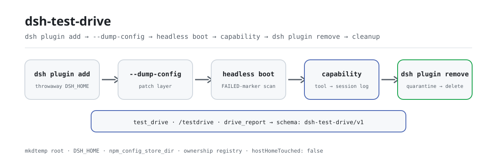

<div align="center">

<picture>
  <source media="(prefers-color-scheme: dark)" srcset="docs/assets/dsh-test-drive-flow-dark.svg">
  
</picture>

# dsh-test-drive

**एक डिस्पोज़ेबल प्रोफ़ाइल में इंस्टॉल, बूट, दावा, अनइंस्टॉल और सफ़ाई — «यह चलता भी है क्या?» को दोहराने योग्य पाइपलाइन बना दें।**

DeepSeek Harness प्लगइनों के लिए आइसोलेटेड इंस्टॉल-और-स्मोक परीक्षण: हर लक्ष्य को अपनी `mkdtemp` जड़ मिलती है (थ्रोअवे `DSH_HOME`, थ्रोअवे कार्यशील निर्देशिका और रीडायरेक्ट किया गया pnpm store), आपका असली `~/.dsh` शुरू से अंत तक न पढ़ा जाता है न लिखा जाता है, और परिणाम एक संरचित रिकॉर्ड बनता है जिसे आगे की टूलिंग सीधे खपत कर सकती है।

[इंस्टॉल](#तीन-चरणों-में-शुरुआत) · [कॉन्फ़िगरेशन](#कॉन्फ़िगरेशन) · [FAQ](#faq) · [简体中文](README.md) · [English](README.en.md) · [Español](README.es.md) · [Português](README.pt.md) · [हिन्दी](README.hi.md)

[](LICENSE)
[](#संगतता)
[](https://www.npmjs.com/package/dsh-test-drive)
[](https://github.com/PerryLink/dsh-test-drive/actions/workflows/ci.yml)
[](#संगतता)

[](https://github.com/PerryLink/dsh-test-drive/stargazers)
[](https://www.npmjs.com/package/dsh-test-drive)
[](https://dshfind.com/plugins/PerryLink/dsh-test-drive?ref=badge)
[](https://securityscorecards.dev/viewer/?uri=github.com/PerryLink/dsh-test-drive)
[](https://dsh.market/)
[](https://gitee.com/perrylink/dsh-test-drive)

```sh
dsh plugin --profile <name> add dsh-test-drive
```

</div>

<sub>सामुदायिक प्लगइन, DeepSeek से असंबद्ध। कैनोनिकल रिपॉज़िटरी: <https://github.com/PerryLink/dsh-test-drive> (Gitee एक मिरर है)।</sub>

## यह क्या है

`dsh-test-drive` «यह प्लगइन इंस्टॉल होता भी है और बूट होता है क्या?» को छह चरणों की पाइपलाइन बना देता है: एक थ्रोअवे `DSH_HOME` में `dsh plugin add` → `--dump-config` से सिद्ध करना कि bundle patch परत वास्तव में लागू हुई → एक headless बूट जो loader विफलता मार्कर खोजता है → वैकल्पिक क्षमता-दावा (agent से किसी नामित टूल या कमांड को कॉल कराना, फिर जाँचना कि टिकाऊ सत्र लॉग में वह कॉल दर्ज है और देखा गया आउटपुट अपेक्षित शब्दशः मान रखता है) → `dsh plugin remove` → dry-run → क्वारंटीन-नामांतरण → हटाने की सीढ़ी से इस प्लगइन की अपनी अस्थायी जड़ों की सफ़ाई। हर चरण में स्थिति, निकास कोड, अवधि और sanitized आउटपुट-पुच्छ होती है, और पूरा रन एक ही `schema: "dsh-test-drive/v1"` रिकॉर्ड होता है: एक लक्ष्य के लिए `test_drive`, बैच के लिए `/testdrive`, और परिणाम देखने के लिए `drive_report`।

## तीन चरणों में शुरुआत

1. **इंस्टॉल करें** (दो चैनल):

   ```sh
   # npm चैनल (प्रकाशित रिलीज़; पहले से बने पैकेजों को build अनुमति नहीं चाहिए)
   dsh plugin --profile web add dsh-test-drive
   # git चैनल (नवीनतम main; git+https://github.com/PerryLink/dsh-test-drive.git के बराबर)
   dsh plugin --profile web add github:PerryLink/dsh-test-drive#<commit-sha>
   ```

   git चैनल पर पहला `add` विफल होता है क्योंकि pnpm पैकेज के `prepare` build को रोकता है; pnpm जो सटीक कुंजी छापता है उसे प्रोफ़ाइल के `pnpm-workspace.yaml` में कॉपी करें और दोबारा चलाएँ:

   ```yaml
   allowBuilds:
     'dsh-test-drive': true
   ```

   npm के पहले से बने पैकेजों को build अनुमति नहीं चाहिए। प्रोफ़ाइल पुनः आरंभ करें, फिर सत्र में `test_drive` / `/testdrive` इस्तेमाल करें।

2. **न्यूनतम कॉन्फ़िग** (डिफ़ॉल्ट से ही चलता है; केवल क्षमता-दावा चलाने के लिए `capability.*` और `forwardEnv` चाहिए):

   ```yaml
   - insert:
       - id: test-drive
         name: dsh-test-drive
         config:
           headlessTask: "Reply with exactly: ok"
           forwardEnv: [DEEPSEEK_API_KEY]
           capability:
             enabled: true
             kind: tool
             name: plugin_vet
             args: '{}'
             expect: pass
   ```

3. **माउंट सत्यापित करें** (पुनः आरंभ के बाद):

   ```sh
   dsh --profile web --dump-config | grep -A3 'id: test-drive'
   ```

   फिर किसी ज्ञात लक्ष्य पर पहला परीक्षण चलाएँ:

   ```text
   test_drive({ target: "dsh-click" })
   → verdict pass · tdr_0b9b6e6a61e3e80cc4620f2e · पूरा रिकॉर्ड «उदाहरण» में
   ```

**अनइंस्टॉल**: `dsh plugin --profile web remove dsh-test-drive` (या प्रोफ़ाइल पैच से वह पंक्ति हटाएँ)।

> `test_drive` को ऐसा `dsh` CLI चाहिए जो **दूसरा** headless DSH प्रोसेस चला सके। DSH Desktop का launcher (`dsh.CMD`) केवल `dsh plugin …`, `--dump-config` और `--version` की अनुमति देता है और नीति के अनुसार दूसरा headless बूट अस्वीकार करता है — अब त्रुटि यह स्पष्ट कहती है, «cannot parse npm shim» नहीं। `config.dshBin` को npm/pnpm से इंस्टॉल किए `dsh` CLI पर, या सामान्य Node + dsh JS एंट्री पर इंगित करें।

<details>
<summary>DSH Desktop मार्केट से इंस्टॉल करें</summary>

सभी PerryLink प्लगइन DSH Desktop के अंतर्निहित मार्केट में ब्राउज़ किए जा सकते हैं: **Market → Sources → Add source → पेस्ट करें** `https://perrylink-dsh-catalog.perrylink.workers.dev/catalog-source.json` **→ चुनें**। इंस्टॉलेशन के लिए मार्केट की npm पहचान जाँच और आपकी पुष्टि आवश्यक रहती है।

</details>

## मुख्य क्षमताएँ

`dsh-test-drive` «इस इंस्टॉल को सत्यापित करो» को देखने और दोहराने योग्य चरणों में बाँटता है:

- **`test_drive` टूल** — एक लक्ष्य की पूरी पाइपलाइन चलाकर संरचित रिकॉर्ड समकालिक रूप से लौटाता है; `background: true` देने पर `drive-batch` जॉब शुरू होता है और `{ kind: 'background', jobId }` मिलता है।
- **`/testdrive <लक्ष्य...>` कमांड** — स्पेस/कॉमा से अलग लक्ष्य-सूची को एक `drive-batch` बैकग्राउंड जॉब के रूप में चलाता है, प्रगति जॉब आउटपुट से स्ट्रीम करता है, और अंत में मैट्रिक्स रिपोर्ट (JSON + Markdown) देता है जिसकी अंतिम पंक्ति मैट्रिक्स id बताती है।
- **`drive_report` टूल** — किसी भी संग्रहीत रन (`tdr_...`), मैट्रिक्स (`tdm_...`), या id न देने पर नवीनतम मैट्रिक्स को Markdown में लौटाता है।
- **क्षमता-दावा** — «बूट हुआ और निकल गया» से आगे: वैकल्पिक `capability` चरण agent से `args` के साथ नामित टूल (`kind: tool`) या `/कमांड` (`kind: command`) चलवाता है, फिर जाँचता है कि टिकाऊ सत्र लॉग में वह कॉल दर्ज है और देखे गए आउटपुट में `expect` मौजूद है। साफ़ बूट केवल स्मोक है; `observed` सिद्ध करता है कि नामित क्षमता वास्तव में काम करती है।
- **संरचित परिणाम** — हर रिकॉर्ड में विभेदक `schema: "dsh-test-drive/v1"` और प्रथम-श्रेणी फ़ील्ड होते हैं: `stages.install.status`, `stages.smoke.status`, `stages.capability.status`, प्रति-चरण `durationMs`, sanitized `summary` / `outputTail`, और समग्र `verdict` (`pass` / `fail` / `partial` / `unknown`)। यही वह मशीन-पठनीय अनुबंध है जिसे आगे के स्कोरर (dsh-score) खपत करते हैं।
- **संरचना से सुरक्षा** — हर अस्थायी निर्देशिका इसी प्लगइन द्वारा `dsh-test-drive-` उपसर्ग से बनाई जाती है, जीवंत स्वामित्व-रजिस्ट्री में दर्ज रहती है, और केवल dry-run → क्वारंटीन-नामांतरण → हटाने की सीढ़ी से हटती है। होस्ट प्रोफ़ाइल कभी पढ़ी या लिखी नहीं जाती।

```text
लक्ष्य ──dsh plugin add──▶ थ्रोअवे DSH_HOME ──--dump-config──▶ patch परत
                                │                                     │
                                ├──headless boot──▶ FAILED-मार्कर स्कैन
                                ├──capability────▶ tool/command + सत्र लॉग
                                └──dsh plugin remove──▶ क्वारंटीन → हटाना
```

### टूल सतह

| सतह | रूप | लौटाता है / नोट्स |
|---|---|---|
| `test_drive` | टूल | पूरा संरचित रिकॉर्ड (समकालिक), या `{ kind: 'background', jobId }` |
| `/testdrive` | कमांड | एक `drive-batch` जॉब; अंतिम पंक्ति `drive_report` के लिए मैट्रिक्स id बताती है |
| `drive_report` | टूल | `tdr_...` रन / `tdm_...` मैट्रिक्स / नवीनतम मैट्रिक्स, Markdown में |

`test_drive` का `target` git स्पेक (`github:owner/repo#sha`, `git+https://...`), npm पैकेज नाम, स्थानीय पथ या `.tgz` tarball स्वीकार करता है; `capability` का रूप `{ kind: 'tool' | 'command', name, args, expect }` है और उसे `DEEPSEEK_API_KEY` चाहिए (होस्ट वातावरण या `forwardEnv`) — बिना उसके चरण `skipped` रहता है, कभी विफल नहीं।

### संरचित परिणाम

निर्णय नियम: इंस्टॉल विफलता, बूट विफलता (`smoke.fail`), या `not-registered` / `failed` तक पहुँचा क्षमता चरण ⇒ `fail`; इंस्टॉल सफल + patch प्रभावी + साफ़ बूट (`pass` / `boot-ok`) + अनइंस्टॉल सफल ⇒ `pass` (क्षमता चरण `observed` हो तो टिप्पणी सहित); इंस्टॉल हुआ पर बाद का आश्वासन अनुपस्थित ⇒ `partial`; बाकी सब ⇒ `unknown`।

<details>
<summary>पूर्ण रिकॉर्ड नमूना (dsh-test-drive/v1)</summary>

```json
{
  "schema": "dsh-test-drive/v1",
  "run": { "runId": "tdr_9f2c...", "startedAt": "2026-08-16T00:00:00.000Z",
           "finishedAt": "2026-08-16T00:00:45.120Z", "durationMs": 45120,
           "harnessVersion": "0.1.7-rc.2", "pluginVersion": "0.3.13",
           "platform": "win32", "node": "v22.22.3" },
  "target": { "kind": "repo", "spec": "github:owner/dsh-click#abc123",
              "resolved": { "packageName": "dsh-click", "packageVersion": "0.1.0",
                            "hasBundleManifest": true } },
  "isolation": { "tempDshHome": true, "tempWorkspace": true, "tempStore": true,
                 "hostHomeTouched": false },
  "stages": {
    "install":   { "status": "pass", "exitCode": 0, "durationMs": 30412, "attempts": 2,
                   "summary": "install ok after allowBuilds allowance", "outputTail": "",
                   "allowBuildsNeeded": true },
    "config":    { "status": "pass", "exitCode": 0, "durationMs": 2310, "attempts": 1,
                   "summary": "dump ok (exit 0)", "outputTail": "",
                   "patchEffective": true, "layers": ["dsh-click"] },
    "smoke":     { "status": "boot-ok", "exitCode": 1, "durationMs": 4123, "attempts": 1,
                   "summary": "booted without loader failures; headless task did not complete (credentials/model unreachable)",
                   "outputTail": "", "bootFailed": false, "taskCompleted": false },
    "capability": { "status": "observed", "exitCode": 0, "durationMs": 8123, "attempts": 1,
                    "summary": "tool \"plugin_vet\" called and its result contains the expectation",
                    "outputTail": "", "capabilityKind": "tool", "name": "plugin_vet",
                    "expectMatched": true,
                    "detail": "tool \"plugin_vet\" called and its result contains the expectation" },
    "uninstall": { "status": "pass", "exitCode": 0, "durationMs": 5123, "attempts": 1,
                   "summary": "remove ok (exit 0)", "outputTail": "" },
    "cleanup":   { "status": "pass", "quarantined": true, "removed": true,
                   "summary": "owned temp root quarantined and removed" }
  },
  "verdict": "pass",
  "verdictReason": "install, patch, boot, and uninstall verified; headless task inconclusive (see smoke.summary)"
}
```

</details>

### उदाहरण

ये प्लगइन के असली प्रवेश-बिंदु हैं; एक बार इंस्टॉल करके कोई एक कॉल करें।

**विस्तृत उदाहरण** — कमांड `test_drive`, इनपुट:

```sh
test_drive({ target: "dsh-click" })
```

आउटपुट:

```text
# Test drive tdr_0b9b6e6a61e3e80cc4620f2e

- Target: `dsh-click` (npm)
- Verdict: ✅ pass — install, patch, boot, task, and uninstall all verified
- Installed: dsh-click@0.2.0
- Isolation: throwaway DSH_HOME + workspace + pnpm store; host profile untouched

| Stage | Result | Exit | Duration | Summary |
|---|---|---|---|---|
| install | ✅ pass | 0 | 1 ms | install ok (exit 0) |
| config (--dump-config) | ✅ pass | 0 | 0 ms | patch effective: dsh-click |
| smoke (headless boot) | ✅ pass | 0 | 0 ms | booted cleanly and the headless task completed |
| capability | ⏭️ skipped | null | 0 ms | capability assertion disabled (config.capability.enabled is false and no per-drive capability given) |
| uninstall | ✅ pass | 0 | 0 ms | remove ok (exit 0) |
| cleanup | ✅ pass | — | — | owned temp root quarantined and removed |
```

*Observed from `README.md:153-163,174-211; tests/drive.spec.ts:73-101; src/report.ts:34-55`*

**विफलता शाखा** — इनपुट:

```text
{"target":"   "}
```

आउटपुट:

```text
isError=true; error.message=dsh-test-drive: target must be a non-empty string
```

*Observed from `plugins/dsh-test-drive/src/tools.ts:297-299 (blank target check); exercised through plugins/dsh-test-drive/tests/harness.ts`*

**संक्षिप्त उदाहरण**: `test_drive` · `/testdrive` · `drive_report`

## कॉन्फ़िगरेशन

सभी कुंजियाँ वैकल्पिक हैं (नीचे डिफ़ॉल्ट दिए हैं); अमान्य मान लोड पर ज़ोर से विफल होते हैं। `cordis.patch.yml` हर कुंजी को इनलाइन टिप्पणी से समझाता है।

सबसे अधिक इस्तेमाल होने वाली कुंजियाँ:

| कुंजी | डिफ़ॉल्ट | अर्थ |
|---|---|---|
| `profileName` | `headless` | हर थ्रोअवे DSH_HOME के भीतर आरंभ होने वाला प्रोफ़ाइल टेम्पलेट (base + headless bundles)। |
| `dshBin` | `""` | `dsh` executable का निरपेक्ष पथ; खाली छोड़ने पर PATH से स्वतः पता लगता है (Windows पर npm का `.cmd`/`.bat` shim पार्स होता है)। |
| `headlessTask` | `"Reply with exactly: ok"` | बूट-स्मोक चरण की एक-बार की टास्क; खाली हो तो चरण छूट जाता है। |
| `forwardEnv` | `[]` | टेस्ट प्रोफ़ाइल के चाइल्ड प्रोसेस में भेजे जाने वाले वातावरण चरों के **नाम** (मान कभी नहीं); मान कभी लॉग नहीं होते। |
| `allowBuilds` | `true` | टेस्ट प्रोफ़ाइल में रुके हुए git `prepare` build को अनुमति देकर इंस्टॉल एक बार दोहराता है। |
| `capability.enabled` | `false` | क्षमता-दावा चरण चलाएँ (पंजीकृत → कॉल → देखा गया)। |
| `capability.expect` | `""` | देखे गए आउटपुट में अपेक्षित शब्दशः मान (केस-असंवेदी उपस्ट्रिंग)। |
| `keepTempDirs` | `false` | विफलता पर अस्थायी निर्देशिकाएँ फ़ॉरेंसिक के लिए रख छोड़ें (स्वामित्व छोड़ दिया जाता है; सफ़ाई आपकी)। |

<details>
<summary>पूर्ण कॉन्फ़िगरेशन तालिका (19 कुंजियाँ)</summary>

| कुंजी | डिफ़ॉल्ट | अर्थ |
|---|---|---|
| `profileName` | `headless` | हर थ्रोअवे DSH_HOME के भीतर आरंभ होने वाला प्रोफ़ाइल टेम्पलेट (base + headless bundles)। |
| `dshBin` | `""` | `dsh` executable का निरपेक्ष पथ; खाली छोड़ने पर PATH से स्वतः पता लगता है (Windows पर npm का `.cmd`/`.bat` shim पार्स होता है)। |
| `headlessTask` | `"Reply with exactly: ok"` | बूट-स्मोक चरण की एक-बार की टास्क; खाली हो तो चरण छूट जाता है। |
| `forwardEnv` | `[]` | टेस्ट प्रोफ़ाइल के चाइल्ड प्रोसेस में भेजे जाने वाले वातावरण चरों के **नाम** (मान कभी नहीं); मान कभी लॉग नहीं होते। |
| `allowBuilds` | `true` | टेस्ट प्रोफ़ाइल में रुके हुए git `prepare` build को अनुमति देकर इंस्टॉल एक बार दोहराता है। |
| `installTimeoutMs` | `600000` | `dsh plugin add` चरण की समय-सीमा (मि.से.)। |
| `configTimeoutMs` | `60000` | `--dump-config` चरण की समय-सीमा (मि.से.)। |
| `smokeTimeoutMs` | `300000` | headless बूट-स्मोक चरण की समय-सीमा (मि.से.)। |
| `capabilityTimeoutMs` | `300000` | क्षमता-दावा टास्क की समय-सीमा (मि.से.)। |
| `capability.enabled` | `false` | क्षमता-दावा चरण चलाएँ (पंजीकृत → कॉल → देखा गया)। |
| `capability.kind` | `tool` | क्या दावा करना है: `tool` या `command`। |
| `capability.name` | `""` | टूल या कमांड का नाम (आगे `/` के बिना)। |
| `capability.args` | `""` | कॉल टेक्स्ट: टूल आर्ग्युमेंट (JSON-जैसे) या कमांड शब्द। |
| `capability.expect` | `""` | देखे गए आउटपुट में अपेक्षित शब्दशः मान (केस-असंवेदी उपस्ट्रिंग)। |
| `uninstallTimeoutMs` | `120000` | `dsh plugin remove` चरण की समय-सीमा (मि.से.)। |
| `outputTailBytes` | `8000` | प्रति चरण दर्ज sanitized आउटपुट-पुच्छ की सीमा (बाइट)। |
| `keepTempDirs` | `false` | विफलता पर अस्थायी निर्देशिकाएँ फ़ॉरेंसिक के लिए रख छोड़ें (स्वामित्व छोड़ दिया जाता है; सफ़ाई आपकी)। |
| `maxBatchTargets` | `20` | `/testdrive` बैच की सीमा। |
| `batchConcurrency` | `1` | बैच की समवर्तीता (सीरियल रहने से pnpm-store विवाद टलता है)। |

</details>

प्रोफ़ाइल पैच में ओवरराइड उदाहरण:

```yaml
- insert:
    - id: test-drive
      name: dsh-test-drive
      config:
        headlessTask: "Reply with exactly: ok"
        forwardEnv: [DEEPSEEK_API_KEY]
        capability:
          enabled: true
          kind: tool
          name: plugin_vet
          args: '{}'
          expect: pass
```

## FAQ

<details>
<summary>क्या यह मेरे असली <code>~/.dsh</code> को छूता है?</summary>

नहीं। हर परीक्षण OS की अस्थायी निर्देशिका के नीचे नई `mkdtemp` जड़ में चलता है: थ्रोअवे `DSH_HOME`, थ्रोअवे कार्यशील निर्देशिका और रीडायरेक्ट किया गया pnpm store। परीक्षित प्लगइन का कोड केवल उसी प्रोफ़ाइल में चलता है; होस्ट प्रोफ़ाइल न पढ़ी जाती है न लिखी जाती, और संरचित रिकॉर्ड `isolation.hostHomeTouched: false` कहता है। सफ़ाई केवल इस प्लगइन द्वारा पंजीकृत निर्देशिकाएँ स्वीकार करती है — `%TEMP%` की पूरी स्कैनिंग नहीं, पराए उपसर्ग नहीं, असली होम पथ नहीं।

</details>

<details>
<summary>यदि कंपोज़िशन में <code>storageDomain</code> न हो तो क्या होता है?</summary>

टूल काम करते रहते हैं, बस रिपोर्टें स्थायी नहीं होतीं: प्लगइन कारण लॉग करके persistence बंद कर देता है, और `drive_report` नाटक करने के बजाय ईमानदारी से विफल होता है। इसके विपरीत जिन कंपोज़िशन में `storageDomain` है वे रिकॉर्ड `test_drive` डोमेन में रखते हैं (तालिकाएँ `runs`, `matrices`, और नवीनतम-मैट्रिक्स पॉइंटर)।

</details>

<details>
<summary>क्या परीक्षित चाइल्ड प्रोसेस को मेरी क्रेडेंशियल मिलती हैं?</summary>

डिफ़ॉल्ट रूप से नहीं। चाइल्ड प्रोसेस ऐसा वातावरण पाते हैं जिससे क्रेडेंशियल हटा दिए गए हैं; जब तक आप `forwardEnv` में कोई चर स्पष्ट रूप से नामित न करें (केवल नाम), होस्ट रहस्य परीक्षित प्रोफ़ाइल तक नहीं पहुँचते, और वे मान कभी लॉग नहीं होते। इसके अलावा हर रिपोर्ट और लॉग स्ट्रिंग शुद्ध sanitizer से गुज़रती है: टोकन शब्दशः मान, URL क्रेडेंशियल और bearer हेडर लाल किए जाते हैं, अस्थायी जड़ के पथ `<testdrive-temp>` बन जाते हैं, और आउटपुट-पुच्छ बाइट-सीमित रहती है।

</details>

<details>
<summary>बूट चरण अक्सर केवल <code>boot-ok</code> पर क्यों रुक जाता है?</summary>

क्योंकि बूट जाँच को क्रेडेंशियल नहीं चाहिए, जबकि एक-बार की टास्क पूरी करने को चाहिए। क्रेडेंशियल के बिना प्लगइन ईमानदार `boot-ok` बताता है — कोई loader विफलता नहीं मिली और टास्क पूरी नहीं हुई — बजाय इसके कि असत्यापित चीज़ को `pass` लिख दे। `pass` तक पहुँचने के लिए `forwardEnv` से क्रेडेंशियल स्पष्ट रूप से भेजें (उनके मान फिर भी लॉग में नहीं जाते)।

</details>

<details>
<summary>विफलता पर अस्थायी निर्देशिकाएँ बची रह जाती हैं?</summary>

चुपचाप नहीं। सफ़ाई `finally` में चलती है — सफलता, विफलता, टाइमआउट और निरस्त — और प्लगइन टियरडाउन पर एक बार फिर; हटाने से पहले जड़ को `dsh-test-drive-quarantine-<ts>` निर्देशिका में बदला जाता है, सत्यापित किया जाता है और तभी हटाया जाता है। हटाना विफल हो तो निर्देशिका क्वारंटीन में रहती है और रिपोर्ट होती है। घटनास्थल सुरक्षित रखना हो तो `keepTempDirs: true` रखें — तब स्वामित्व छोड़ दिया जाता है और सफ़ाई आपके ज़िम्मे आती है।

</details>

## सुरक्षा सीमाएँ

- **आइसोलेशन।** हर परीक्षण OS की अस्थायी निर्देशिका के नीचे नई `mkdtemp` जड़ में चलता है: थ्रोअवे `DSH_HOME`, थ्रोअवे कार्यशील निर्देशिका और रीडायरेक्ट किया गया pnpm store। परीक्षित प्लगइन का कोड केवल उसी प्रोफ़ाइल में चलता है; आपकी होस्ट प्रोफ़ाइल अछूती रहती है।
- **स्वामित्व।** जीवंत रजिस्ट्री इस प्लगइन इंस्टेंस द्वारा बनाई हर जड़ दर्ज करती है। सफ़ाई हर उस पथ को अस्वीकार करती है जो पंजीकृत न हो, OS अस्थायी निर्देशिका की सीधी संतान न हो, या जिसमें `dsh-test-drive-` उपसर्ग न हो — `%TEMP%` की पूरी स्कैनिंग नहीं, पराए उपसर्ग नहीं, असली होम पथ नहीं।
- **सफ़ाई की सीढ़ी।** किसी भी बदलाव से पहले पूरा dry-run प्लान (निरपेक्ष पथ) लॉग होता है। हटाने में पहले जड़ को `dsh-test-drive-quarantine-<ts>` निर्देशिका में बदला जाता है, सत्यापन होता है, फिर हटाया जाता है; विफलता पर निर्देशिका क्वारंटीन में रहती है और रिपोर्ट होती है, कभी चुपचाप नहीं गिराई जाती। सफ़ाई सफलता, विफलता, टाइमआउट और निरस्त — सब में `finally` में चलती है, और प्लगइन टियरडाउन पर फिर से।
- **`allowBuilds` एक असली अनुमति है।** किसी git पैकेज के `prepare` build को अनुमति देना इंस्टॉल के समय उस पैकेज का कोड चलाना है। अनुमति केवल थ्रोअवे प्रोफ़ाइल तक सीमित है, फिर भी केवल उन्हीं लक्ष्यों को परखें जिन पर आप भरोसा करते हैं, और commit पिन करें।
- **headless स्मोक डिफ़ॉल्ट रूप से बिना कुंजी है।** बूट जाँच को क्रेडेंशियल नहीं चाहिए; एक-बार की टास्क पूरी करने को चाहिए। क्रेडेंशियल स्पष्ट रूप से (`forwardEnv`) भेजें और उन्हें कभी लॉग न करें।

## अनुमतियाँ और डेटा

- **सेवा सतह।** केवल सार्वजनिक सेवाएँ खपत होती हैं: `ctx.subprocess`, `ctx.jobs`, `ctx.storageDomain`, `ctx.tools`, `ctx.commands`। `storageDomain` वैकल्पिक है — उसके बिना भी बूट और परीक्षण चलते रहते हैं।
- **अनुमतियाँ।** `dshWorkshop` मैनिफ़ेस्ट `fs:read`, `fs:write`, `subprocess:spawn`, `session:append`, `network:inherit`, `native-code:none` घोषित करता है — लेखन केवल अपनी बनाई अस्थायी जड़ों और रिपोर्ट persistence तक सीमित है, और `network:inherit` केवल होस्ट से विरासत में मिलता है (लक्ष्य के registry/git इंस्टॉल को वैसे भी नेटवर्क चाहिए)।
- **डेटा।** रिपोर्टें `test_drive` storage डोमेन में रहती हैं (तालिकाएँ `runs`, `matrices`, और नवीनतम-मैट्रिक्स पॉइंटर); वह डोमेन न हो तो रिपोर्टें स्थायी नहीं होतीं और कारण लॉग होता है।
- **सत्र लॉग।** चाइल्ड प्रोसेस को क्रेडेंशियल-रहित वातावरण मिलता है और `forwardEnv` केवल नाम भेजता है; हर रिपोर्ट/लॉग स्ट्रिंग sanitize होती है — टोकन शब्दशः मान, URL क्रेडेंशियल और bearer हेडर लाल, अस्थायी जड़ के पथ `<testdrive-temp>`, आउटपुट-पुच्छ बाइट-सीमित।

## ज्ञात सीमाएँ

- **DSH Desktop समर्थित टेस्ट होस्ट नहीं है।** `test_drive` को ऐसा `dsh` CLI चाहिए जो दूसरा headless प्रोसेस चला सके, जबकि `dsh.CMD` launcher केवल `dsh plugin …`, `--dump-config` और `--version` की अनुमति देता है; `dshBin` को npm/pnpm से इंस्टॉल किए `dsh` पर इंगित करें।
- registry/git लक्ष्य इंस्टॉल करने के लिए चाइल्ड `dsh`/pnpm प्रोसेस को नेटवर्क पहुँच चाहिए।
- स्मोक टास्क को `pass` तक पहुँचने के लिए मॉडल क्रेडेंशियल चाहिए; बिना उनके यह ईमानदार `boot-ok` बताता है।
- जिन कंपोज़िशन में `storageDomain` नहीं है वहाँ रिपोर्टें स्थायी नहीं होतीं (`drive_report` ईमानदारी से विफल होता है)।
- `dsh` का PATH पर मिलना ज़रूरी है (या `dshBin` सेट करें); Windows पर npm का `.cmd`/`.bat` shim स्वतः पार्स होता है, पर केवल `.ps1` मिलने पर `dshBin` माँगा जाता है।
- बैच डिफ़ॉल्ट रूप से सीरियल चलते हैं; `batchConcurrency` बढ़ाने से pnpm-store की डिस्क साझा होती है, शुद्धता नहीं बदलती।

## अन्य DSH प्लगइनों के साथ इंटरऑपरेबिलिटी

`dsh-test-drive` दो टूल और एक कमांड देता है, और दूसरे प्लगइनों की seams में शामिल नहीं होता:

- **नेमस्पेस अलगाव।** केवल `test_drive` और `drive_report`, तथा `/testdrive` कमांड पंजीकृत करता है — अंतर्निहित टूल या अन्य प्लगइनों के किसी नंगे नाम पर कब्ज़ा नहीं।
- **क्लाइंट या HTTP संसाधन नहीं।** इस पैकेज का कोई `client/` आधा नहीं है: क्लाइंट slot नहीं, `webServer` उपसर्ग नहीं, `agent/pre-step` या `tools/post-execute` waterfall श्रोता नहीं (`AGENTS.md` दर्ज करता है कि यह प्लगइन आज कोई waterfall श्रोता पंजीकृत नहीं करता), और ग्लोबल ऑब्जेक्ट पर कोई बदलाव नहीं।
- **सेवा-कुंजी टकराव नहीं।** कोई सेवा कुंजी नहीं देता और केवल `subprocess`, `jobs`, `tools`, `commands` तथा वैकल्पिक `storageDomain` खपत करता है।
- **patch परत केवल अपनी पंक्ति डालती है।** bundle patch केवल अपनी एक `test-drive` पंक्ति `insert` करता है और अंतर्निहित पंक्ति का `config` कभी नहीं लिखता।
- **पंजीकरण एक effect है।** टूल, कमांड और डोमेन-क्लोज़र सब `ctx.effect` के भीतर पंजीकृत होते हैं; रोकने या हॉट-रीलोड पर केवल वही रद्द होता है जो इस प्लगइन ने पंजीकृत किया, और अस्थायी-जड़ रजिस्ट्री अपने disposer से बची चीज़ें समेट लेती है।

## संगतता

| सतह | स्थिति |
|---|---|
| Harness | DeepSeek Harness `dsh-v0.2.1-alpha.1` (GitHub tag, 2026-09-11 को सत्यापित: पूर्ण गेट शृंखला + profile इंस्टॉल स्मोक)। npm निर्भरता पंक्तियाँ `0.1.2-rc.1` और `0.1.7-rc.2`; `engines.dsh`: `>=0.2.1-0 <0.3.0 \|\| >=0.2.2-0 <0.3.0` |
| Node | `^22.19.0 \|\| >=24.9.0` |
| पैकेज प्रबंधक | `pnpm@11.7.0` |
| प्लेटफ़ॉर्म | Windows / macOS / Linux (शुद्ध host प्लगइन, कोई UI आधा नहीं) |
| बाहरी टूल | PATH पर `dsh` CLI (स्वतः पता, npm shim पार्स), PATH पर `pnpm` |

## इकोसिस्टम और गुणवत्ता

- [Gitee मिरर](https://gitee.com/perrylink/dsh-test-drive) (सिंक मिरर; GitHub कैनोनिकल है)
- [dshfind प्लगइन पेज](https://dshfind.com/plugins/PerryLink/dsh-test-drive) (इंस्टॉल और रैंकिंग)
- [OpenSSF Scorecard रिपोर्ट](https://securityscorecards.dev/viewer/?uri=github.com/PerryLink/dsh-test-drive) ([.github/workflows/scorecard.yml](.github/workflows/scorecard.yml) द्वारा संचालित)
- [dsh-plugin-doctor सत्यापन रिपोर्ट](https://github.com/PerryLink/dsh-plugin-doctor#verified-徽章) (इस रेपो के [.github/workflows/plugin-doctor.yml](.github/workflows/plugin-doctor.yml) द्वारा संचालित)
- [DSH Market](https://dsh.market/) (सूचीबद्ध)
- **1024 स्टोर चैनल**: एक बार `npm i -g dsh1024`, फिर `dsh1024 plugin --profile web add dsh-test-drive` ([deepseek1024.com](https://deepseek1024.com) इंस्टॉल रैंकिंग में गिना जाता है)
- [इकोसिस्टम नॉलेज बेस](https://perrylink.github.io/dsh-plugin-guide/) — मापे गए आँकड़े, मार्केटिंग नहीं: डेवलपमेंट गाइड · चयन डेटा · रखरखाव मानदंड

## डेवलपमेंट

```sh
pnpm install                     # node ^22.19 || >=24.9
pnpm run typecheck               # tsc: src + tests, @deepseek-ai/* स्थानीय harness checkout से हल
pnpm run typecheck:ci            # tsc: प्रकाशित host टाइप के विरुद्ध
pnpm test                        # vitest
pnpm run build                   # node scripts/prepare.mjs (tsdown bundle + declarations)
pnpm run verify:self-contained   # निर्भरता स्पेक registry से हल होती हैं
pnpm run verify:artifacts        # भेजी गई फ़ाइलें मौजूद + lib/index.js इम्पोर्ट योग्य
pnpm run check:readmes           # पाँच-भाषा README संगति
pnpm pack                        # प्रकाशित tarball
```

- `typecheck` स्थानीय harness checkout से `@deepseek-ai/*` हल करता है; `typecheck:ci` प्रकाशित host टाइप के विरुद्ध जाँचता है।
- टेस्ट असली `Context`/`Session`/`ToolRuntime`/`LocalJobRegistry`/storage स्टैक और स्क्रिप्टेड subprocess provider इस्तेमाल करते हैं।
- असली CLI के साथ एंड-टू-एंड (नेटवर्क + PATH पर `dsh` चाहिए): `DSH_TESTDRIVE_E2E=1 pnpm run test:e2e` — इस पैकेज के अपने checkout को असली इंस्टॉल-स्मोक लूप से चलाता है।
- रिलीज़: `node scripts/release.mjs <x.y.z>` (संस्करण बढ़ाता, CHANGELOG पर तिथि लगाता, गेट दोबारा चलाता, commit + tag करता; push नहीं)।

### GitHub Action (action.yml)

रेपो में एक composite [`action.yml`](action.yml) मौजूद है जिसे किसी भी प्लगइन रेपो में `uses:` से दोबारा इस्तेमाल किया जा सकता है: यह आइसोलेटेड थ्रोअवे प्रोफ़ाइल में लक्ष्य चलाता है और CI द्वारा खपत की जाने वाली रिपोर्ट-जोड़ी देता है — Markdown (PR टिप्पणी) और JUnit XML (test reporter / स्थिति जाँच)।

```yaml
# .github/workflows/test-drive.yml
name: test-drive
on: [pull_request, workflow_dispatch]
jobs:
  smoke:
    runs-on: ubuntu-latest
    steps:
      - uses: actions/checkout@v4
      - name: Drive this plugin
        id: drive
        uses: PerryLink/dsh-test-drive@v0.2.4
        with:
          target: github:${{ github.repository }}#${{ github.sha }}
      - name: Publish JUnit
        uses: EnricoMi/publish-unit-test-result-action@v2
        with:
          files: ${{ steps.drive.outputs.junit }}
      - name: Comment the report
        run: cat "${{ steps.drive.outputs.markdown }}"
```

`action.yml` इनपुट: `target` (आवश्यक), `headless-task` (वैकल्पिक स्मोक टास्क) और `dsh-version` (`dsh` CLI स्पेक); आउटपुट: `markdown`, `junit` (रिपोर्ट पथ) और `verdict` (`pass`/`fail`/`partial`/`unknown`)। चालन स्वयं बिना कुंजी रहता है (install → patch जाँच → बूट स्मोक → अनइंस्टॉल → सफ़ाई); केवल capability दावे को `DEEPSEEK_API_KEY` चाहिए, और उसके बिना वह `skipped` रहता है, विफल नहीं।

वही रिपोर्ट-जोड़ी प्रोग्रामेटिक रूप से भी मिलती है: `renderDriveResult` / `renderMatrix` (Markdown) और `renderDriveJUnitXml` / `renderMatrixJUnitXml` (JUnit) पैकेज रूट से निर्यात होते हैं और स्थिर `DriveResult` या `MatrixRecord` पर काम करते हैं।

README की छवियाँ [`scripts/gen-readme-assets.py`](scripts/gen-readme-assets.py) (Python + Pillow) से प्रोग्रामेटिक रूप में बनती हैं और सुरक्षित रूप से दोबारा चलाई जा सकती हैं: `python scripts/gen-readme-assets.py`।

Topics: `dsh`, `dsh-plugin`, `deepseek-harness`, `deepseek`, `cordis`, `plugin-testing`, `install-smoke`, `compatibility-matrix`, `ci`

## परिवार और आभार

यह प्रोजेक्ट [PerryLink](https://github.com/PerryLink) के DeepSeek Harness प्लगइन परिवार का हिस्सा है (सभी Apache-2.0)। अगर यह उपयोगी लगे, तो **एक स्टार अगले व्यक्ति को इसे खोजने में मदद करता है** — इसके पीछे कुछ भी लॉक नहीं है।

- [@PerryLink](https://github.com/PerryLink) — निर्माता और रखरखावकर्ता: एकल-लक्ष्य पाइपलाइन, क्षमता-दावा चरण, अस्थायी-जड़ स्वामित्व और आइसोलेशन सफ़ाई सीढ़ी, संरचित परिणाम अनुबंध, और पाँच-भाषा दस्तावेज़।

<details>
<summary>सभी प्लगइन खोलें</summary>

| प्लगइन | स्थिति |
|---|---|
| **[dsh-aqua-input-check](https://github.com/PerryLink/dsh-aqua-input-check)** |  |
| **[dsh-archive-check](https://github.com/PerryLink/dsh-archive-check)** |  |
| **[dsh-auto-review](https://github.com/PerryLink/dsh-auto-review)** |  |
| **[dsh-autotier](https://github.com/PerryLink/dsh-autotier)** | 🧊 फ़्रोज़न — रेपो README देखें |
| **[dsh-bid-ca-precheck](https://github.com/PerryLink/dsh-bid-ca-precheck)** |  |
| **[dsh-bid-qual-check](https://github.com/PerryLink/dsh-bid-qual-check)** |  |
| **[dsh-cert-mcp](https://github.com/PerryLink/dsh-cert-mcp)** | 🧊 फ़्रोज़न — रेपो README देखें |
| **[dsh-checkpoint-rewind](https://github.com/PerryLink/dsh-checkpoint-rewind)** |  |
| **[dsh-click](https://github.com/PerryLink/dsh-click)** |  |
| **[dsh-composer-history](https://github.com/PerryLink/dsh-composer-history)** |  |
| **[dsh-contract-stance](https://github.com/PerryLink/dsh-contract-stance)** |  |
| **[dsh-customs-doc-check](https://github.com/PerryLink/dsh-customs-doc-check)** |  |
| **[dsh-data-quality](https://github.com/PerryLink/dsh-data-quality)** | 🧊 फ़्रोज़न — रेपो README देखें |
| **[dsh-demurrage-ledger](https://github.com/PerryLink/dsh-demurrage-ledger)** |  |
| **[dsh-doublecheck](https://github.com/PerryLink/dsh-doublecheck)** |  |
| **[dsh-drill-script-check](https://github.com/PerryLink/dsh-drill-script-check)** |  |
| **[dsh-eia-guide-check](https://github.com/PerryLink/dsh-eia-guide-check)** |  |
| **[dsh-emergency-plan](https://github.com/PerryLink/dsh-emergency-plan)** |  |
| **[dsh-essay-rubric-check](https://github.com/PerryLink/dsh-essay-rubric-check)** |  |
| **[dsh-evidence-check](https://github.com/PerryLink/dsh-evidence-check)** |  |
| **[dsh-export-ctl-check](https://github.com/PerryLink/dsh-export-ctl-check)** |  |
| **[dsh-fast](https://github.com/PerryLink/dsh-fast)** |  |
| **[dsh-fmea-table-check](https://github.com/PerryLink/dsh-fmea-table-check)** |  |
| **[dsh-forecast-penalty](https://github.com/PerryLink/dsh-forecast-penalty)** |  |
| **[dsh-fund-research](https://github.com/PerryLink/dsh-fund-research)** |  |
| **[dsh-github](https://github.com/PerryLink/dsh-github)** |  |
| **[dsh-gongwen-flow-check](https://github.com/PerryLink/dsh-gongwen-flow-check)** |  |
| **[dsh-gongwen-word-check](https://github.com/PerryLink/dsh-gongwen-word-check)** |  |
| **[dsh-guard-plan-qc](https://github.com/PerryLink/dsh-guard-plan-qc)** |  |
| **[dsh-hazchem-check](https://github.com/PerryLink/dsh-hazchem-check)** |  |
| **[dsh-hazplan-check](https://github.com/PerryLink/dsh-hazplan-check)** |  |
| **[dsh-hidden-risk-map](https://github.com/PerryLink/dsh-hidden-risk-map)** |  |
| **[dsh-hs-classify](https://github.com/PerryLink/dsh-hs-classify)** |  |
| **[dsh-icd-rule-check](https://github.com/PerryLink/dsh-icd-rule-check)** |  |
| **[dsh-industry-research](https://github.com/PerryLink/dsh-industry-research)** |  |
| **[dsh-lawcite-adapter](https://github.com/PerryLink/dsh-lawcite-adapter)** |  |
| **[dsh-laya](https://github.com/PerryLink/dsh-laya)** |  |
| **[dsh-lc-doc-check](https://github.com/PerryLink/dsh-lc-doc-check)** |  |
| **[dsh-learning-gap-check](https://github.com/PerryLink/dsh-learning-gap-check)** |  |
| **[dsh-library](https://github.com/PerryLink/dsh-library)** |  |
| **[dsh-local-ai](https://github.com/PerryLink/dsh-local-ai)** |  |
| **[dsh-lsp-actions](https://github.com/PerryLink/dsh-lsp-actions)** |  |
| **[dsh-mask](https://github.com/PerryLink/dsh-mask)** |  |
| **[dsh-mcp-panel](https://github.com/PerryLink/dsh-mcp-panel)** |  |
| **[dsh-medrec-qc](https://github.com/PerryLink/dsh-medrec-qc)** |  |
| **[dsh-memento](https://github.com/PerryLink/dsh-memento)** | 🧊 फ़्रोज़न — रेपो README देखें |
| **[dsh-nsfc-form-check](https://github.com/PerryLink/dsh-nsfc-form-check)** |  |
| **[dsh-nurse-record-check](https://github.com/PerryLink/dsh-nurse-record-check)** |  |
| **[dsh-observe](https://github.com/PerryLink/dsh-observe)** |  |
| **[dsh-origin-rvc-check](https://github.com/PerryLink/dsh-origin-rvc-check)** |  |
| **[dsh-ota-review-check](https://github.com/PerryLink/dsh-ota-review-check)** |  |
| **[dsh-output-styles](https://github.com/PerryLink/dsh-output-styles)** |  |
| **[dsh-paper-doc-adapter](https://github.com/PerryLink/dsh-paper-doc-adapter)** |  |
| **[dsh-permission-rules](https://github.com/PerryLink/dsh-permission-rules)** |  |
| **[dsh-permit-report-check](https://github.com/PerryLink/dsh-permit-report-check)** |  |
| **[dsh-pipeline-check](https://github.com/PerryLink/dsh-pipeline-check)** |  |
| **[dsh-pleading-draft](https://github.com/PerryLink/dsh-pleading-draft)** |  |
| **[dsh-plugin-doctor](https://github.com/PerryLink/dsh-plugin-doctor)** | 🚫 रिटायर्ड (रेपो संग्रहीत) |
| **[dsh-plugin-guide](https://github.com/PerryLink/dsh-plugin-guide)** |  |
| **[dsh-plugin-kit](https://github.com/PerryLink/dsh-plugin-kit)** | 🚫 रिटायर्ड (रेपो संग्रहीत) |
| **[dsh-plugin-upgrade](https://github.com/PerryLink/dsh-plugin-upgrade)** | 🚫 रिटायर्ड (रेपो संग्रहीत) |
| **[dsh-policy-brief-draft](https://github.com/PerryLink/dsh-policy-brief-draft)** |  |
| **[dsh-power-loss-split](https://github.com/PerryLink/dsh-power-loss-split)** |  |
| **[dsh-power-ticket-check](https://github.com/PerryLink/dsh-power-ticket-check)** |  |
| **[dsh-ppap-check](https://github.com/PerryLink/dsh-ppap-check)** |  |
| **[dsh-protest-deadline](https://github.com/PerryLink/dsh-protest-deadline)** |  |
| **[dsh-railway-window](https://github.com/PerryLink/dsh-railway-window)** |  |
| **[dsh-repair-order-qc](https://github.com/PerryLink/dsh-repair-order-qc)** |  |
| **[dsh-research-report](https://github.com/PerryLink/dsh-research-report)** |  |
| **[dsh-review-reply-check](https://github.com/PerryLink/dsh-review-reply-check)** |  |
| **[dsh-rulefile-check](https://github.com/PerryLink/dsh-rulefile-check)** |  |
| **[dsh-safety-brief-check](https://github.com/PerryLink/dsh-safety-brief-check)** |  |
| **[dsh-score](https://github.com/PerryLink/dsh-score)** | 🧊 फ़्रोज़न — रेपो README देखें |
| **[dsh-session-sync](https://github.com/PerryLink/dsh-session-sync)** |  |
| **[dsh-site-log-check](https://github.com/PerryLink/dsh-site-log-check)** |  |
| **[dsh-skill-pack-security](https://github.com/PerryLink/dsh-skill-pack-security)** |  |
| **[dsh-soe-decision-check](https://github.com/PerryLink/dsh-soe-decision-check)** |  |
| **[dsh-soilwater-check](https://github.com/PerryLink/dsh-soilwater-check)** |  |
| **[dsh-sop-sync-check](https://github.com/PerryLink/dsh-sop-sync-check)** |  |
| **[dsh-spc-gbt-adapter](https://github.com/PerryLink/dsh-spc-gbt-adapter)** |  |
| **[dsh-talk](https://github.com/PerryLink/dsh-talk)** |  |
| **[dsh-tender-extract](https://github.com/PerryLink/dsh-tender-extract)** |  |
| **[dsh-tender-matrix](https://github.com/PerryLink/dsh-tender-matrix)** |  |
| **[dsh-test-drive](https://github.com/PerryLink/dsh-test-drive)** |  |
| **[dsh-ticktick](https://github.com/PerryLink/dsh-ticktick)** | 🚫 रिटायर्ड (रेपो संग्रहीत) |
| **[dsh-translate](https://github.com/PerryLink/dsh-translate)** |  |
| **[dsh-warranty-calc](https://github.com/PerryLink/dsh-warranty-calc)** |  |
| **[dsh-budget](https://github.com/PerryLink/dsh-budget)** | 🧊 फ़्रोज़न — रेपो README देखें |
| **[dsh-claude-move](https://github.com/PerryLink/dsh-claude-move)** | 🧊 फ़्रोज़न — रेपो README देखें |
| **[dsh-defend](https://github.com/PerryLink/dsh-defend)** | 🧊 फ़्रोज़न — रेपो README देखें |
| **[dsh-draw](https://github.com/PerryLink/dsh-draw)** | 🧊 फ़्रोज़न — रेपो README देखें |
| **[dsh-reach](https://github.com/PerryLink/dsh-reach)** | 🧊 फ़्रोज़न — रेपो README देखें |
| **[dsh-background-agents](https://github.com/PerryLink/dsh-background-agents)** | 🚫 रिटायर्ड (रेपो संग्रहीत) |
| **[dsh-session-pin](https://github.com/PerryLink/dsh-session-pin)** | 🚫 रिटायर्ड (रेपो संग्रहीत) |
| **[dsh-team-rooms](https://github.com/PerryLink/dsh-team-rooms)** | 🚫 रिटायर्ड (रेपो संग्रहीत) |

</details>

## लाइसेंस

[LICENSE](LICENSE) (Apache License 2.0) © 2026 dsh-test-drive contributors

<p align="center"><sub>Apache-2.0 · सामुदायिक प्लगइन, DeepSeek से असंबद्ध।</sub></p>
