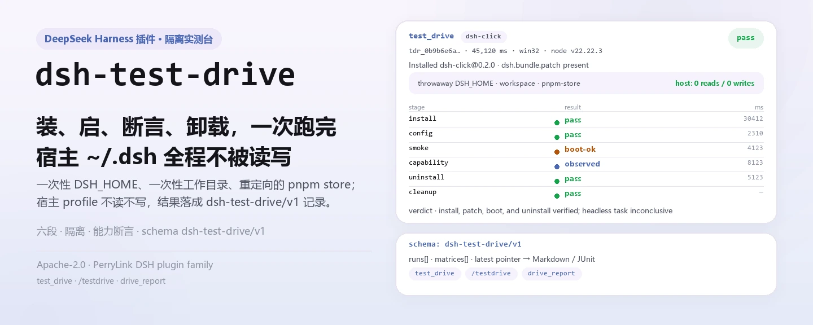
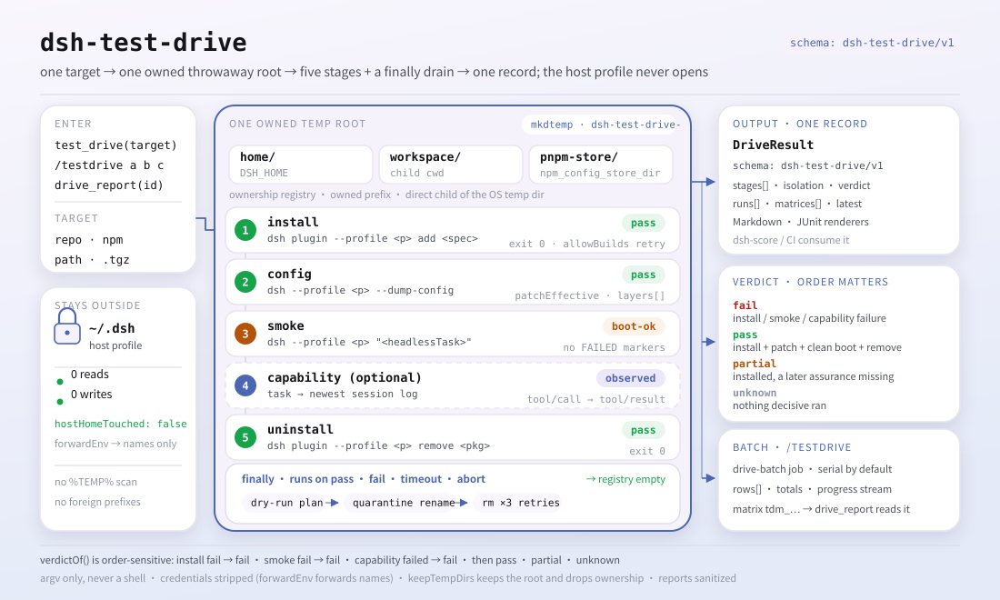

<div align="center">

<picture>
  <source media="(prefers-color-scheme: dark)" srcset="docs/assets/dsh-test-drive-hero-zh-dark.webp">
  
</picture>

# dsh-test-drive

**在一次性 profile 里装、启动、断言、卸载、清理——把「装一下看看能不能跑」变成可复现的流水线。**

面向 DeepSeek Harness 插件的隔离式安装冒烟实测：每个目标独占一个 `mkdtemp` 根（一次性 `DSH_HOME`、一次性工作目录、重定向的 pnpm store），你真实的 `~/.dsh` 从头到尾不被读写，结果落成下游可直接消费的结构化记录。

[安装](#三步上手) · [配置](#配置) · [FAQ](#faq) · [简体中文](README.md) · [English](README.en.md) · [Español](README.es.md) · [Português](README.pt.md) · [हिन्दी](README.hi.md)

[](LICENSE)
[](#兼容性)
[](https://www.npmjs.com/package/dsh-test-drive)
[](https://github.com/PerryLink/dsh-test-drive/actions/workflows/ci.yml)
[](#兼容性)

[](https://github.com/PerryLink/dsh-test-drive/stargazers)
[](https://www.npmjs.com/package/dsh-test-drive)
[](https://dshfind.com/plugins/PerryLink/dsh-test-drive?ref=badge)
[](https://securityscorecards.dev/viewer/?uri=github.com/PerryLink/dsh-test-drive)
[](https://dsh.market/)
[](https://gitee.com/perrylink/dsh-test-drive)

```sh
dsh plugin --profile <name> add dsh-test-drive
```

</div>

<sub>社区插件，与 DeepSeek 官方无关。唯一仓库：<https://github.com/PerryLink/dsh-test-drive>（Gitee 为镜像）。</sub>

## 它是什么

`dsh-test-drive` 把「这个插件到底装不装得上、启不启得来」变成一条六段流水线：`dsh plugin add` 装进一个一次性 `DSH_HOME` → `--dump-config` 核对 bundle patch 层确实生效 → headless 启动一遍并扫描 loader 失败标记 → 可选地做一次能力断言（让 agent 调用某个具名工具或命令，核对持久会话日志里确实记下了这次调用、观察输出里确实出现期望字面量）→ `dsh plugin remove` → 按 dry-run → 隔离改名 → 删除的阶梯清掉本插件拥有的临时根。每段都带状态、退出码、耗时与脱敏后的输出尾部，最终是一条 `schema: "dsh-test-drive/v1"` 的结构化记录：单目标用 `test_drive`，批量用 `/testdrive`，回看用 `drive_report`。

<picture>
  <source media="(prefers-color-scheme: dark)" srcset="docs/assets/dsh-test-drive-flow-v5-dark.svg">
  
</picture>

## 三步上手

1. **安装**（两通道）：

   ```sh
   # npm 渠道（已发布版本；预构建包无需构建许可）
   dsh plugin --profile web add dsh-test-drive
   # git 渠道（最新 main；等价于 git+https://github.com/PerryLink/dsh-test-drive.git）
   dsh plugin --profile web add github:PerryLink/dsh-test-drive#<commit-sha>
   ```

   git 渠道首次 `add` 会因 pnpm 拦截该包的 `prepare` 构建而失败；把 pnpm 打印的精确键复制进 profile 的 `pnpm-workspace.yaml` 后重跑：

   ```yaml
   allowBuilds:
     'dsh-test-drive': true
   ```

   npm 通道的预构建包不需要构建许可。重启 profile 后，即可在会话中使用 `test_drive` / `/testdrive`。

2. **最小配置**（默认即可用；只有要跑能力断言时才需要 `capability.*` 与 `forwardEnv`）：

   ```yaml
   - insert:
       - id: test-drive
         name: dsh-test-drive
         config:
           headlessTask: "Reply with exactly: ok"
           forwardEnv: [DEEPSEEK_API_KEY]
           capability:
             enabled: true
             kind: tool
             name: plugin_vet
             args: '{}'
             expect: pass
   ```

3. **验证已生效**（重启后）：

   ```sh
   dsh --profile web --dump-config | grep -A3 'id: test-drive'
   ```

   然后对一个已知目标发起第一次实测：

   ```text
   test_drive({ target: "dsh-click" })
   → verdict pass · tdr_0b9b6e6a61e3e80cc4620f2e · 完整记录见下方「示例」
   ```

**卸载**：`dsh plugin --profile web remove dsh-test-drive`（或从 profile patch 删掉该行）。

> `test_drive` 需要一个能启动**第二个** headless DSH 进程的 `dsh` CLI。DSH Desktop 的 launcher（`dsh.CMD`）只允许 `dsh plugin …`、`--dump-config` 与 `--version`，会按策略拒绝第二次 headless 启动——报错会明确说明这一点，而不是「cannot parse npm shim」。请把 `config.dshBin` 指向 npm/pnpm 安装的 `dsh` CLI，或普通 Node + dsh JS 入口。

<details>
<summary>从 DSH Desktop 市场安装</summary>

所有 PerryLink 插件均可在 DSH Desktop 内置市场中浏览：**市场 → 来源 → 添加来源 → 粘贴** `https://perrylink-dsh-catalog.perrylink.workers.dev/catalog-source.json` **→ 选中**。安装仍需通过市场的 npm 身份校验与你的确认。

</details>

## 核心能力

`dsh-test-drive` 把一次「装机验证」拆成可观察、可回放的阶段：

- **`test_drive` 工具** —— 单个目标跑完整流水线，同步返回结构化记录；传 `background: true` 则启动 `drive-batch` 后台任务并返回 `{ kind: 'background', jobId }`。
- **`/testdrive <目标...>` 命令** —— 空格/逗号分隔的目标列表，作为一个 `drive-batch` 后台任务批量跑；进度经任务输出流式推送，最后产出矩阵报告（JSON + Markdown），末行给出矩阵 id。
- **`drive_report` 工具** —— 按 id 取回任意单次记录（`tdr_...`）、矩阵（`tdm_...`），或不传 id 取最新矩阵，以 Markdown 渲染。
- **能力断言** —— 不止于「启动并退出」：可选的 `capability` 阶段让 agent 以 `args` 调用具名工具（`kind: tool`）或运行 `/命令`（`kind: command`），核对持久会话日志确实记下这次调用、且观察输出包含 `expect`。干净启动只是冒烟，`observed` 才证明具名能力真实可用。
- **结构化结果** —— 每条记录带判别符 `schema: "dsh-test-drive/v1"`，关键字段均为一级字段：`stages.install.status`、`stages.smoke.status`、`stages.capability.status`、各阶段 `durationMs`、脱敏后的 `summary` / `outputTail`，以及总判定 `verdict`（`pass` / `fail` / `partial` / `unknown`）。这是下游评分方（dsh-score）消费的机器可读契约。
- **结构安全** —— 每个临时目录都由本插件以专属前缀 `dsh-test-drive-` 创建、登记在活跃所有权注册表中，且只经 dry-run → 隔离改名 → 删除的阶梯清理。宿主机 profile 永不被读取或写入。

```text
target ──dsh plugin add──▶ 一次性 DSH_HOME ──--dump-config──▶ patch 层
                                │                                  │
                                ├──headless boot──▶ FAILED-marker 扫描
                                ├──capability────▶ tool/command + 会话日志
                                └──dsh plugin remove──▶ quarantine → delete
```

### 工具面

| 表面 | 形态 | 返回 / 说明 |
|---|---|---|
| `test_drive` | 工具 | 完整结构化记录（同步），或 `{ kind: 'background', jobId }` |
| `/testdrive` | 命令 | 一个 `drive-batch` 后台任务；末行给出供 `drive_report` 使用的矩阵 id |
| `drive_report` | 工具 | `tdr_...` 单次记录 / `tdm_...` 矩阵 / 最新矩阵，Markdown 渲染 |

`test_drive` 的 `target` 接受 git 规格（`github:owner/repo#sha`、`git+https://...`）、npm 包名、本地路径或 `.tgz` 压缩包；`capability` 形如 `{ kind: 'tool' | 'command', name, args, expect }`，需要 `DEEPSEEK_API_KEY`（宿主环境或 `forwardEnv`），缺失时该阶段为 `skipped`，绝不算失败。

### 结构化结果

判定规则：安装失败、启动失败（`smoke.fail`）、或能力阶段到达 `not-registered` / `failed` ⇒ `fail`；安装通过 + patch 生效 + 启动干净（`pass` / `boot-ok`）+ 卸载通过 ⇒ `pass`（能力阶段 `observed` 时附说明）；已安装但后续保证缺失 ⇒ `partial`；其余 ⇒ `unknown`。

<details>
<summary>完整记录样例（dsh-test-drive/v1）</summary>

```json
{
  "schema": "dsh-test-drive/v1",
  "run": { "runId": "tdr_9f2c...", "startedAt": "2026-08-16T00:00:00.000Z",
           "finishedAt": "2026-08-16T00:00:45.120Z", "durationMs": 45120,
           "harnessVersion": "0.1.7-rc.2", "pluginVersion": "0.3.13",
           "platform": "win32", "node": "v22.22.3" },
  "target": { "kind": "repo", "spec": "github:owner/dsh-click#abc123",
              "resolved": { "packageName": "dsh-click", "packageVersion": "0.1.0",
                            "hasBundleManifest": true } },
  "isolation": { "tempDshHome": true, "tempWorkspace": true, "tempStore": true,
                 "hostHomeTouched": false },
  "stages": {
    "install":   { "status": "pass", "exitCode": 0, "durationMs": 30412, "attempts": 2,
                   "summary": "install ok after allowBuilds allowance", "outputTail": "",
                   "allowBuildsNeeded": true },
    "config":    { "status": "pass", "exitCode": 0, "durationMs": 2310, "attempts": 1,
                   "summary": "dump ok (exit 0)", "outputTail": "",
                   "patchEffective": true, "layers": ["dsh-click"] },
    "smoke":     { "status": "boot-ok", "exitCode": 1, "durationMs": 4123, "attempts": 1,
                   "summary": "booted without loader failures; headless task did not complete (credentials/model unreachable)",
                   "outputTail": "", "bootFailed": false, "taskCompleted": false },
    "capability": { "status": "observed", "exitCode": 0, "durationMs": 8123, "attempts": 1,
                    "summary": "tool \"plugin_vet\" called and its result contains the expectation",
                    "outputTail": "", "capabilityKind": "tool", "name": "plugin_vet",
                    "expectMatched": true,
                    "detail": "tool \"plugin_vet\" called and its result contains the expectation" },
    "uninstall": { "status": "pass", "exitCode": 0, "durationMs": 5123, "attempts": 1,
                   "summary": "remove ok (exit 0)", "outputTail": "" },
    "cleanup":   { "status": "pass", "quarantined": true, "removed": true,
                   "summary": "owned temp root quarantined and removed" }
  },
  "verdict": "pass",
  "verdictReason": "install, patch, boot, and uninstall verified; headless task inconclusive (see smoke.summary)"
}
```

</details>

### 示例

以下为插件真实入口；安装后调用一个即可。

**详细示例** — 命令 `test_drive`，输入：

```sh
test_drive({ target: "dsh-click" })
```

输出：

```text
# Test drive tdr_0b9b6e6a61e3e80cc4620f2e

- Target: `dsh-click` (npm)
- Verdict: ✅ pass — install, patch, boot, task, and uninstall all verified
- Installed: dsh-click@0.2.0
- Isolation: throwaway DSH_HOME + workspace + pnpm store; host profile untouched

| Stage | Result | Exit | Duration | Summary |
|---|---|---|---|---|
| install | ✅ pass | 0 | 1 ms | install ok (exit 0) |
| config (--dump-config) | ✅ pass | 0 | 0 ms | patch effective: dsh-click |
| smoke (headless boot) | ✅ pass | 0 | 0 ms | booted cleanly and the headless task completed |
| capability | ⏭️ skipped | null | 0 ms | capability assertion disabled (config.capability.enabled is false and no per-drive capability given) |
| uninstall | ✅ pass | 0 | 0 ms | remove ok (exit 0) |
| cleanup | ✅ pass | — | — | owned temp root quarantined and removed |
```

*Observed from `README.md:153-163,174-211; tests/drive.spec.ts:73-101; src/report.ts:34-55`*

**失败分支** — 输入：

```text
{"target":"   "}
```

输出：

```text
isError=true; error.message=dsh-test-drive: target must be a non-empty string
```

*Observed from `plugins/dsh-test-drive/src/tools.ts:297-299 (blank target check); exercised through plugins/dsh-test-drive/tests/harness.ts`*

**简短示例**：`test_drive` · `/testdrive` · `drive_report`

## 配置

所有键均可选（下列为默认值）；非法值在加载期响亮失败。`cordis.patch.yml` 逐键内联注释。

最常用键：

| 键 | 默认值 | 含义 |
|---|---|---|
| `profileName` | `headless` | 每次一次性 DSH_HOME 内初始化的 profile 模板（base + headless bundles）。 |
| `dshBin` | `""` | `dsh` 可执行文件的绝对路径覆盖；为空则自动探测 PATH（Windows 下解析 npm 的 `.cmd`/`.bat` shim）。 |
| `headlessTask` | `"Reply with exactly: ok"` | 引导冒烟阶段的一句任务；为空则跳过该阶段。 |
| `forwardEnv` | `[]` | 转发进测试 profile 子进程的环境变量**名**（绝不转发值，值永不落日志）。 |
| `allowBuilds` | `true` | 在测试 profile 中放行被拦截的 git `prepare` 构建并重试一次安装。 |
| `capability.enabled` | `false` | 是否运行能力断言阶段（注册 → 调用 → 观察到）。 |
| `capability.expect` | `""` | 期望出现在观察输出中的字面量（不区分大小写子串）。 |
| `keepTempDirs` | `false` | 失败时保留临时目录供取证（所有权被放弃，由你清理）。 |

<details>
<summary>完整配置表（19 个键）</summary>

| 键 | 默认值 | 含义 |
|---|---|---|
| `profileName` | `headless` | 每次一次性 DSH_HOME 内初始化的 profile 模板（base + headless bundles）。 |
| `dshBin` | `""` | `dsh` 可执行文件的绝对路径覆盖；为空则自动探测 PATH（Windows 下解析 npm 的 `.cmd`/`.bat` shim）。 |
| `headlessTask` | `"Reply with exactly: ok"` | 引导冒烟阶段的一句任务；为空则跳过该阶段。 |
| `forwardEnv` | `[]` | 转发进测试 profile 子进程的环境变量**名**（绝不转发值，值永不落日志）。 |
| `allowBuilds` | `true` | 在测试 profile 中放行被拦截的 git `prepare` 构建并重试一次安装。 |
| `installTimeoutMs` | `600000` | `dsh plugin add` 阶段时限（毫秒）。 |
| `configTimeoutMs` | `60000` | `--dump-config` 阶段时限（毫秒）。 |
| `smokeTimeoutMs` | `300000` | headless 引导冒烟阶段时限（毫秒）。 |
| `capabilityTimeoutMs` | `300000` | 能力断言任务时限（毫秒）。 |
| `capability.enabled` | `false` | 是否运行能力断言阶段（注册 → 调用 → 观察到）。 |
| `capability.kind` | `tool` | 断言对象：`tool` 或 `command`。 |
| `capability.name` | `""` | 工具或命令名（不带前导 `/`）。 |
| `capability.args` | `""` | 调用文本：工具参数（JSON 风格）或命令参数。 |
| `capability.expect` | `""` | 期望出现在观察输出中的字面量（不区分大小写子串）。 |
| `uninstallTimeoutMs` | `120000` | `dsh plugin remove` 阶段时限（毫秒）。 |
| `outputTailBytes` | `8000` | 每阶段记录的脱敏输出尾部上限（字节）。 |
| `keepTempDirs` | `false` | 失败时保留临时目录供取证（所有权被放弃，由你清理）。 |
| `maxBatchTargets` | `20` | `/testdrive` 批上限。 |
| `batchConcurrency` | `1` | 批并发度（串行可避免 pnpm-store 争用）。 |

</details>

profile patch 中的覆盖示例：

```yaml
- insert:
    - id: test-drive
      name: dsh-test-drive
      config:
        headlessTask: "Reply with exactly: ok"
        forwardEnv: [DEEPSEEK_API_KEY]
        capability:
          enabled: true
          kind: tool
          name: plugin_vet
          args: '{}'
          expect: pass
```

## FAQ

<details>
<summary>会碰我真实的 <code>~/.dsh</code> 吗？</summary>

不会。每次实测都在 OS 临时目录下的一个全新 `mkdtemp` 根内进行：一次性 `DSH_HOME`、一次性工作目录、重定向的 pnpm store，被测插件的代码只在那套临时 profile 里执行。宿主机 profile 既不被读取也不被写入，结构化记录里的 `isolation.hostHomeTouched` 恒为 `false`。清理只认本插件登记过的目录，绝不扫描 `%TEMP%`、不碰他人前缀、不碰真实家目录。

</details>

<details>
<summary>组合里没有 <code>storageDomain</code> 时，报告会丢吗？</summary>

工具照常工作，只是报告不持久化：插件会记录一条原因后禁用持久化，`drive_report` 会如实报错而不是假装成功。反过来，有 `storageDomain` 的组合会把记录写进 `test_drive` 领域（表 `runs`、`matrices` 与 latest-matrix 指针）。

</details>

<details>
<summary>被测插件的子进程会拿到我的密钥吗？</summary>

默认不会。子进程继承的是**已剥离凭据**的环境；除非你在 `forwardEnv` 里显式点名某个变量（只写变量**名**），宿主机密钥不会进入被测 profile，而且这些值永不落日志。所有报告与日志字符串还会过纯函数脱敏：令牌字面量、URL 凭据、bearer 头被涂红，临时根路径替换为 `<testdrive-temp>`，输出尾部按字节封顶。

</details>

<details>
<summary>为什么冒烟阶段经常只到 <code>boot-ok</code>？</summary>

因为启动检查本身不需要凭据，而真跑完一句任务需要模型凭据。没有凭据时插件如实上报 `boot-ok`——既没有 loader 失败，也没有跑完任务——而不是把没验证过的东西记成 `pass`。要让它走到 `pass`，请显式配置 `forwardEnv` 转发凭据（值仍不进日志）。

</details>

<details>
<summary>实测失败时临时目录会残留吗？</summary>

不会静默残留。清理在 `finally` 里执行，覆盖成功、失败、超时与中止，插件卸载时还会再扫一次；删除前先把根目录改名为 `dsh-test-drive-quarantine-<时间戳>` 隔离目录再核验，失败时目录保持隔离并如实上报。想保留现场取证就设 `keepTempDirs: true`，此时所有权会被放弃，由你自己清理。

</details>

## 安全边界

- **隔离**：每次实测在 OS 临时目录下全新 `mkdtemp` 根内进行：一次性 `DSH_HOME`、一次性工作目录、重定向的 pnpm store。被测插件代码只在那个 profile 中运行；宿主机 profile 不受影响。
- **所有权**：活跃注册表记录本插件实例创建的每个根目录。清理会拒绝任何「非注册的、不在 OS 临时目录直接子级、不携带 `dsh-test-drive-` 前缀」的路径——不扫 `%TEMP%` 全量、不碰他人前缀、不碰真实家目录。
- **清理阶梯**：任何变更前先打印完整 dry-run 计划（绝对路径）。删除先把根目录改名为 `dsh-test-drive-quarantine-<时间戳>` 隔离目录，核验后再删；失败则目录保持隔离并如实上报，绝不静默丢弃。成功、失败、超时、中止的所有路径都在 `finally` 中执行清理，插件卸载时再次清扫。
- **`allowBuilds` 是真实权限**：放行 git 包的 `prepare` 构建意味着在安装时执行该包的代码。放行范围仅限一次性 profile，但仍只测你信任的目标，并固定 commit。
- **headless 冒烟默认无密钥**：启动检查不需要凭据；完成一句任务才需要。要转发凭据请显式配置 `forwardEnv`，且绝不记录其值。

## 权限与数据

- **服务面**：只消费公开服务 —— `ctx.subprocess`、`ctx.jobs`、`ctx.storageDomain`、`ctx.tools`、`ctx.commands`；其中 `storageDomain` 是可选依赖，缺失时启动与实测都不受影响。
- **权限**：`dshWorkshop` manifest 声明 `fs:read`、`fs:write`、`subprocess:spawn`、`session:append`、`network:inherit`、`native-code:none` —— 写权限只用于自己创建的临时根与报告落盘，`network:inherit` 只是继承宿主（被测目标的 registry/git 安装本来就需要网络）。
- **数据**：报告存于 `test_drive` storage-domain（表 `runs`、`matrices`；latest-matrix 指针）；没有该领域时报告不持久化并记录原因。
- **会话日志**：子进程继承已剥离凭据的环境，`forwardEnv` 只转发变量名；所有报告/日志字符串都经纯函数脱敏 —— 令牌字面量、URL 凭据与 bearer 头被涂红，临时根路径被替换为 `<testdrive-temp>`，输出尾部按字节封顶。

## 已知限制

- **DSH Desktop 不是受支持的测试宿主。** `test_drive` 需要能启动第二个 headless 进程的 `dsh` CLI，而 `dsh.CMD` launcher 只允许 `dsh plugin …`、`--dump-config` 与 `--version`；请把 `dshBin` 指向 npm/pnpm 安装的 `dsh`。
- 安装 registry/git 目标需要子进程 `dsh`/pnpm 具备网络访问。
- 冒烟任务需要模型凭据才能到 `pass`；没有时如实上报 `boot-ok`。
- 没有 `storageDomain` 的组合不持久化报告（`drive_report` 会诚实报错）。
- `dsh` 必须能在 PATH 上定位（或配置 `dshBin`）；Windows 下自动解析 npm 的 `.cmd`/`.bat` shim，若只解析到 `.ps1` 会要求配置 `dshBin`。
- 批默认串行执行；提高 `batchConcurrency` 只影响 pnpm-store 磁盘争用，不影响正确性。

## 与其他 DSH 插件的互操作性

`dsh-test-drive` 只暴露两个工具与一个命令，不参与别的插件的接缝：

- **命名空间隔离。** 只注册 `test_drive`、`drive_report` 两个工具与 `/testdrive` 一条命令，不占用内置工具或插件已用的裸名。
- **不占客户端与 HTTP 资源。** 本包含无 `client/` 半，不注册客户端 slot、不注册 `webServer` 路由、不装 `agent/pre-step` / `tools/post-execute` 等 waterfall 监听器（`AGENTS.md` 明确记录：本插件当前不注册任何 waterfall 监听器），也不改全局对象。
- **无服务键冲突。** 不提供任何 service key，只消费 `subprocess`、`jobs`、`tools`、`commands` 与可选的 `storageDomain`。
- **patch 层只插自己一行。** 组合包 patch 只 `insert` 自己的 `test-drive` 行，从不覆写内置行的 `config`。
- **注册即 effect。** 工具、命令与领域关闭都在 `ctx.effect` 内注册，停止/热重载只撤销自己注册的东西，临时目录注册表也会在 disposer 里扫尾。

## 兼容性

| 维度 | 状态 |
|---|---|
| Harness | DeepSeek Harness `dsh-v0.2.1-alpha.1`（GitHub tag，2026-09-11 已核验：完整门禁链 + profile 安装冒烟）。npm 依赖线 `0.1.2-rc.1` 与 `0.1.7-rc.2`；`engines.dsh`：`>=0.2.1-0 <0.3.0 \|\| >=0.2.2-0 <0.3.0` |
| Node | `^22.19.0 \|\| >=24.9.0` |
| 包管理器 | `pnpm@11.7.0` |
| 平台 | Windows / macOS / Linux（纯 host 插件，无 UI 半） |
| 外部工具 | PATH 上的 `dsh` CLI（自动探测，可解析 npm shim）、PATH 上的 `pnpm` |

## 生态与质量

- [Gitee 镜像](https://gitee.com/perrylink/dsh-test-drive)（同步镜像，以 GitHub 为准）
- [dshfind 插件页](https://dshfind.com/plugins/PerryLink/dsh-test-drive)（安装量与排名）
- [OpenSSF Scorecard 报告](https://securityscorecards.dev/viewer/?uri=github.com/PerryLink/dsh-test-drive)（由 [.github/workflows/scorecard.yml](.github/workflows/scorecard.yml) 驱动）
- [dsh-plugin-doctor 验证报告](https://github.com/PerryLink/dsh-plugin-doctor#verified-徽章)（由本仓的 [.github/workflows/plugin-doctor.yml](.github/workflows/plugin-doctor.yml) 驱动）
- [DSH Market](https://dsh.market/)（已上架）
- **1024 商店渠道**：先 `npm i -g dsh1024`，再 `dsh1024 plugin --profile web add dsh-test-drive`（计入 [deepseek1024.com](https://deepseek1024.com) 安装排行）
- [生态实测知识库](https://perrylink.github.io/dsh-plugin-guide/)：插件开发指南 · 选型实测数据 · 维护取舍判据

## 开发

```sh
pnpm install                     # node ^22.19 || >=24.9
pnpm run typecheck               # tsc：src + tests，经本地 harness checkout 解析 @deepseek-ai/*
pnpm run typecheck:ci            # tsc：对照已发布的宿主类型
pnpm test                        # vitest
pnpm run build                   # node scripts/prepare.mjs（tsdown bundle + 声明）
pnpm run verify:self-contained   # 依赖 spec 均来自 registry
pnpm run verify:artifacts        # 发布文件齐全 + lib/index.js 可 import
pnpm run check:readmes           # 五语 README 一致性
pnpm pack                        # 发布 tarball
```

- `typecheck` 经本地 harness checkout 解析 `@deepseek-ai/*`；`typecheck:ci` 对照已发布的宿主类型检查。
- 测试使用真实 `Context`/`Session`/`ToolRuntime`/`LocalJobRegistry`/storage 栈 + 脚本化 subprocess provider。
- 真实 CLI 端到端（需网络 + PATH 上的 `dsh`）：`DSH_TESTDRIVE_E2E=1 pnpm run test:e2e` —— 用真实安装冒烟循环实测本包自身 checkout。
- 发布：`node scripts/release.mjs <x.y.z>`（升版本、CHANGELOG 落日期、重跑门禁、commit + tag；不 push）。

### GitHub Action（action.yml）

仓库内置一个 composite [`action.yml`](action.yml)，可在任意插件仓库里 `uses:` 复用：它在一次性隔离 profile 里驱动目标，并输出 CI 消费的报告对 —— Markdown（PR 评论）与 JUnit XML（测试报告/状态检查）。

```yaml
# .github/workflows/test-drive.yml
name: test-drive
on: [pull_request, workflow_dispatch]
jobs:
  smoke:
    runs-on: ubuntu-latest
    steps:
      - uses: actions/checkout@v4
      - name: Drive this plugin
        id: drive
        uses: PerryLink/dsh-test-drive@v0.2.4
        with:
          target: github:${{ github.repository }}#${{ github.sha }}
      - name: Publish JUnit
        uses: EnricoMi/publish-unit-test-result-action@v2
        with:
          files: ${{ steps.drive.outputs.junit }}
      - name: Comment the report
        run: cat "${{ steps.drive.outputs.markdown }}"
```

`action.yml` 输入：`target`（必填）、`headless-task`（可选冒烟任务）、`dsh-version`（`dsh` CLI 规格）；输出：`markdown`、`junit`（报告路径）与 `verdict`（`pass`/`fail`/`partial`/`unknown`）。驱动本身无需密钥（install → patch 校验 → 启动冒烟 → 卸载 → 清理）；只有 capability 断言需要 `DEEPSEEK_API_KEY`，缺省时 `skipped` 而不是失败。

同一对报告也可编程取得：`renderDriveResult` / `renderMatrix`（Markdown）与 `renderDriveJUnitXml` / `renderMatrixJUnitXml`（JUnit）从包根导出，作用于已结算的 `DriveResult` 或 `MatrixRecord`。

配图由 [`scripts/gen-readme-assets.py`](scripts/gen-readme-assets.py) 程序化生成（Python + Pillow），可重复执行：`python scripts/gen-readme-assets.py`。

Topics：`dsh`, `dsh-plugin`, `deepseek-harness`, `deepseek`, `cordis`, `plugin-testing`, `install-smoke`, `compatibility-matrix`, `ci`

## 家族与致谢

本项目是 [PerryLink](https://github.com/PerryLink) 维护的 DeepSeek Harness 插件家族成员（全部 Apache-2.0）。如果这个插件帮到了你，**给个 star** —— 它不解锁任何功能，但会让下一个人更容易找到它。

- [@PerryLink](https://github.com/PerryLink) —— 创建者与维护者：单目标流水线、能力断言阶段、临时目录所有权与隔离清理阶梯、结构化结果契约与五语文档。

<details>
<summary>展开全部插件</summary>

| 插件 | 状态 |
|---|---|
| **[dsh-aqua-input-check](https://github.com/PerryLink/dsh-aqua-input-check)** |  |
| **[dsh-archive-check](https://github.com/PerryLink/dsh-archive-check)** |  |
| **[dsh-auto-review](https://github.com/PerryLink/dsh-auto-review)** |  |
| **[dsh-autotier](https://github.com/PerryLink/dsh-autotier)** | 🧊 已冻结 — 见仓库 README |
| **[dsh-bid-ca-precheck](https://github.com/PerryLink/dsh-bid-ca-precheck)** |  |
| **[dsh-bid-qual-check](https://github.com/PerryLink/dsh-bid-qual-check)** |  |
| **[dsh-cert-mcp](https://github.com/PerryLink/dsh-cert-mcp)** | 🧊 已冻结 — 见仓库 README |
| **[dsh-checkpoint-rewind](https://github.com/PerryLink/dsh-checkpoint-rewind)** |  |
| **[dsh-click](https://github.com/PerryLink/dsh-click)** |  |
| **[dsh-composer-history](https://github.com/PerryLink/dsh-composer-history)** |  |
| **[dsh-contract-stance](https://github.com/PerryLink/dsh-contract-stance)** |  |
| **[dsh-customs-doc-check](https://github.com/PerryLink/dsh-customs-doc-check)** |  |
| **[dsh-data-quality](https://github.com/PerryLink/dsh-data-quality)** | 🧊 已冻结 — 见仓库 README |
| **[dsh-demurrage-ledger](https://github.com/PerryLink/dsh-demurrage-ledger)** |  |
| **[dsh-doublecheck](https://github.com/PerryLink/dsh-doublecheck)** |  |
| **[dsh-drill-script-check](https://github.com/PerryLink/dsh-drill-script-check)** |  |
| **[dsh-eia-guide-check](https://github.com/PerryLink/dsh-eia-guide-check)** |  |
| **[dsh-emergency-plan](https://github.com/PerryLink/dsh-emergency-plan)** |  |
| **[dsh-essay-rubric-check](https://github.com/PerryLink/dsh-essay-rubric-check)** |  |
| **[dsh-evidence-check](https://github.com/PerryLink/dsh-evidence-check)** |  |
| **[dsh-export-ctl-check](https://github.com/PerryLink/dsh-export-ctl-check)** |  |
| **[dsh-fast](https://github.com/PerryLink/dsh-fast)** |  |
| **[dsh-fmea-table-check](https://github.com/PerryLink/dsh-fmea-table-check)** |  |
| **[dsh-forecast-penalty](https://github.com/PerryLink/dsh-forecast-penalty)** |  |
| **[dsh-fund-research](https://github.com/PerryLink/dsh-fund-research)** |  |
| **[dsh-github](https://github.com/PerryLink/dsh-github)** |  |
| **[dsh-gongwen-flow-check](https://github.com/PerryLink/dsh-gongwen-flow-check)** |  |
| **[dsh-gongwen-word-check](https://github.com/PerryLink/dsh-gongwen-word-check)** |  |
| **[dsh-guard-plan-qc](https://github.com/PerryLink/dsh-guard-plan-qc)** |  |
| **[dsh-hazchem-check](https://github.com/PerryLink/dsh-hazchem-check)** |  |
| **[dsh-hazplan-check](https://github.com/PerryLink/dsh-hazplan-check)** |  |
| **[dsh-hidden-risk-map](https://github.com/PerryLink/dsh-hidden-risk-map)** |  |
| **[dsh-hs-classify](https://github.com/PerryLink/dsh-hs-classify)** |  |
| **[dsh-icd-rule-check](https://github.com/PerryLink/dsh-icd-rule-check)** |  |
| **[dsh-industry-research](https://github.com/PerryLink/dsh-industry-research)** |  |
| **[dsh-lawcite-adapter](https://github.com/PerryLink/dsh-lawcite-adapter)** |  |
| **[dsh-laya](https://github.com/PerryLink/dsh-laya)** |  |
| **[dsh-lc-doc-check](https://github.com/PerryLink/dsh-lc-doc-check)** |  |
| **[dsh-learning-gap-check](https://github.com/PerryLink/dsh-learning-gap-check)** |  |
| **[dsh-library](https://github.com/PerryLink/dsh-library)** |  |
| **[dsh-local-ai](https://github.com/PerryLink/dsh-local-ai)** |  |
| **[dsh-lsp-actions](https://github.com/PerryLink/dsh-lsp-actions)** |  |
| **[dsh-mask](https://github.com/PerryLink/dsh-mask)** |  |
| **[dsh-mcp-panel](https://github.com/PerryLink/dsh-mcp-panel)** |  |
| **[dsh-medrec-qc](https://github.com/PerryLink/dsh-medrec-qc)** |  |
| **[dsh-memento](https://github.com/PerryLink/dsh-memento)** | 🧊 已冻结 — 见仓库 README |
| **[dsh-nsfc-form-check](https://github.com/PerryLink/dsh-nsfc-form-check)** |  |
| **[dsh-nurse-record-check](https://github.com/PerryLink/dsh-nurse-record-check)** |  |
| **[dsh-observe](https://github.com/PerryLink/dsh-observe)** |  |
| **[dsh-origin-rvc-check](https://github.com/PerryLink/dsh-origin-rvc-check)** |  |
| **[dsh-ota-review-check](https://github.com/PerryLink/dsh-ota-review-check)** |  |
| **[dsh-output-styles](https://github.com/PerryLink/dsh-output-styles)** |  |
| **[dsh-paper-doc-adapter](https://github.com/PerryLink/dsh-paper-doc-adapter)** |  |
| **[dsh-permission-rules](https://github.com/PerryLink/dsh-permission-rules)** |  |
| **[dsh-permit-report-check](https://github.com/PerryLink/dsh-permit-report-check)** |  |
| **[dsh-pipeline-check](https://github.com/PerryLink/dsh-pipeline-check)** |  |
| **[dsh-pleading-draft](https://github.com/PerryLink/dsh-pleading-draft)** |  |
| **[dsh-plugin-doctor](https://github.com/PerryLink/dsh-plugin-doctor)** | 🚫 已退役（仓库已归档） |
| **[dsh-plugin-guide](https://github.com/PerryLink/dsh-plugin-guide)** |  |
| **[dsh-plugin-kit](https://github.com/PerryLink/dsh-plugin-kit)** | 🚫 已退役（仓库已归档） |
| **[dsh-plugin-upgrade](https://github.com/PerryLink/dsh-plugin-upgrade)** | 🚫 已退役（仓库已归档） |
| **[dsh-policy-brief-draft](https://github.com/PerryLink/dsh-policy-brief-draft)** |  |
| **[dsh-power-loss-split](https://github.com/PerryLink/dsh-power-loss-split)** |  |
| **[dsh-power-ticket-check](https://github.com/PerryLink/dsh-power-ticket-check)** |  |
| **[dsh-ppap-check](https://github.com/PerryLink/dsh-ppap-check)** |  |
| **[dsh-protest-deadline](https://github.com/PerryLink/dsh-protest-deadline)** |  |
| **[dsh-railway-window](https://github.com/PerryLink/dsh-railway-window)** |  |
| **[dsh-repair-order-qc](https://github.com/PerryLink/dsh-repair-order-qc)** |  |
| **[dsh-research-report](https://github.com/PerryLink/dsh-research-report)** |  |
| **[dsh-review-reply-check](https://github.com/PerryLink/dsh-review-reply-check)** |  |
| **[dsh-rulefile-check](https://github.com/PerryLink/dsh-rulefile-check)** |  |
| **[dsh-safety-brief-check](https://github.com/PerryLink/dsh-safety-brief-check)** |  |
| **[dsh-score](https://github.com/PerryLink/dsh-score)** | 🧊 已冻结 — 见仓库 README |
| **[dsh-session-sync](https://github.com/PerryLink/dsh-session-sync)** |  |
| **[dsh-site-log-check](https://github.com/PerryLink/dsh-site-log-check)** |  |
| **[dsh-skill-pack-security](https://github.com/PerryLink/dsh-skill-pack-security)** |  |
| **[dsh-soe-decision-check](https://github.com/PerryLink/dsh-soe-decision-check)** |  |
| **[dsh-soilwater-check](https://github.com/PerryLink/dsh-soilwater-check)** |  |
| **[dsh-sop-sync-check](https://github.com/PerryLink/dsh-sop-sync-check)** |  |
| **[dsh-spc-gbt-adapter](https://github.com/PerryLink/dsh-spc-gbt-adapter)** |  |
| **[dsh-talk](https://github.com/PerryLink/dsh-talk)** |  |
| **[dsh-tender-extract](https://github.com/PerryLink/dsh-tender-extract)** |  |
| **[dsh-tender-matrix](https://github.com/PerryLink/dsh-tender-matrix)** |  |
| **[dsh-test-drive](https://github.com/PerryLink/dsh-test-drive)** |  |
| **[dsh-ticktick](https://github.com/PerryLink/dsh-ticktick)** | 🚫 已退役（仓库已归档） |
| **[dsh-translate](https://github.com/PerryLink/dsh-translate)** |  |
| **[dsh-warranty-calc](https://github.com/PerryLink/dsh-warranty-calc)** |  |
| **[dsh-budget](https://github.com/PerryLink/dsh-budget)** | 🧊 已冻结 — 见仓库 README |
| **[dsh-claude-move](https://github.com/PerryLink/dsh-claude-move)** | 🧊 已冻结 — 见仓库 README |
| **[dsh-defend](https://github.com/PerryLink/dsh-defend)** | 🧊 已冻结 — 见仓库 README |
| **[dsh-draw](https://github.com/PerryLink/dsh-draw)** | 🧊 已冻结 — 见仓库 README |
| **[dsh-reach](https://github.com/PerryLink/dsh-reach)** | 🧊 已冻结 — 见仓库 README |
| **[dsh-background-agents](https://github.com/PerryLink/dsh-background-agents)** | 🚫 已退役（仓库已归档） |
| **[dsh-session-pin](https://github.com/PerryLink/dsh-session-pin)** | 🚫 已退役（仓库已归档） |
| **[dsh-team-rooms](https://github.com/PerryLink/dsh-team-rooms)** | 🚫 已退役（仓库已归档） |

</details>

## License

[LICENSE](LICENSE)（Apache License 2.0）© 2026 dsh-test-drive contributors

<p align="center"><sub>Apache-2.0 · 社区插件，与 DeepSeek 无关。</sub></p>
