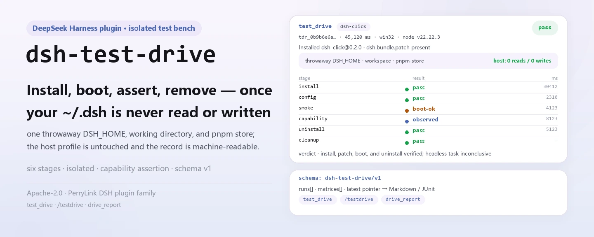

<div align="center">

<picture>
  <source media="(prefers-color-scheme: dark)" srcset="docs/assets/dsh-test-drive-hero-en-dark.webp">
  
</picture>

# dsh-test-drive

**Instalar, iniciar, verificar, desinstalar e limpar dentro de um perfil descartável: transforme «isso sequer sobe?» em um pipeline reproduzível.**

Testes isolados de instalação e inicialização para plugins do DeepSeek Harness: cada alvo recebe sua própria raiz `mkdtemp` (um `DSH_HOME` descartável, um diretório de trabalho descartável e um pnpm store redirecionado), seu `~/.dsh` real nunca é lido nem gravado, e o resultado é um registro estruturado que as ferramentas seguintes podem consumir.

[Instalar](#instalação-em-três-passos) · [Configuração](#configuração) · [FAQ](#faq) · [简体中文](README.md) · [English](README.en.md) · [Español](README.es.md) · [Português](README.pt.md) · [हिन्दी](README.hi.md)

[](LICENSE)
[](#compatibilidade)
[](https://www.npmjs.com/package/dsh-test-drive)
[](https://github.com/PerryLink/dsh-test-drive/actions/workflows/ci.yml)
[](#compatibilidade)

[](https://github.com/PerryLink/dsh-test-drive/stargazers)
[](https://www.npmjs.com/package/dsh-test-drive)
[](https://dshfind.com/plugins/PerryLink/dsh-test-drive?ref=badge)
[](https://securityscorecards.dev/viewer/?uri=github.com/PerryLink/dsh-test-drive)
[](https://dsh.market/)
[](https://gitee.com/perrylink/dsh-test-drive)

```sh
dsh plugin --profile <name> add dsh-test-drive
```

</div>

<sub>Plugin da comunidade, sem afiliação com a DeepSeek. Repositório canônico: <https://github.com/PerryLink/dsh-test-drive> (o Gitee é um espelho).</sub>

## O que é

O `dsh-test-drive` transforma «este plugin instala e sobe?» em um pipeline de seis estágios: `dsh plugin add` dentro de um `DSH_HOME` descartável → `--dump-config` para provar que a camada de patch do bundle realmente entrou em vigor → um boot headless que varre marcadores de falha do loader → uma asserção de capacidade opcional (levar o agente a chamar uma ferramenta ou comando nomeado e conferir que o registro de sessão durável anotou a chamada e que a saída observada contém o literal esperado) → `dsh plugin remove` → limpeza das raízes temporárias que o plugin possui pela escada dry-run → renomeação para quarentena → remoção. Cada estágio traz estado, código de saída, duração e uma cauda de saída sanitizada, e a execução inteira é um único registro `schema: "dsh-test-drive/v1"`: `test_drive` para um alvo, `/testdrive` para um lote e `drive_report` para reler resultados.

<picture>
  <source media="(prefers-color-scheme: dark)" srcset="docs/assets/dsh-test-drive-flow-v5-dark.svg">
  
</picture>

## Instalação em três passos

1. **Instalar** (dois canais):

   ```sh
   # canal npm (versões publicadas; pacotes pré-compilados não precisam de permissão de build)
   dsh plugin --profile web add dsh-test-drive
   # canal git (main mais recente; equivale a git+https://github.com/PerryLink/dsh-test-drive.git)
   dsh plugin --profile web add github:PerryLink/dsh-test-drive#<commit-sha>
   ```

   O primeiro `add` pelo canal git falha porque o pnpm bloqueia o build `prepare` do pacote; copie a chave exata que o pnpm imprimiu para o `pnpm-workspace.yaml` do perfil e execute de novo:

   ```yaml
   allowBuilds:
     'dsh-test-drive': true
   ```

   Pacotes npm pré-compilados não precisam de permissão de build. Reinicie o perfil e use `test_drive` / `/testdrive` em uma sessão.

2. **Configuração mínima** (os padrões já funcionam; só o estágio de capacidade precisa de `capability.*` e `forwardEnv`):

   ```yaml
   - insert:
       - id: test-drive
         name: dsh-test-drive
         config:
           headlessTask: "Reply with exactly: ok"
           forwardEnv: [DEEPSEEK_API_KEY]
           capability:
             enabled: true
             kind: tool
             name: plugin_vet
             args: '{}'
             expect: pass
   ```

3. **Verificar que entrou em vigor** (depois de reiniciar):

   ```sh
   dsh --profile web --dump-config | grep -A3 'id: test-drive'
   ```

   Depois rode a primeira verificação contra um alvo conhecido:

   ```text
   test_drive({ target: "dsh-click" })
   → verdict pass · tdr_0b9b6e6a61e3e80cc4620f2e · registro completo em «Exemplos»
   ```

**Desinstalar**: `dsh plugin --profile web remove dsh-test-drive` (ou apague a linha do patch do perfil).

> `test_drive` precisa de um CLI `dsh` capaz de iniciar um **segundo** processo DSH headless. O launcher do DSH Desktop (`dsh.CMD`) só permite `dsh plugin …`, `--dump-config` e `--version`, e recusa por política um segundo boot headless — o erro agora diz isso explicitamente em vez de «cannot parse npm shim». Aponte `config.dshBin` para um CLI `dsh` instalado via npm/pnpm, ou para um Node comum com a entrada JS do dsh.

<details>
<summary>Instalar pelo mercado do DSH Desktop</summary>

Todos os plugins da PerryLink estão no mercado embutido do DSH Desktop: **Mercado → Fontes → Adicionar fonte → colar** `https://perrylink-dsh-catalog.perrylink.workers.dev/catalog-source.json` **→ selecionar**. A instalação continua passando pela verificação de identidade npm do mercado e pela sua confirmação.

</details>

## Capacidades principais

O `dsh-test-drive` divide «verificar esta instalação» em estágios observáveis e reproduzíveis:

- **Ferramenta `test_drive`** — executa o pipeline completo de um alvo e devolve o registro estruturado de forma síncrona; com `background: true` inicia um job `drive-batch` e devolve `{ kind: 'background', jobId }`.
- **Comando `/testdrive <alvos...>`** — recebe uma lista separada por espaços ou vírgulas, roda como um único job `drive-batch` em segundo plano, transmite o progresso pela saída do job e termina com um relatório matricial (JSON + Markdown) cuja última linha nomeia o id da matriz.
- **Ferramenta `drive_report`** — busca qualquer execução guardada (`tdr_...`), uma matriz (`tdm_...`) ou, sem id, a matriz mais recente, renderizada em Markdown.
- **Asserção de capacidade** — além de «subiu e saiu»: o estágio opcional `capability` leva o agente a chamar uma ferramenta nomeada (`kind: tool`) ou executar `/comando` (`kind: command`) com `args`, e verifica que o registro de sessão durável anotou a chamada e que a saída observada contém `expect`. Um boot limpo é só um smoke test; `observed` prova que uma capacidade nomeada funciona de verdade.
- **Resultados estruturados** — cada registro carrega o discriminador `schema: "dsh-test-drive/v1"` com campos de primeiro nível: `stages.install.status`, `stages.smoke.status`, `stages.capability.status`, `durationMs` por estágio, `summary` / `outputTail` sanitizados e um `verdict` global (`pass` / `fail` / `partial` / `unknown`). É o contrato legível por máquina que os pontuadores seguintes (dsh-score) consomem.
- **Segurança por construção** — cada diretório temporário é criado por este plugin com o prefixo próprio `dsh-test-drive-`, fica registrado em um registro de propriedade vivo e só é removido pela escada dry-run → renomeação para quarentena → remoção. O perfil hospedeiro nunca é lido nem gravado.

```text
alvo ──dsh plugin add──▶ DSH_HOME descartável ──--dump-config──▶ camada de patch
                                │                                        │
                                ├──headless boot──▶ varredura de marcadores FAILED
                                ├──capability────▶ tool/command + registro de sessão
                                └──dsh plugin remove──▶ quarentena → remoção
```

### Superfície de ferramentas

| Superfície | Forma | Devolve / notas |
|---|---|---|
| `test_drive` | ferramenta | o registro estruturado completo (síncrono), ou `{ kind: 'background', jobId }` |
| `/testdrive` | comando | um job `drive-batch`; a última linha nomeia o id da matriz para `drive_report` |
| `drive_report` | ferramenta | uma execução `tdr_...`, uma matriz `tdm_...` ou a matriz mais recente, em Markdown |

O `target` do `test_drive` aceita uma especificação git (`github:owner/repo#sha`, `git+https://...`), um nome de pacote npm, um caminho local ou um tarball `.tgz`; `capability` tem a forma `{ kind: 'tool' | 'command', name, args, expect }` e precisa de `DEEPSEEK_API_KEY` (ambiente hospedeiro ou `forwardEnv`): sem ela o estágio fica `skipped`, nunca falho.

### Resultado estruturado

Regras do veredicto: falha de instalação, falha de boot (`smoke.fail`) ou um estágio de capacidade que chegou a `not-registered` / `failed` ⇒ `fail`; instalação ok + patch efetivo + boot limpo (`pass` / `boot-ok`) + desinstalação ok ⇒ `pass` (com nota quando o estágio de capacidade chegou a `observed`); algo instalado mas sem a garantia posterior ⇒ `partial`; caso contrário ⇒ `unknown`.

<details>
<summary>Exemplo de registro completo (dsh-test-drive/v1)</summary>

```json
{
  "schema": "dsh-test-drive/v1",
  "run": { "runId": "tdr_9f2c...", "startedAt": "2026-08-16T00:00:00.000Z",
           "finishedAt": "2026-08-16T00:00:45.120Z", "durationMs": 45120,
           "harnessVersion": "0.1.7-rc.2", "pluginVersion": "0.3.13",
           "platform": "win32", "node": "v22.22.3" },
  "target": { "kind": "repo", "spec": "github:owner/dsh-click#abc123",
              "resolved": { "packageName": "dsh-click", "packageVersion": "0.1.0",
                            "hasBundleManifest": true } },
  "isolation": { "tempDshHome": true, "tempWorkspace": true, "tempStore": true,
                 "hostHomeTouched": false },
  "stages": {
    "install":   { "status": "pass", "exitCode": 0, "durationMs": 30412, "attempts": 2,
                   "summary": "install ok after allowBuilds allowance", "outputTail": "",
                   "allowBuildsNeeded": true },
    "config":    { "status": "pass", "exitCode": 0, "durationMs": 2310, "attempts": 1,
                   "summary": "dump ok (exit 0)", "outputTail": "",
                   "patchEffective": true, "layers": ["dsh-click"] },
    "smoke":     { "status": "boot-ok", "exitCode": 1, "durationMs": 4123, "attempts": 1,
                   "summary": "booted without loader failures; headless task did not complete (credentials/model unreachable)",
                   "outputTail": "", "bootFailed": false, "taskCompleted": false },
    "capability": { "status": "observed", "exitCode": 0, "durationMs": 8123, "attempts": 1,
                    "summary": "tool \"plugin_vet\" called and its result contains the expectation",
                    "outputTail": "", "capabilityKind": "tool", "name": "plugin_vet",
                    "expectMatched": true,
                    "detail": "tool \"plugin_vet\" called and its result contains the expectation" },
    "uninstall": { "status": "pass", "exitCode": 0, "durationMs": 5123, "attempts": 1,
                   "summary": "remove ok (exit 0)", "outputTail": "" },
    "cleanup":   { "status": "pass", "quarantined": true, "removed": true,
                   "summary": "owned temp root quarantined and removed" }
  },
  "verdict": "pass",
  "verdictReason": "install, patch, boot, and uninstall verified; headless task inconclusive (see smoke.summary)"
}
```

</details>

### Exemplos

Estes são os pontos de entrada reais do plugin; instale uma vez e chame um.

**Exemplo detalhado** — comando `test_drive`, entrada:

```sh
test_drive({ target: "dsh-click" })
```

Saída:

```text
# Test drive tdr_0b9b6e6a61e3e80cc4620f2e

- Target: `dsh-click` (npm)
- Verdict: ✅ pass — install, patch, boot, task, and uninstall all verified
- Installed: dsh-click@0.2.0
- Isolation: throwaway DSH_HOME + workspace + pnpm store; host profile untouched

| Stage | Result | Exit | Duration | Summary |
|---|---|---|---|---|
| install | ✅ pass | 0 | 1 ms | install ok (exit 0) |
| config (--dump-config) | ✅ pass | 0 | 0 ms | patch effective: dsh-click |
| smoke (headless boot) | ✅ pass | 0 | 0 ms | booted cleanly and the headless task completed |
| capability | ⏭️ skipped | null | 0 ms | capability assertion disabled (config.capability.enabled is false and no per-drive capability given) |
| uninstall | ✅ pass | 0 | 0 ms | remove ok (exit 0) |
| cleanup | ✅ pass | — | — | owned temp root quarantined and removed |
```

*Observed from `README.md:153-163,174-211; tests/drive.spec.ts:73-101; src/report.ts:34-55`*

**Ramo de falha** — entrada:

```text
{"target":"   "}
```

Saída:

```text
isError=true; error.message=dsh-test-drive: target must be a non-empty string
```

*Observed from `plugins/dsh-test-drive/src/tools.ts:297-299 (blank target check); exercised through plugins/dsh-test-drive/tests/harness.ts`*

**Exemplos curtos**: `test_drive` · `/testdrive` · `drive_report`

## Configuração

Todas as chaves são opcionais (os padrões aparecem abaixo); valores inválidos falham ruidosamente na carga. O `cordis.patch.yml` documenta cada chave em linha.

Chaves mais usadas:

| Chave | Padrão | Descrição |
|---|---|---|
| `profileName` | `headless` | Modelo de perfil inicializado dentro de cada DSH_HOME descartável (bundles base + headless). |
| `dshBin` | `""` | Caminho absoluto do executável `dsh`; vazio autodetecta o PATH (no Windows o shim `.cmd`/`.bat` do npm é interpretado). |
| `headlessTask` | `"Reply with exactly: ok"` | Tarefa única do estágio de boot; vazio pula o estágio. |
| `forwardEnv` | `[]` | NOMES de variáveis de ambiente (nunca valores) repassados aos processos filhos do perfil de teste; os valores nunca são registrados. |
| `allowBuilds` | `true` | Libera no perfil de teste um build `prepare` de git bloqueado e repete a instalação uma vez. |
| `capability.enabled` | `false` | Executa o estágio de asserção de capacidade (registrada → chamada → observada). |
| `capability.expect` | `""` | Literal esperado na saída observada (subcadeia sem diferenciar maiúsculas). |
| `keepTempDirs` | `false` | Mantém os diretórios temporários na falha para perícia (a propriedade é abandonada; você limpa). |

<details>
<summary>Tabela de configuração completa (19 chaves)</summary>

| Chave | Padrão | Descrição |
|---|---|---|
| `profileName` | `headless` | Modelo de perfil inicializado dentro de cada DSH_HOME descartável (bundles base + headless). |
| `dshBin` | `""` | Caminho absoluto do executável `dsh`; vazio autodetecta o PATH (no Windows o shim `.cmd`/`.bat` do npm é interpretado). |
| `headlessTask` | `"Reply with exactly: ok"` | Tarefa única do estágio de boot; vazio pula o estágio. |
| `forwardEnv` | `[]` | NOMES de variáveis de ambiente (nunca valores) repassados aos processos filhos do perfil de teste; os valores nunca são registrados. |
| `allowBuilds` | `true` | Libera no perfil de teste um build `prepare` de git bloqueado e repete a instalação uma vez. |
| `installTimeoutMs` | `600000` | Limite do estágio `dsh plugin add` (ms). |
| `configTimeoutMs` | `60000` | Limite do estágio `--dump-config` (ms). |
| `smokeTimeoutMs` | `300000` | Limite do estágio de boot headless (ms). |
| `capabilityTimeoutMs` | `300000` | Limite da tarefa de asserção de capacidade (ms). |
| `capability.enabled` | `false` | Executa o estágio de asserção de capacidade (registrada → chamada → observada). |
| `capability.kind` | `tool` | O que afirmar: `tool` ou `command`. |
| `capability.name` | `""` | Nome da ferramenta ou comando (sem `/` inicial). |
| `capability.args` | `""` | Texto de invocação: argumentos da ferramenta (estilo JSON) ou palavras do comando. |
| `capability.expect` | `""` | Literal esperado na saída observada (subcadeia sem diferenciar maiúsculas). |
| `uninstallTimeoutMs` | `120000` | Limite do estágio `dsh plugin remove` (ms). |
| `outputTailBytes` | `8000` | Teto da cauda de saída sanitizada registrada por estágio (bytes). |
| `keepTempDirs` | `false` | Mantém os diretórios temporários na falha para perícia (a propriedade é abandonada; você limpa). |
| `maxBatchTargets` | `20` | Teto de alvos por lote do `/testdrive`. |
| `batchConcurrency` | `1` | Concorrência do lote (em série evita disputa pelo pnpm store). |

</details>

Exemplo de sobrescrita no patch do perfil:

```yaml
- insert:
    - id: test-drive
      name: dsh-test-drive
      config:
        headlessTask: "Reply with exactly: ok"
        forwardEnv: [DEEPSEEK_API_KEY]
        capability:
          enabled: true
          kind: tool
          name: plugin_vet
          args: '{}'
          expect: pass
```

## FAQ

<details>
<summary>Ele toca meu <code>~/.dsh</code> real?</summary>

Não. Cada verificação roda dentro de uma raiz `mkdtemp` nova sob o diretório temporário do sistema: um `DSH_HOME` descartável, um diretório de trabalho descartável e um pnpm store redirecionado. O código do plugin testado só executa nesse perfil; o perfil hospedeiro não é lido nem gravado, e o registro estruturado afirma `isolation.hostHomeTouched: false`. A limpeza só aceita diretórios registrados por este plugin — sem varreduras de `%TEMP%`, sem prefixos alheios e sem caminhos do home real.

</details>

<details>
<summary>E quando a composição não tem <code>storageDomain</code>?</summary>

As ferramentas continuam funcionando, mas os relatórios não são persistidos: o plugin registra o motivo e desativa a persistência, e o `drive_report` falha honestamente em vez de fingir. Por outro lado, composições com `storageDomain` guardam os registros no domínio `test_drive` (tabelas `runs`, `matrices` e o ponteiro para a matriz mais recente).

</details>

<details>
<summary>Os processos filhos testados recebem minhas credenciais?</summary>

Por padrão não. Os processos filhos herdam um ambiente sem credenciais; a menos que você nomeie explicitamente uma variável em `forwardEnv` (apenas nomes), segredos do hospedeiro nunca chegam a um perfil testado, e esses valores nunca entram no log. Além disso, cada relatório e cada string de log passa por sanitizadores puros: literais de token, credenciais de URL e cabeçalhos bearer são tarjados, caminhos da raiz temporária viram `<testdrive-temp>` e as caudas de saída são limitadas por bytes.

</details>

<details>
<summary>Por que o estágio de boot muitas vezes para em <code>boot-ok</code>?</summary>

Porque a checagem de boot não precisa de credenciais, enquanto concluir a tarefa única precisa. Sem credenciais o plugin informa o honesto `boot-ok` — não houve falha de loader e a tarefa não terminou — em vez de anotar como `pass` algo que não verificou. Para chegar a `pass`, repasse credenciais explicitamente com `forwardEnv` (os valores continuam fora do log).

</details>

<details>
<summary>Sobram diretórios temporários quando uma verificação falha?</summary>

Não em silêncio. A limpeza roda em um `finally` no sucesso, na falha, no timeout e no aborto, e mais uma vez no desmonte do plugin; antes de apagar, renomeia a raiz para um diretório `dsh-test-drive-quarantine-<ts>`, verifica e só então remove. Se a remoção falhar, o diretório fica em quarentena e é reportado. Para preservar a cena do crime, use `keepTempDirs: true`: a propriedade é abandonada e a limpeza passa a ser sua.

</details>

## Limites de segurança

- **Isolamento.** Cada verificação roda dentro de uma raiz `mkdtemp` nova sob o diretório temporário do sistema: um `DSH_HOME` descartável, um diretório de trabalho descartável e um pnpm store redirecionado. O código do plugin testado só executa nesse perfil; seu perfil hospedeiro não é tocado.
- **Propriedade.** Um registro vivo anota cada raiz que esta instância do plugin cria. A limpeza recusa tudo o que não seja um filho direto registrado do diretório temporário do sistema com o prefixo `dsh-test-drive-`: sem varreduras de `%TEMP%`, sem prefixos alheios e sem caminhos do home real.
- **Escada de limpeza.** Antes de qualquer mutação o plano completo de dry-run é registrado (caminhos absolutos). A remoção primeiro renomeia a raiz para um diretório `dsh-test-drive-quarantine-<ts>`, verifica e só então apaga; se falhar, o diretório fica em quarentena e é reportado, nunca descartado em silêncio. A limpeza roda em um `finally` no sucesso, na falha, no timeout e no aborto, e de novo no desmonte do plugin.
- **`allowBuilds` é uma permissão real.** Liberar o build `prepare` de um pacote git executa o código desse pacote durante a instalação. A liberação se limita ao perfil descartável, mas teste só alvos em que você confia e fixe os commits.
- **O boot headless é sem chaves por padrão.** A checagem de boot não precisa de credenciais; concluir a tarefa única precisa. Repasse credenciais explicitamente (`forwardEnv`) e nunca as registre.

## Permissões e dados

- **Superfície de serviços.** Só serviços públicos são consumidos: `ctx.subprocess`, `ctx.jobs`, `ctx.storageDomain`, `ctx.tools`, `ctx.commands`. O `storageDomain` é opcional: sem ele tanto o boot quanto as verificações continuam funcionando.
- **Permissões.** O manifesto `dshWorkshop` declara `fs:read`, `fs:write`, `subprocess:spawn`, `session:append`, `network:inherit`, `native-code:none` — a escrita cobre apenas as raízes temporárias que ele cria e a persistência de relatórios, e `network:inherit` só herda do hospedeiro (instalações registry/git do alvo precisam de rede de qualquer forma).
- **Dados.** Os relatórios vivem no domínio de armazenamento `test_drive` (tabelas `runs`, `matrices` e o ponteiro para a matriz mais recente); sem esse domínio os relatórios não são persistidos e o motivo fica registrado.
- **Registro de sessão.** Processos filhos recebem um ambiente sem credenciais e o `forwardEnv` repassa apenas nomes; cada string de relatório/log é sanitizada — literais de token, credenciais de URL e cabeçalhos bearer tarjados, caminhos da raiz temporária trocados por `<testdrive-temp>` e caudas de saída limitadas por bytes.

## Limitações conhecidas

- **O DSH Desktop não é um hospedeiro de teste suportado.** O `test_drive` precisa de um CLI `dsh` capaz de iniciar um segundo processo headless, enquanto o launcher `dsh.CMD` só permite `dsh plugin …`, `--dump-config` e `--version`; aponte `dshBin` para um `dsh` instalado via npm/pnpm.
- Instalar alvos de registry/git exige acesso de rede dos processos filhos `dsh`/pnpm.
- A tarefa de boot precisa de credenciais de modelo para chegar a `pass`; sem elas informa o honesto `boot-ok`.
- Em composições sem `storageDomain`, os relatórios não são persistidos (`drive_report` falha honestamente).
- O `dsh` precisa estar localizável no PATH (ou configurar `dshBin`); no Windows o shim `.cmd`/`.bat` do npm é interpretado automaticamente, mas se só houver um `.ps1` ele pede `dshBin`.
- Lotes rodam em série por padrão; aumentar `batchConcurrency` divide o disco do pnpm store, não a correção.

## Interoperabilidade com outros plugins DSH

O `dsh-test-drive` expõe duas ferramentas e um comando, e não entra nas costuras de outros plugins:

- **Isolamento de nomes.** Registra apenas `test_drive` e `drive_report`, mais o comando `/testdrive`: nenhum nome nu já usado por ferramentas embutidas ou outros plugins.
- **Sem recursos de cliente ou HTTP.** Este pacote não tem metade `client/`: sem slots de cliente, sem prefixos `webServer`, sem listeners waterfall `agent/pre-step` ou `tools/post-execute` (o `AGENTS.md` registra que este plugin não instala listeners waterfall) e sem patch em objetos globais.
- **Sem conflito de chaves de serviço.** Não oferece nenhuma chave de serviço e consome apenas `subprocess`, `jobs`, `tools`, `commands` e o opcional `storageDomain`.
- **A camada de patch insere só a própria linha.** O patch do bundle faz `insert` da sua única linha `test-drive` e nunca sobrescreve o `config` de uma linha embutida.
- **Registro é um effect.** Ferramentas, comando e fechamento do domínio registram dentro de `ctx.effect`; parar ou recarregar a quente revoga só o que este plugin registrou, e o registro de raízes temporárias varre sobras pelo disposer.

## Compatibilidade

| Superfície | Estado |
|---|---|
| Harness | DeepSeek Harness `dsh-v0.2.1-alpha.1` (tag do GitHub, verificado em 2026-09-11: cadeia completa de portões + smoke de instalação de perfil). Linhas npm `0.1.2-rc.1` e `0.1.7-rc.2`; `engines.dsh`: `>=0.2.1-0 <0.3.0 \|\| >=0.2.2-0 <0.3.0` |
| Node | `^22.19.0 \|\| >=24.9.0` |
| Gerenciador de pacotes | `pnpm@11.7.0` |
| Plataforma | Windows / macOS / Linux (plugin de host puro, sem metade de UI) |
| Ferramentas externas | CLI `dsh` no PATH (autodetectado, com interpretação de shims npm), `pnpm` no PATH |

## Ecossistema e qualidade

- [Espelho Gitee](https://gitee.com/perrylink/dsh-test-drive) (espelho de sincronização; o GitHub é o canônico)
- [Página do plugin no dshfind](https://dshfind.com/plugins/PerryLink/dsh-test-drive) (instalações e ranking)
- [Relatório OpenSSF Scorecard](https://securityscorecards.dev/viewer/?uri=github.com/PerryLink/dsh-test-drive) (alimentado por [.github/workflows/scorecard.yml](.github/workflows/scorecard.yml))
- [Relatório de verificação dsh-plugin-doctor](https://github.com/PerryLink/dsh-plugin-doctor#verified-徽章) (alimentado pelo [.github/workflows/plugin-doctor.yml](.github/workflows/plugin-doctor.yml) deste repositório)
- [DSH Market](https://dsh.market/) (listado)
- **Canal 1024 store**: `npm i -g dsh1024` uma vez, depois `dsh1024 plugin --profile web add dsh-test-drive` (conta para o ranking de instalações do [deepseek1024.com](https://deepseek1024.com))
- [Base de conhecimento do ecossistema](https://perrylink.github.io/dsh-plugin-guide/) — dados medidos, não marketing: guia de desenvolvimento de plugins · dados de seleção de plugins · critérios de manutenção

## Desenvolvimento

```sh
pnpm install                     # node ^22.19 || >=24.9
pnpm run typecheck               # tsc: src + testes, resolvendo @deepseek-ai/* pelo checkout local do harness
pnpm run typecheck:ci            # tsc: contra os tipos publicados do host
pnpm test                        # vitest
pnpm run build                   # node scripts/prepare.mjs (bundle tsdown + declarações)
pnpm run verify:self-contained   # as specs de dependências resolvem pelo registry
pnpm run verify:artifacts        # arquivos enviados presentes + lib/index.js importável
pnpm run check:readmes           # consistência dos README em cinco idiomas
pnpm pack                        # o tarball publicado
```

- `typecheck` resolve `@deepseek-ai/*` pelo checkout local do harness; `typecheck:ci` confere contra os tipos publicados do host.
- Os testes usam a pilha real `Context`/`Session`/`ToolRuntime`/`LocalJobRegistry`/storage com um provedor de subprocess roteirizado.
- Ponta a ponta com CLI real (precisa de rede + `dsh` no PATH): `DSH_TESTDRIVE_E2E=1 pnpm run test:e2e` — conduz o próprio checkout deste pacote pelo laço real de instalação e boot.
- Publicação: `node scripts/release.mjs <x.y.z>` (sobe versão, sela o CHANGELOG, reexecuta o portão, faz commit + tag; nunca push).

### GitHub Action (action.yml)

O repositório traz um [`action.yml`](action.yml) composto que reutiliza este plugin em qualquer repositório de plugins: conduz um alvo em um perfil descartável isolado e emite o par de relatórios que a CI consome — Markdown (comentário de PR) e JUnit XML (test reporter / verificação de status).

```yaml
# .github/workflows/test-drive.yml
name: test-drive
on: [pull_request, workflow_dispatch]
jobs:
  smoke:
    runs-on: ubuntu-latest
    steps:
      - uses: actions/checkout@v4
      - name: Drive this plugin
        id: drive
        uses: PerryLink/dsh-test-drive@v0.2.4
        with:
          target: github:${{ github.repository }}#${{ github.sha }}
      - name: Publish JUnit
        uses: EnricoMi/publish-unit-test-result-action@v2
        with:
          files: ${{ steps.drive.outputs.junit }}
      - name: Comment the report
        run: cat "${{ steps.drive.outputs.markdown }}"
```

Entradas do `action.yml`: `target` (obrigatória), `headless-task` (tarefa de fumaça opcional) e `dsh-version` (a especificação do CLI `dsh`). Saídas: `markdown`, `junit` (caminhos dos relatórios) e `verdict` (`pass`/`fail`/`partial`/`unknown`). A condução em si continua sem chaves (install → patch check → boot smoke → uninstall → cleanup); a asserção de capacidade é o único estágio que precisa de `DEEPSEEK_API_KEY`, e sem ela fica `skipped`, nunca falha.

O mesmo par de relatórios está disponível por código: `renderDriveResult` / `renderMatrix` (Markdown) e `renderDriveJUnitXml` / `renderMatrixJUnitXml` (JUnit) são exportados da raiz do pacote sobre um `DriveResult` ou `MatrixRecord` já resolvido.

As imagens do README são geradas programaticamente por [`scripts/gen-readme-assets.py`](scripts/gen-readme-assets.py) (Python + Pillow) e podem ser reexecutadas sem risco: `python scripts/gen-readme-assets.py`.

Topics: `dsh`, `dsh-plugin`, `deepseek-harness`, `deepseek`, `cordis`, `plugin-testing`, `install-smoke`, `compatibility-matrix`, `ci`

## Família e agradecimentos

Este projeto faz parte da família de plugins do DeepSeek Harness da [PerryLink](https://github.com/PerryLink) (todos Apache-2.0). Se for útil, **uma estrela ajuda a próxima pessoa a encontrá-lo** — nada fica bloqueado atrás dela.

- [@PerryLink](https://github.com/PerryLink) — criador e mantenedor: o pipeline de um único alvo, o estágio de asserção de capacidade, a propriedade das raízes temporárias e a escada de limpeza isolada, o contrato de resultados estruturados e a documentação em cinco idiomas.

<details>
<summary>Expandir todos os plugins</summary>

| Plugin | Status |
|---|---|
| **[dsh-aqua-input-check](https://github.com/PerryLink/dsh-aqua-input-check)** |  |
| **[dsh-archive-check](https://github.com/PerryLink/dsh-archive-check)** |  |
| **[dsh-auto-review](https://github.com/PerryLink/dsh-auto-review)** |  |
| **[dsh-autotier](https://github.com/PerryLink/dsh-autotier)** | 🧊 CONGELADO — ver o README do repo |
| **[dsh-bid-ca-precheck](https://github.com/PerryLink/dsh-bid-ca-precheck)** |  |
| **[dsh-bid-qual-check](https://github.com/PerryLink/dsh-bid-qual-check)** |  |
| **[dsh-cert-mcp](https://github.com/PerryLink/dsh-cert-mcp)** | 🧊 CONGELADO — ver o README do repo |
| **[dsh-checkpoint-rewind](https://github.com/PerryLink/dsh-checkpoint-rewind)** |  |
| **[dsh-click](https://github.com/PerryLink/dsh-click)** |  |
| **[dsh-composer-history](https://github.com/PerryLink/dsh-composer-history)** |  |
| **[dsh-contract-stance](https://github.com/PerryLink/dsh-contract-stance)** |  |
| **[dsh-customs-doc-check](https://github.com/PerryLink/dsh-customs-doc-check)** |  |
| **[dsh-data-quality](https://github.com/PerryLink/dsh-data-quality)** | 🧊 CONGELADO — ver o README do repo |
| **[dsh-demurrage-ledger](https://github.com/PerryLink/dsh-demurrage-ledger)** |  |
| **[dsh-doublecheck](https://github.com/PerryLink/dsh-doublecheck)** |  |
| **[dsh-drill-script-check](https://github.com/PerryLink/dsh-drill-script-check)** |  |
| **[dsh-eia-guide-check](https://github.com/PerryLink/dsh-eia-guide-check)** |  |
| **[dsh-emergency-plan](https://github.com/PerryLink/dsh-emergency-plan)** |  |
| **[dsh-essay-rubric-check](https://github.com/PerryLink/dsh-essay-rubric-check)** |  |
| **[dsh-evidence-check](https://github.com/PerryLink/dsh-evidence-check)** |  |
| **[dsh-export-ctl-check](https://github.com/PerryLink/dsh-export-ctl-check)** |  |
| **[dsh-fast](https://github.com/PerryLink/dsh-fast)** |  |
| **[dsh-fmea-table-check](https://github.com/PerryLink/dsh-fmea-table-check)** |  |
| **[dsh-forecast-penalty](https://github.com/PerryLink/dsh-forecast-penalty)** |  |
| **[dsh-fund-research](https://github.com/PerryLink/dsh-fund-research)** |  |
| **[dsh-github](https://github.com/PerryLink/dsh-github)** |  |
| **[dsh-gongwen-flow-check](https://github.com/PerryLink/dsh-gongwen-flow-check)** |  |
| **[dsh-gongwen-word-check](https://github.com/PerryLink/dsh-gongwen-word-check)** |  |
| **[dsh-guard-plan-qc](https://github.com/PerryLink/dsh-guard-plan-qc)** |  |
| **[dsh-hazchem-check](https://github.com/PerryLink/dsh-hazchem-check)** |  |
| **[dsh-hazplan-check](https://github.com/PerryLink/dsh-hazplan-check)** |  |
| **[dsh-hidden-risk-map](https://github.com/PerryLink/dsh-hidden-risk-map)** |  |
| **[dsh-hs-classify](https://github.com/PerryLink/dsh-hs-classify)** |  |
| **[dsh-icd-rule-check](https://github.com/PerryLink/dsh-icd-rule-check)** |  |
| **[dsh-industry-research](https://github.com/PerryLink/dsh-industry-research)** |  |
| **[dsh-lawcite-adapter](https://github.com/PerryLink/dsh-lawcite-adapter)** |  |
| **[dsh-laya](https://github.com/PerryLink/dsh-laya)** |  |
| **[dsh-lc-doc-check](https://github.com/PerryLink/dsh-lc-doc-check)** |  |
| **[dsh-learning-gap-check](https://github.com/PerryLink/dsh-learning-gap-check)** |  |
| **[dsh-library](https://github.com/PerryLink/dsh-library)** |  |
| **[dsh-local-ai](https://github.com/PerryLink/dsh-local-ai)** |  |
| **[dsh-lsp-actions](https://github.com/PerryLink/dsh-lsp-actions)** |  |
| **[dsh-mask](https://github.com/PerryLink/dsh-mask)** |  |
| **[dsh-mcp-panel](https://github.com/PerryLink/dsh-mcp-panel)** |  |
| **[dsh-medrec-qc](https://github.com/PerryLink/dsh-medrec-qc)** |  |
| **[dsh-memento](https://github.com/PerryLink/dsh-memento)** | 🧊 CONGELADO — ver o README do repo |
| **[dsh-nsfc-form-check](https://github.com/PerryLink/dsh-nsfc-form-check)** |  |
| **[dsh-nurse-record-check](https://github.com/PerryLink/dsh-nurse-record-check)** |  |
| **[dsh-observe](https://github.com/PerryLink/dsh-observe)** |  |
| **[dsh-origin-rvc-check](https://github.com/PerryLink/dsh-origin-rvc-check)** |  |
| **[dsh-ota-review-check](https://github.com/PerryLink/dsh-ota-review-check)** |  |
| **[dsh-output-styles](https://github.com/PerryLink/dsh-output-styles)** |  |
| **[dsh-paper-doc-adapter](https://github.com/PerryLink/dsh-paper-doc-adapter)** |  |
| **[dsh-permission-rules](https://github.com/PerryLink/dsh-permission-rules)** |  |
| **[dsh-permit-report-check](https://github.com/PerryLink/dsh-permit-report-check)** |  |
| **[dsh-pipeline-check](https://github.com/PerryLink/dsh-pipeline-check)** |  |
| **[dsh-pleading-draft](https://github.com/PerryLink/dsh-pleading-draft)** |  |
| **[dsh-plugin-doctor](https://github.com/PerryLink/dsh-plugin-doctor)** | 🚫 APOSENTADO (repo arquivado) |
| **[dsh-plugin-guide](https://github.com/PerryLink/dsh-plugin-guide)** |  |
| **[dsh-plugin-kit](https://github.com/PerryLink/dsh-plugin-kit)** | 🚫 APOSENTADO (repo arquivado) |
| **[dsh-plugin-upgrade](https://github.com/PerryLink/dsh-plugin-upgrade)** | 🚫 APOSENTADO (repo arquivado) |
| **[dsh-policy-brief-draft](https://github.com/PerryLink/dsh-policy-brief-draft)** |  |
| **[dsh-power-loss-split](https://github.com/PerryLink/dsh-power-loss-split)** |  |
| **[dsh-power-ticket-check](https://github.com/PerryLink/dsh-power-ticket-check)** |  |
| **[dsh-ppap-check](https://github.com/PerryLink/dsh-ppap-check)** |  |
| **[dsh-protest-deadline](https://github.com/PerryLink/dsh-protest-deadline)** |  |
| **[dsh-railway-window](https://github.com/PerryLink/dsh-railway-window)** |  |
| **[dsh-repair-order-qc](https://github.com/PerryLink/dsh-repair-order-qc)** |  |
| **[dsh-research-report](https://github.com/PerryLink/dsh-research-report)** |  |
| **[dsh-review-reply-check](https://github.com/PerryLink/dsh-review-reply-check)** |  |
| **[dsh-rulefile-check](https://github.com/PerryLink/dsh-rulefile-check)** |  |
| **[dsh-safety-brief-check](https://github.com/PerryLink/dsh-safety-brief-check)** |  |
| **[dsh-score](https://github.com/PerryLink/dsh-score)** | 🧊 CONGELADO — ver o README do repo |
| **[dsh-session-sync](https://github.com/PerryLink/dsh-session-sync)** |  |
| **[dsh-site-log-check](https://github.com/PerryLink/dsh-site-log-check)** |  |
| **[dsh-skill-pack-security](https://github.com/PerryLink/dsh-skill-pack-security)** |  |
| **[dsh-soe-decision-check](https://github.com/PerryLink/dsh-soe-decision-check)** |  |
| **[dsh-soilwater-check](https://github.com/PerryLink/dsh-soilwater-check)** |  |
| **[dsh-sop-sync-check](https://github.com/PerryLink/dsh-sop-sync-check)** |  |
| **[dsh-spc-gbt-adapter](https://github.com/PerryLink/dsh-spc-gbt-adapter)** |  |
| **[dsh-talk](https://github.com/PerryLink/dsh-talk)** |  |
| **[dsh-tender-extract](https://github.com/PerryLink/dsh-tender-extract)** |  |
| **[dsh-tender-matrix](https://github.com/PerryLink/dsh-tender-matrix)** |  |
| **[dsh-test-drive](https://github.com/PerryLink/dsh-test-drive)** |  |
| **[dsh-ticktick](https://github.com/PerryLink/dsh-ticktick)** | 🚫 APOSENTADO (repo arquivado) |
| **[dsh-translate](https://github.com/PerryLink/dsh-translate)** |  |
| **[dsh-warranty-calc](https://github.com/PerryLink/dsh-warranty-calc)** |  |
| **[dsh-budget](https://github.com/PerryLink/dsh-budget)** | 🧊 CONGELADO — ver o README do repo |
| **[dsh-claude-move](https://github.com/PerryLink/dsh-claude-move)** | 🧊 CONGELADO — ver o README do repo |
| **[dsh-defend](https://github.com/PerryLink/dsh-defend)** | 🧊 CONGELADO — ver o README do repo |
| **[dsh-draw](https://github.com/PerryLink/dsh-draw)** | 🧊 CONGELADO — ver o README do repo |
| **[dsh-reach](https://github.com/PerryLink/dsh-reach)** | 🧊 CONGELADO — ver o README do repo |
| **[dsh-background-agents](https://github.com/PerryLink/dsh-background-agents)** | 🚫 APOSENTADO (repo arquivado) |
| **[dsh-session-pin](https://github.com/PerryLink/dsh-session-pin)** | 🚫 APOSENTADO (repo arquivado) |
| **[dsh-team-rooms](https://github.com/PerryLink/dsh-team-rooms)** | 🚫 APOSENTADO (repo arquivado) |

</details>

## Licença

[LICENSE](LICENSE) (Apache License 2.0) © 2026 dsh-test-drive contributors

<p align="center"><sub>Apache-2.0 · Plugin da comunidade, sem afiliação com a DeepSeek.</sub></p>
